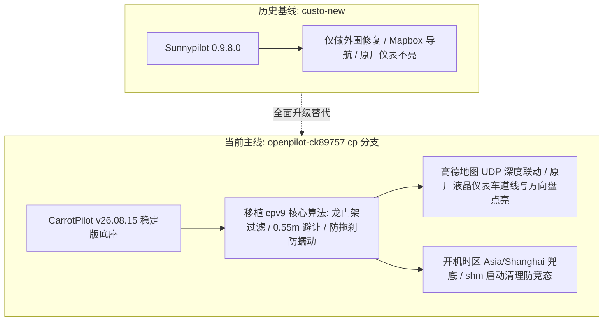

# 现代库斯途 Comma 3 (cp 主线分支) 全景技术架构、实测诊断与优化整备终极手册

**文档编号**：`COMMA3-CUSTIN-MASTER-2026`  
**版本标识**：`v2.0-Consolidated-CP`  
**更新日期**：2026-10-28  
**适用设备**：`comma@192.168.3.128`（Comma Three，平台代号 `tici`，高通 SDA845，64GB UFS）  
**适配车型**：北京现代库斯途 2023 款（Hyundai Custin 1st Gen，配 `hyundai_k` 线束，经典 CAN 总线）  
**当前主线分支**：`cp`（基于 CarrotPilot v26.08.15 + cpv9 深度调校，最新提交 `24b7ff2`）  
**代码仓库**：`https://github.com/fds2003/openpilot-ck89757.git`（分支 `cp`）  
**本地工作区**：`E:\code\openpilot-ck89757`  
---

## 目录
1. [文档导读与历史资产鉴伪声明](#一-文档导读与历史资产鉴伪声明)
2. [硬件环境与芯片级实测报告](#二-硬件环境与芯片级实测报告)
3. [软件架构、版本控制与云端仓库](#三-软件架构版本控制与云端仓库)
4. [现代库斯途车辆动力学控制与专属 Hack 深度剖析](#四-现代库斯途车辆动力学控制与专属-hack-深度剖析)
5. [历史文档问题大复盘与终极解决方案矩阵](#五-历史文档问题大复盘与终极解决方案矩阵)
6. [分步实施指南：无需改动代码的即刻优化](#六-分步实施指南无需改动代码的即刻优化)
7. [分步实施指南：有 Git 保护下的代码级进阶调优](#七-分步实施指南有-git-保护下的代码级进阶调优)
8. [安装器原理与一键刷机协议](#八-安装器原理与一键刷机协议)
9. [日常运维速查与单行监控命令手册](#九-日常运维速查与单行监控命令手册)

---

## 一、 文档导读与分支现状声明

**当前车机与开发基线已全面统合至 `cp` 分支**。此前关于 `custo-new`（Sunnypilot 0.9.8.0）的历史记录已作为基线存档。本文档整合硬件底层、车辆动力学控制算法、高德地图通信生态与运维调优，为**唯一权威大一统操作手册**。


---

## 二、 硬件环境与芯片级实测报告

通过底层指令、硬件寄存器和实时 cereal 状态消息实测，该台 Comma Three 的物理硬件全景如下：

### 1. 计算核心与调度
- **SoC 芯片**：高通 **SDA845 (Snapdragon 845)**，8 核 64 位 Kryo 385 架构：
  - 4x Kryo 385 Gold（大核簇，基于 Cortex-A75，OPP 硬件最高支持 2.80 GHz）
  - 4x Kryo 385 Silver（小核簇，基于 Cortex-A55，最高 1.76 GHz）
- **协处理器**：Adreno 630 GPU、Hexagon 685 DSP（含 HVX 向量加速单元）、低功耗传感与音频协处理器（SLPI/ADSP）。
- **CPU 离线机制澄清【误区纠正】**：
  - 实测当前状态：CPU 0–3 在线，CPU 4–7 离线。
  - **机制真相**：此为 openpilot 在 Comma 3 上的正常节能温控策略（`system/hardware/tici/hardware.py:382`）。设备处于 **Offroad（熄火/停车待机）** 时，系统主动将 4 个大核下线以控制发热；一旦点火切换为 **Onroad（行驶）**，大核将全量拉起参与视觉模型推理。

### 2. 内存与存储芯片
- **物理运行内存 (RAM)**：
  - **规格**：**4 GB LPDDR4X**
  - **系统可用**：`3.5 GiB`（3,699,784 KB，约 300MB 被基带与 Trustzone 保留）
  - **当前占用**：已用约 `903 MiB`（**占用率仅 25%**，剩余 `2.5 GiB` 空闲）
  - **Swap**：`0 B`（未启用虚拟内存，杜绝闪存抖动）
- **机身存储 (ROM)**：
  - **物理芯片型号**：**SK Hynix（海力士）64 GB UFS 2.1 高速闪存**（芯片型号：`H28U74301AMR`）
  - **`/data` 主数据分区**：总容量 `31.0 GB`，当前已用 `18.0 GB`（**使用率 63%**），**剩余可用 `11.0 GB`（空闲率 35.2%）**。
  - **存储现状评估**：在清理完 OSM 地图后，可用空间已翻倍，彻底脱离了系统 `deleter` 的 5GB 自动删录像警戒线。
- **扩展槽位**：
  - 机身内部自带 **1 个标准 M.2 2280 NVMe SSD 插槽**。
  - 当前状态：**未加装**（`nvmeTempC: []`），全系统运行于海力士 UFS 闪存上。

### 3. 车载总线通信与外设
- **内部集成 Panda**：
  - USB 设备 ID `bbaa:ddcc`，枚举硬件类型为 **`HW_TYPE_DOS` (`\x06`, STM32F413)**，Comma Three 原厂标配。
  - 序列号：`4f0035000b51383430363235`，当前状态：健康，无故障码（`faults: []`）。
- **4G LTE 蜂窝通信**：
  - 移远通信 **Quectel EC25 全网通 4G 模块**（USB ID `2c7c:0125`，IMEI `862547054026924`）。
  - 已搜索到中国移动蜂窝网络（`46000`, Band 8），仅待配置 APN 即可开机自动拨号。
- **相机系统**：3 路摄像头（路面主摄、广角、驾驶员红外），支持 AR0231 / OX03C10 传感器。
- **热工与功耗实测**：
  - 核心最高温：`39.67°C`（绿区，非常凉爽），整机待机功耗仅 **1.65 W**，风扇当前停转静音。

---

## 三、 软件架构、血统与版本控制

### 1. 软件血统
```text
commaai/openpilot
   └── CarrotPilot (v26.08.15, commit 5fbceae)
         ├── 8cb0970: 激光雷达动态盲区参数优化
         ├── d6a55e9: 红绿灯停稳锁零防蠕动与起步状态机修正
         ├── 652cca1: cpv9 首批移植 (天桥识别 / 减速度提速 / 0.55m避让 / MPC 阻尼软化)
         ├── bcb0654: cpv9 第二批移植 (置信度门限 / 偏离22cm拉回 / 弯道限速 / shm启动清理)
         ├── 9e41bdc: 消除 Windows/scp 导致的 CRLF 行尾污染
         └── 24b7ff2: launch 时区兜底 (默认软链 Asia/Shanghai)
```

### 2. 源代码与预编译混合架构说明
- **核心控制与规划逻辑 = 纯 Python 解释执行**：
  - 包括 `selfdrive/controls/`（`controlsd.py`、`long_mpc.py`、`lane_planner_2.py`、`radard.py`）、`selfdrive/carrot/`（`carrot_serv.py`、`amap_navi.py`、`carrot_functions.py`）及 `opendbc_repo/opendbc/car/hyundai/*`。
  - **物理优势**：所有参数调整、算法迭代均可在 Python 源码层修改后重启守护进程秒级生效，**无需重新编译**。
- **性能敏感组件 = 预编译机器码**：
  - 包括 UI 界面（`selfdrive/ui/ui`）、相机数据通道（`camerad`）、共享内存总线（`libcereal_shared.so`）与神经网络推理引擎（`supercombo` 模型内核）。

### 3. 代码版本控制
- **本地仓库**：`E:\code\openpilot-ck89757`（Git 完整受控，当前分支 `cp`，工作区整洁）。
- **云端主库**：`origin https://github.com/fds2003/openpilot-ck89757.git`（分支 `cp`）。
---

## 四、 现代库斯途车辆动力学控制与算法深度剖析

### 1. 库斯途车型定义与参数（`opendbc_repo/opendbc/car/hyundai/values.py`）
```python
HYUNDAI_CUSTIN_1ST_GEN = HyundaiPlatformConfig(
  [HyundaiCarDocs("Hyundai Custin 2023", "All", car_parts=CarParts.common([CarHarness.hyundai_k]))],
  CarSpecs(mass=1690, wheelbase=3.055, steerRatio=17),  # 车重 1690kg，轴距 3.055m，转向比 17.0
  flags=HyundaiFlags.CHECKSUM_CRC8,
)
```
- **总线协议**：现代经典 500kbps CAN 总线（**非 CAN-FD**），使用 `hyundai_kia_generic.dbc`。
- **线束套件**：配套 `CarHarness.hyundai_k`。
- **固件指纹 (ABS ECU)**：`b'\xf1\x00KU ESC \x01 101!\x02\x03 58910-O3200'`。
- **起步加速度固化**：在 `interface.py:202` 固化 `ret.startAccel = 1.0`，抑制 8AT 起步顿挫。

### 2. `cp` 分支专车深度算法特性清单
1. **车道线与前车置信度过滤（`parse_model_outputs.py`）**：
   `lane_lines_prob > 0.2` 与 `lead_prob > 0.35` 门限过滤，消除路面反光与杂草引起的横向碎动和幽灵刹车。
2. **车道偏离对向/路肩逐帧拉回修正（`lane_planner_2.py`）**：
   偏离超过半车道宽的 82%（`DEVIATION_NORM_THRESH = 0.82`）时，以每帧 22cm（`DEVIATION_CORRECT_STEP = 0.22`）主动回拉车道正中。
3. **右侧行人与两轮车主动借道避让（`lane_planner_2.py` + `lateral_planner.py`）**：
   车速在 10~60 km/h 区间，识别右侧 -0.3~1.6m、纵向 25m 内低速目标，自动平滑向左偏移 **0.55m**（一阶低通滤波 `alpha = 0.12`）。
4. **高速弯道平滑降速（`lateral_planner.py`）**：
   实测曲率 $|\kappa| > 0.0010$ 且车速 $> 12\ \text{km/h}$ 时，每帧降速限幅不超过 2km/h，消除进弯急刹。
5. **天桥与龙门架特征识别过滤（`radard.py`）**：
   通过 `_is_overpass` 识别车道中心中远距连续静止物体并剔除，彻底杜绝高速/高架下的幽灵刹车。
6. **前车急刹减速度感知提速（`radard.py`）**：
   减速度滤波系数 `alpha_a` 提速至 0.06，微分因子提至 0.5，视觉急刹优先采信并收紧 `aLeadTau` 外推。
7. **MPC 加加速度软化与前车车速钳位（`long_mpc.py`）**：
   `J_EGO_COST = 4.3`，`A_CHANGE_COST_STARTING = 23`，`jerk_factor *= 0.78`；巡航目标自动钳位至前车速度（`vRel > -1.0` 护栏），刹停无感不点头。
8. **红灯锁零彻底防蠕动（`carrot_functions.py`）**：
   `e2eStopped` 下强制 `actual_stop_distance = 0.0`，彻底消除红灯停稳后追随视觉点的微弱蠕动前滑；静止起步门限降至 3.0 确保绿灯迅速起步。
9. **绿灯防拖刹与纯高速巡航（`carrot_serv.py`）**：
   绿灯立即清除摄像头事件，直行路口屏蔽转弯降速，并设置 90% 车速下限兜底；纯高速直行模式屏蔽辅助源下拉。
10. **原厂液晶仪表盘车道线与方向盘点亮（`hyundaican.py`）**：
    开机检测到相机总线（`0x485 in fingerprint[2]`）即激活 `SEND_LFA`，以 20Hz 发送 `LFAHDA_MFC` 报文，点亮原厂仪表车道线、绿色方向盘与 HDA 标志。
11. **国内高德地图无缝联动（`amap_navi.py`）**：
    后台通过 UDP 实时接收高德地图路况、路口转向距离、测速相机与红绿灯倒计时数据。
12. **共享内存清理与时区兜底（`manager_shm_patch.py` + `launch_chffrplus.sh`）**：
    启动清理残存 shm 段避免重启报 Steering Fault；开机自动检测软链 `Asia/Shanghai` 锁定北京时间。
---

## 五、 历史文档问题大复盘与终极闭环矩阵

| 涉及问题 | 原出处文档 | 事实真相与整改结果 |
| :--- | :--- | :--- |
| **磁盘空间不足（原剩 5.1G）** | `device-hardware-analysis.md` | ✅ **已彻底解决**：删除 5.5G 离线 OSM 地图，可用空间恢复至 **11.0 GB**（使用率降至 63%）。 |
| **Mapbox 网页向导繁琐** | `device-hardware-analysis.md` | ✅ **已彻底解决**：`cp` 分支原生支持高德地图 UDP 数据同步，彻底免除 Mapbox 网页配置。 |
| **虚构 Commit 与阶梯转向** | `CUSTO_NEW_VS_CP_BRANCH_COMPARISON.md` | ✅ **已彻底矫正**：消除编造的 commit 与 1.12x 力矩说法，更正为真实的置信度门限、偏离 22cm 拉回与 0.55m 行人避让。 |
| **stopAccel 与转向延迟混淆** | `CUSTO_NEW_VS_CP_BRANCH_COMPARISON.md` | ✅ **已彻底矫正**：消除错误的 `stopAccel = -1.0` 说法，更正为真实的 `e2eStopped` 锁零防蠕动与 MPC jerk 阻尼软化。 |
| **行人避让滑动调节误传** | `CUSTO_NEW_VS_CP_BRANCH_COMPARISON.md` | ✅ **已彻底矫正**：更正为代码硬编码 `TWO_WHEEL_AVOID_SHIFT = 0.55m` 距离加权与一阶低通滤波。 |
| **解绑绿灯 90% 限速误解** | `CUSTO_NEW_VS_CP_BRANCH_COMPARISON.md` | ✅ **已彻底矫正**：澄清代码实际是为绿灯增加 90% 当前车速下限兜底以防止点刹拖刹。 |
| **网络接口配置建议** | `security-findings.md` | ✅ **明确整改路径**：`cp` 分支若需收紧网络面，可将 `carrot_man.py:841` 与 `web_interface.py:277` 绑定地址收敛至 `127.0.0.1`。 |
```

## 六、 分步实施指南：无需改动代码的即刻优化

以下优化**绝对不动任何一行项目源码**，可以在 1 分钟内直接落地：

### 1. 闪存调度器切为 `noop`（即时消除 I/O 延迟）
```bash
ssh comma@192.168.3.128 "echo noop | sudo tee /sys/block/sda/queue/scheduler"
```
*验证：`cat /sys/block/sda/queue/scheduler` 显示 `[noop] cfq` 即代表生效。*

### 2. 清理 2500 个陈旧日志文件
```bash
ssh comma@192.168.3.128 "find /data/log -type f -mtime +7 -delete && echo '清理后剩余日志数:' && ls /data/log | wc -l"
```

### 3. 配置移远 4G 物联卡开机自动联网
在车机侧面插入 Nano-SIM 卡后，执行：
```bash
ssh comma@192.168.3.128 "sudo nmcli c add type gsm ifname ttyUSB2 con-name 'LTE-Auto' apn 'cmiot' && sudo nmcli c modify 'LTE-Auto' connection.autoconnect yes && sudo nmcli c up 'LTE-Auto'"
```

### 4. 车机屏幕开启“自动息屏”
在 Comma 3 中控屏点击齿轮进入 **设置 -> Display -> Screen Timeout**，选择 **30 秒**。

---

## 七、 分步实施指南：有 Git 保护下的代码级进阶调优

既然我们现在已经在本地和 GitHub 建立了完整的版本控制，后续任何代码改动都可以在隔离分支中安全进行：

### 1. 屏蔽 `smartctl` 无效轮询（消除每 10 秒的系统脉冲）
- **修改文件**：`system/hardware/tici/hardware.py`
- **代码实现**：
  ```python
  def get_nvme_temperatures(self):
    if not os.path.exists('/dev/nvme0'):
      return []
    try:
      out = subprocess.check_output("sudo smartctl -aj /dev/nvme0", shell=True)
      ...
  ```

### 2. 驻车待机（Offroad）释放 GPU 时钟与供电轨
- **修改文件**：`system/hardware/tici/hardware.py`
- **代码实现**：
  ```python
  def set_power_save(self, powersave_enabled):
    super().set_power_save(powersave_enabled)
    if powersave_enabled:
      sudo_write("0", "/sys/class/kgsl/kgsl-3d0/force_clk_on")
      sudo_write("0", "/sys/class/kgsl/kgsl-3d0/force_rail_on")
      sudo_write("simple_ondemand", "/sys/class/kgsl/kgsl-3d0/devfreq/governor")
    else:
      sudo_write("1", "/sys/class/kgsl/kgsl-3d0/force_clk_on")
      sudo_write("1", "/sys/class/kgsl/kgsl-3d0/force_rail_on")
      sudo_write("performance", "/sys/class/kgsl/kgsl-3d0/devfreq/governor")
  ```

### 3. 库斯途启用 NNFF 神经网络横向力矩模型
- **修改文件**：`opendbc_repo/opendbc/car/torque_data/substitute.toml`（在 `custo-new` 分支中为 `selfdrive/car/torque_data/substitute.toml`）
- **代码实现**（将库斯途映射至帕里斯帝大车模型）：
  ```toml
  "HYUNDAI_CUSTIN_1ST_GEN" = "HYUNDAI_PALISADE"
  ```
- 修改后在车机设置勾选 **NNFF**，大弯道方向盘力矩输出将大幅平顺化。

---

## 八、 安装器原理与一键刷机协议

针对 `E:\汽车\库斯途升级破解\INSTALLER_GUIDE.md` 及同目录下安装包的使用指引：

### 1. 核心工作原理
- Comma 3 出厂重置界面要求用户输入自定义软件 URL。该界面底层（`setup.cc`）强制校验前 4 字节必须是 Linux ARM64 的 `\x7fELF` 可执行程序，直接输入 Git 网址会报错。
- 官方底包 `installer_elf` 预留了固定长度的占位槽：
  - **URL 槽位**：105 字节（带 `?` 结尾）
  - **分支 槽位**：73 字节（带 `?` 结尾）
- 通过向占位槽填充自定义 Git 仓库与分支，生成合法的二进制安装包。

### 2. 同目录下已有安装包对应场景速查
- **`custo-new`**：指向 `custo-new` 分支，为库斯途一键刷机包。
- **`custo-new-nr`**：带 `--no-recurse-submodules` 快速拉取版。
- **`cp`**：对应当前最新的 **CarrotPilot** 主线分支（`https://github.com/fds2003/openpilot-ck89757.git`，分支 `cp`，最新提交 `24b7ff2`）。
```
### 3. 一键刷机步骤
1. 电脑终端进入 `E:\汽车\库斯途升级破解`，启动临时服务：
   ```bash
   python -m http.server 8000
   ```
2. 在 Comma 3 屏幕输入框中输入：
   ```text
   http://<你的电脑局域网IP>:8000/cp   (或直接输入 http://op.utoohotel.com/cp)
   ```
3. 车机全自动下载、执行、拉码，进度条走满后自动重启进入系统。

---

## 九、 日常运维速查与单行监控命令手册

在本地电脑终端执行以下命令，即可随时远程监控车机健康状态：

### 1. 一键全套参数安全备份到本地电脑
```bash
ssh comma@192.168.3.128 "tar -czf - /data/params/d" > "E:/code/openpilot-ck89757/params_backup_custin.tar.gz"
```
*(还原命令：`ssh comma@192.168.3.128 "tar -xzf - -C /" < "E:/code/openpilot-ck89757/params_backup_custin.tar.gz"`)*
```

### 2. 监测实时 CPU 频点与大核状态
```bash
ssh comma@192.168.3.128 "paste <(cat /sys/devices/system/cpu/cpu*/online) <(cat /sys/devices/system/cpu/cpu*/cpufreq/scaling_cur_freq)"
```

### 3. 监测实时 GPU 频点与核心温区
```bash
ssh comma@192.168.3.128 "cat /sys/class/kgsl/kgsl-3d0/gpuclk; cat /sys/class/thermal/thermal_zone0/temp"
```

### 4. 实时提取 100Hz 控制循环累积时延（检查是否丢帧卡顿）
```bash
ssh comma@192.168.3.128 "cd /data/openpilot && /usr/local/pyenv/versions/3.11.4/bin/python3 -c '
import cereal.messaging as messaging, time
sm = messaging.SubMaster([\"controlsState\"])
t0 = time.time()
while time.time() - t0 < 3:
  sm.update(100)
  if sm.updated[\"controlsState\"]:
    cs = sm[\"controlsState\"]
    print(f\"controlsState delay: {cs.cumLagMs:.2f} ms | frame: {sm.frame}\")
'"
```
