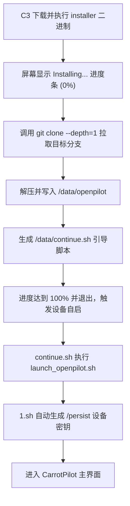

# Comma 3 (C3) 自定义安装器制作与使用指南

本文档详细记录了 Comma 3 / 3X 设备在初始化安装界面下，使用自定义 Git 仓库与分支制作并部署 **专属 ELF 安装器** 的原理、制作流程与分发方法。后续如需为新分支或新仓库制作安装器，按本文档操作即可。

---

## 一、 底层原理深度解析

### 1. 为什么不能直接在 C3 输入 Git 地址？
当 C3 处于出厂重置、未安装系统或清空后的 OOBE（初始设置向导）界面时，设备尚未安装任何业务系统，SSH 服务亦未启用。

屏幕上提示输入软件 URL（"Enter custom software URL"），很多开发者会误以为这里可以输入 `git clone` 命令或 Git 仓库地址。但查阅 C3 引导界面源码 [`selfdrive/ui/qt/setup/setup.cc`](file:///c:/Users/cheng/Desktop/cpv9-utoo/openpilot/selfdrive/ui/qt/setup/setup.cc) 可知：

```cpp
// setup.cc 核心逻辑片段
curl_easy_setopt(curl, CURLOPT_URL, url.toStdString().c_str());
...
int ret = curl_easy_perform(curl);
...
if (!is_elf(tmpfile)) {
  emit finished(url, tr("No custom software found at this URL."));
} else {
  rename(tmpfile, "/tmp/installer");
  // 引导界面退出，系统后台接着直接运行 /tmp/installer 二进制文件
}
```

- C3 会将用户输入的 URL 文件下载到 `/tmp`。
- **强制检查魔数**：读取文件前 4 字节，必须是 `\x7fELF`（Linux aarch64 可执行程序）。如果返回的是网页、Git 协议报文或 Shell 脚本，系统会立即报错：`"No custom software found at this URL."`。

---

### 2. 官方的 `username/branch` 是如何工作的？
- 当在 C3 官方输入框中输入类似 `commaai/release3` 时，C3 内部自动补全为 `https://installer.comma.ai/commaai/release3`。
- Comma 官方云端运行了一个动态生成服务：它拿到用户名和分支后，动态修改预编译安装器二进制中的硬编码字符串，然后把这个 ELF 可执行文件发送给 C3 下载。
- **限制**：官方服务仅支持 `github.com` 上的公开仓库，无法识别内网或私有域名（如 `git.utoohotel.com` 或 `192.168.x.x`）。

---

### 3. 安装器内部实现与字符串占位原理
查阅安装器源码 [`selfdrive/ui/installer/installer.cc`](file:///c:/Users/cheng/Desktop/cpv9-utoo/openpilot/selfdrive/ui/installer/installer.cc)：

```cpp
std::string get_str(std::string const s) {
  std::string::size_type pos = s.find('?');
  assert(pos != std::string::npos);
  return s.substr(0, pos);
}

// 预留足够多的空格，供二进制动态替换
const std::string GIT_URL = get_str("https://github.com/commaai/openpilot.git" "?                                                                ");
const std::string BRANCH_STR = get_str(BRANCH "?                                                                ");
```

- 编译成二进制后，程序在运行期间会截取首个 `?` 前面的内容作为实际的 Git 仓库与分支名。
- 源码中通过预留连续空格，使得编译后的 ELF 二进制具有**固定长度的字符槽位**：
  - **Git 仓库 URL 槽位**：精确预留 **105 字节**（含 `?` 和空格，以 `\x00` 结尾）。
  - **分支名称 槽位**：精确预留 **73 字节**（含 `?` 和空格，以 `\x00` 结尾）。
- 只要我们保持总字节数严格不变，用目标 URL/分支名带上 `?` 并用空格补齐剩余长度，直接写入 ELF 对应的偏移地址，就能得到结构完好、校验通过的定制安装器！

---

## 二、 自动化制作脚本 (`make_installer.py`)

根目录提供了自动化制作脚本，后续制作安装器只需要运行 Python 脚本即可。

### 脚本源码位置
[`scripts/make_installer.py`](file:///c:/Users/cheng/Desktop/cpv9-utoo/openpilot/scripts/make_installer.py)

```python
#!/usr/bin/env python3
"""
Comma 3 (C3) 专属 ELF 安装器制作工具
用于将官方 installer_elf 中的 Git 仓库地址和分支名替换为自定义地址。
"""

import sys
import os
import argparse

# 槽位定义（基于官方 0.9.7 installer_elf 二进制特征）
URL_MARKER = b"https://github.com/commaai/openpilot.git?"
URL_CHUNK_LEN = 105

BRANCH_MARKER = b"release3?"
BRANCH_CHUNK_LEN = 73

def make_installer(base_elf_path, git_url, branch, output_path):
    if not os.path.exists(base_elf_path):
        print(f"[错误] 基础 ELF 文件不存在: {base_elf_path}")
        print("请确保同目录下存在官方基线包 installer_elf")
        sys.exit(1)

    with open(base_elf_path, "rb") as f:
        data = bytearray(f.read())

    # 1. 验证 ELF 头
    if data[:4] != b"\x7fELF":
        print("[错误] 基础文件不是合法的 ELF 二进制文件！")
        sys.exit(1)

    # 2. 定位 URL
    idx_url = data.find(URL_MARKER)
    if idx_url == -1:
        # 如果不是原版，尝试通用匹配特征
        pos = data.find(b".git? ")
        if pos != -1:
            idx_url = data.rfind(b"http", 0, pos)
        if idx_url == -1:
            print("[错误] 未能在 ELF 中定位到 Git URL 槽位！")
            sys.exit(1)

    # 3. 定位 Branch
    idx_branch = data.find(BRANCH_MARKER, idx_url)
    if idx_branch == -1:
        idx_branch = data.find(b"\x00", idx_url + URL_CHUNK_LEN) + 1

    print(f"[*] 找到 URL 偏移: {idx_url} (槽位长度: {URL_CHUNK_LEN})")
    print(f"[*] 找到 Branch 偏移: {idx_branch} (槽位长度: {BRANCH_CHUNK_LEN})")

    # 4. 构造新数据块
    url_target = (git_url.strip() + "?").encode("utf-8")
    branch_target = (branch.strip() + "?").encode("utf-8")

    if len(url_target) > URL_CHUNK_LEN:
        print(f"[错误] Git URL 过长: {len(url_target)} 字节 (最大允许 {URL_CHUNK_LEN - 1} 字符)")
        sys.exit(1)

    if len(branch_target) > BRANCH_CHUNK_LEN:
        print(f"[错误] 分支名称过长: {len(branch_target)} 字节 (最大允许 {BRANCH_CHUNK_LEN - 1} 字符)")
        sys.exit(1)

    url_chunk = url_target + b" " * (URL_CHUNK_LEN - len(url_target))
    branch_chunk = branch_target + b" " * (BRANCH_CHUNK_LEN - len(branch_target))

    # 5. 替换并校验
    data[idx_url:idx_url + URL_CHUNK_LEN] = url_chunk
    data[idx_branch:idx_branch + BRANCH_CHUNK_LEN] = branch_chunk

    with open(output_path, "wb") as f:
        f.write(data)

    print(f"[√] 成功生成新安装器: {output_path}")
    print(f"    - 目标 URL : {git_url}")
    print(f"    - 目标分支 : {branch}")
    print(f"    - 文件大小 : {len(data)} 字节")

if __name__ == "__main__":
    parser = argparse.ArgumentParser(description="制作 Comma 3 自定义安装器 ELF 文件")
    parser.add_argument("--base", default="installer_elf", help="底包 ELF 文件路径 (默认: installer_elf)")
    parser.add_argument("--url", required=True, help="自定义 Git 仓库完整地址 (如 http://git.utoohotel.com/ck89757/openpilot.git)")
    parser.add_argument("--branch", required=True, help="目标分支名 (如 cpv9-dev)")
    parser.add_argument("--output", "-o", default="installer", help="输出文件名 (默认: installer)")

    args = parser.parse_args()
    make_installer(args.base, args.url, args.branch, args.output)
```

---

## 三、 使用制作脚本的常见场景

在项目根目录下打开终端即可执行：

### 场景 1：制作公网 Git 仓库安装器
```bash
python scripts/make_installer.py --url http://git.utoohotel.com/ck89757/openpilot.git --branch cpv9-dev -o installer
```

### 场景 2：制作局域网加速版安装器（在同一路由器 Wi-Fi 下最快）
```bash
python scripts/make_installer.py --url http://192.168.31.200:3000/ck89757/openpilot.git --branch cpv9-dev -o installer_lan
```

---

## 四、 如何在 C3 上安装使用

当生成好 `installer` 之后，可以通过以下两种方式分发给 C3：

### 方式 A：本机局域网临时 HTTP 服务（即开即装，最推荐）
如果您的电脑与 C3 在同一个 Wi-Fi 网络下（假设电脑 IP 为 `192.168.31.90`）：

1. 在电脑端工程根目录下运行：
   ```bash
   python -m http.server 8000
   ```
2. 在 C3 屏幕的自定义 URL 输入框中输入：
   - 局域网克隆版：`http://192.168.31.90:8000/installer_lan`
   - 或公网克隆版：`http://192.168.31.90:8000/installer`
3. C3 会下载此文件并自动进入全屏安装进度条（0% -> 100%）。

---

### 方式 B：部署到公网服务器（永久专属一键安装链接）
将生成的 `installer` 文件上传至您的 Web 服务器（如 Nginx 或 CDN）：

1. 上传至 Web 根目录，例如配置在 Nginx：
   ```nginx
   location /installer {
       root /var/www/html;
       # 确保以二进制流形式下载
       default_type application/octet-stream;
   }
   ```
2. 此时，任何接入互联网的 C3 设备，只需在屏幕上输入：
   ```text
   http://git.utoohotel.com/installer
   ```
   即可全自动完成最新系统的安装！

---

## 五、 安装器执行流程与后续自启动

当 C3 执行该安装器时，安装器的内部生命周期如下：



---

## 六、 常见注意事项

1. **长度限制**：
   - Git 仓库 URL（含 `?`）最大不能超过 105 字节（约 104 字符）。
   - 分支名称（含 `?`）最大不能超过 73 字节（约 72 字符）。
2. **仓库权限**：
   - 目标 Git 仓库必须支持**匿名/公开克隆**（即无需输入用户名和密码），否则 `git clone` 会在后台静默卡死或失败。
3. **保留底包**：
   - 根目录下的 `installer_elf` 为官方原始纯净基准 ELF 文件，请勿删除，以便将来随时派生出新的安装包。
