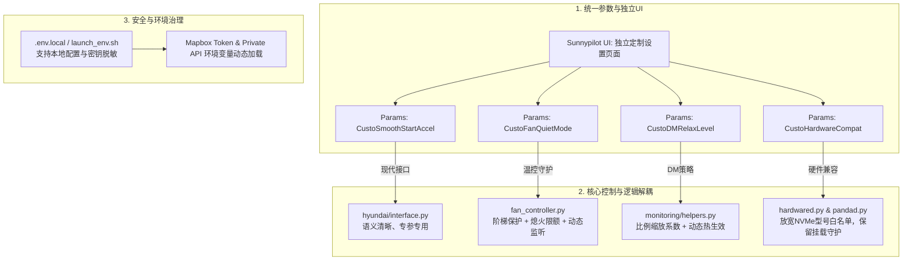

# openpilot custo-new 分支深入代码分析与优化方案

## 一、 项目定位与架构全景

### 1.1 基础架构与分支基线
- **上游基线**：本项目派生自 `sunnypilot v0.9.8.0 release`（commit `167ef31`，基于 `commaai/openpilot 0.9.8`）。
- **当前分支**：`custo-new`（远端仓库：`https://github.com/fds2003/openpilot-ck89757.git`）。
- **核心定位**：针对国内硬件运行环境（comma 3/3X 及改装硬件平台）、自建后端云服务以及现代（Hyundai/Kia/Genesis）等车型的个性化深度定制发行版本。

### 1.2 现有变更文件与改动统计
自基线 `167ef31` 以来，共有 7 个核心文件涉及改动，总计代码变更 `+150 / -9` 行：

| 涉及文件 | 提交描述 / 业务动机 | 当前修改方式 |
| :--- | :--- | :--- |
| `launch_env.sh` | 接入国内自建后端与配置地图 Token | 硬编码服务器域名与 Mapbox Secret Token |
| `selfdrive/car/hyundai/interface.py` | 现代车型起步加速度优化（缓解顿挫） | 借用 `LkasToggle` 开关选择起步加速度 1.0 或 1.6 |
| `selfdrive/monitoring/helpers.py` | 降低驾驶员监控（DM）警报灵敏度 | 借用 `SubaruManualParkingBrakeSng` 放大超时与阈值 |
| `system/hardware/fan_controller.py` | 降低 comma 散热风扇噪音 | 借用 `StockLongToyota` 改为线性插值并限幅 80% |
| `system/hardware/hardwared.py` | 抑制改装设备 NVMe 不兼容警报 | 直接将检查分支修改为 `if False:` 彻底屏蔽 |
| `selfdrive/controls/controlsd.py` | 抑制地下车库/隧道弱 GPS 警报 | 直接注释掉 `self.events.add(EventName.noGps)` |
| `selfdrive/pandad/pandad.py` | 解决部分 Panda 硬件唤醒慢问题 | 将启动免检超时从 25s 延长至 35s |

---

## 二、 现状问题深入分析（第一性原理与根因剖析）

通过对上述 7 个改动进行第一性原理剖析，虽然改动精确击中了“风扇吵、起步冲、DM烦、报错多、需要国内云”等真实痛点，但当前实现方式属于典型的**“打补丁与借壳借用（Hack）”**，存在较多隐患：

### 2.1 语义混淆与参数借用风险（严重）
- **现象**：
  - 现代车起步加速度借用了 `LkasToggle`（原本为丰田等车型车道保持按键保持开关）；
  - 风扇降噪借用了 `StockLongToyota`（丰田原车纵向控制开关）；
  - 降低 DM 灵敏度借用了 `SubaruManualParkingBrakeSng`（斯巴鲁手动电子手刹起步开关）。
- **根因与弊端**：
  - **跨车型逻辑冲突**：若在丰田或斯巴鲁车型上运行该分支，或者切换不同车辆时，开启某一功能会导致完全风马牛不相及的功能同时被强行触发。
  - **UI 与功能认知分裂**：车主在车载 UI 上看到的选项名称与实际控制完全脱节，造成使用困惑和维护混乱。
  - **上游代码合并冲突**：一旦上游对这些原有参数进行重构、废弃或类型调整，本定制分支将直接出现逻辑异常。

### 2.2 散热与硬件安全失控隐患（高危）
- **现象**：在 `system/hardware/fan_controller.py` 中，当启用静音模式时，将原本基于温度目标的闭环 PID 控制替换为 `fan_pwr_out = max(0, min(80, int(interp(cur_temp, [60.0, 80.0], [0, 80]))))`。
- **根因与弊端**：
  - **极端高温失控**：comma 3/3X 贴在前挡风玻璃上，夏季高温暴晒时内部温度极易超过 80℃-85℃。原版在高温下会全力拉满 100% 强力压温；当前实现强行限制在 80%，极易导致设备因过热触发 Thermal Shutdown（直接黑屏停机，导致辅助驾驶突然脱退），甚至造成硬件芯片热损伤。
  - **熄火状态未做功耗保护**：原版在 `ignition == False`（熄火）时严格限制风扇最大功率 ≤ 30%；当前分支未对熄火状态做约束，可能在车主熄火离开后风扇仍以 80% 高速运转，消耗汽车小电瓶电量导致亏电。

### 2.3 粗暴屏蔽安全与状态监控（高危）
- **现象**：
  - `hardwared.py` 中直接 `if False: #TICI` 屏蔽存储检测。
  - `controlsd.py` 中直接将 `EventName.noGps` 注释。
- **根因与弊端**：
  - 屏蔽存储不仅消除了 `Offroad_BadNvme` 提示，连正常的 `/data/media` 挂载失效（`Offroad_StorageMissing`）也一并静默。若磁盘真正脱落或只读，系统无法向用户发出任何警示，导致行车日志与模型文件写入异常崩溃。
  - 屏蔽 `noGps` 导致在地下车库、隧道等长时间无卫星信号时，如果 Kalman 惯导滤波器出现严重发散，系统无法及时提醒驾驶员接管，存在潜在失控风险。

### 2.4 DM（防分心策略）实现质量与动态性缺失
- **现象**：在 `monitoring/helpers.py` 中增加 `dm_open` 和 `dm_close`，全量复制粘贴了近 60 行初始化代码，仅放大了超时时间（10倍）；且仅在 `DriverMonitoring.__init__` 时读取一次参数。
- **根因与弊端**：
  - **动态切换无效**：由于只在初始化读取一次，用户在车机 UI 上动态打开/关闭该选项时，`dmonitoringd` 守护进程不会动态生效，必须重启整机或重启守护进程。
  - **代码重复度极高**：近百行重复赋值，违反 DRY（Don't Repeat Yourself）原则。
  - **安全防线彻底击穿**：注意力转移容忍时间放大到 110 秒至 300 秒，基本等同于完全废弃驾驶员注意力监控，存在严重的法律与行车安全风险。

### 2.5 敏感信息与配置硬编码泄露
- **现象**：在 `launch_env.sh` 中明文提交了私有服务器地址以及 Mapbox Secret Token（`sk.eyJ1I...`）。
- **根因与弊端**：
  - Secret 级别 Token 直接进入 Git 版本控制，仓库推送至 GitHub/Gitee 后可能面临 Token 被盗用、滥用、限流或账户被封禁。
  - 环境配置与代码耦合，不便于不同设备配置不同的专属参数或本地测试。

---

## 三、 第一性原理推导与系统重构方案

遵循**“动机优先、最短路径、根因优先”**的原则，我们对以上核心诉求提出正规化、低耦合、高可靠的演进方案：

---

## 四、 具体优化措施与落地规划

### 4.1 参数体系规范化（彻底解耦借壳参数）
1. 在系统参数定义中正式登记专用参数，替代现存借用参数：
   - `CustoSmoothStartAccel`（取代 `LkasToggle`）
   - `CustoFanQuietMode`（取代 `StockLongToyota`）
   - `CustoDMRelaxLevel`（取代 `SubaruManualParkingBrakeSng`，支持多档位调节）
   - `CustoBypassBadNvmeAlert`（取代 `if False:` 暴力绕过）
2. 在 sunnypilot 界面中增加直观易懂的设置卡片，使车主可以清晰开关对应功能。

### 4.2 风扇温控算法安全重构（兼顾静音与热保护）
重构 `TiciFanController`：
1. **静音舒适区（< 75℃）**：采用平滑曲线降低低转速区噪音；
2. **安全防线区（75℃ ~ 85℃）**：快速线性提升风扇功率；
3. **极温救险区（> 85℃）**：强制拉满 100% 极限散热，严禁限制在 80%，守住不关机、不降频的硬件底线；
4. **熄火保护（`ignition == False`）**：无论何种模式，统一限幅在 30% 以下，杜绝消耗小电瓶。

### 4.3 驾驶员监控（DM）优雅缩放与热生效
1. 废除整段重复代码，改为基于**灵敏度比例系数（Scale Multiplier）**的轻量化调节函数；
2. 引入 `ParamWatcher` 机制，当车主在车机界面切换 DM 偏好时，无需重启系统即可即时生效；
3. 设定科学合理的宽松界限（例如前置预警从 6s 延至 12s，分心超时从 11s 延至 25s），既消除不合理的神经质误报，又保留关键时刻的安全兜底。

### 4.4 硬件兼容层（Hardware Abstraction）优雅实现
1. **针对非三星 NVMe / 改装硬件**：
   - 不再将检测代码粗暴置为 `if False`；
   - 保持 `/data/media` 挂载健康检查；
   - 仅当读取到的 NVMe 型号非白名单时，检查是否开启了 `CustoBypassBadNvmeAlert`，若开启则打一条 info log 并忽略弹窗提示。
2. **针对弱 GPS 告警**：
   - 不直接注释 `noGps` 事件，改为配置项控制；
   - 在进入隧道或无信号达到设定时限时提供更柔和的通知，而非直接取消整个报警。
3. **针对 Panda 启动时序**：
   - 采用自适应握手重试策略替代单纯将延时从 25s 硬编码到 35s。

### 4.5 配置与密钥安全隔离
1. 将 `launch_env.sh` 中的敏感 Token 和自建域名抽象为可重载环境变量；
2. 提供 `launch_env.local.template` 文件，私有 Token 存入 `.gitignore` 包含的本地配置文件或设备端 `/data/params/` 中。

---

## 五、 后续行动步骤建议

按照开发协作规则（**动机优先：先方案后代码，每步停下来等指令**），建议分步推进：

1. **第一步（高危修复与代码治理）**：
   - 重构 `system/hardware/fan_controller.py`，修补极端高温与熄火散热的安全漏洞；
   - 重构 `system/hardware/hardwared.py`，将 `if False` 替换为优雅的非标存储兼容逻辑。
2. **第二步（参数解耦与控制逻辑规范）**：
   - 在现代车接口与 DM 监控中消除借用的 `LkasToggle` 和 `SubaruManualParkingBrakeSng`，替换为自研专属参数；
   - 重构 `monitoring/helpers.py`，消除冗余代码并实现动态热生效。
3. **第三步（配置脱敏与 UI 集成）**：
   - 规范 `launch_env.sh` 的环境变量加载与安全隔离；
   - 在前端界面接入对应的开关选项。
