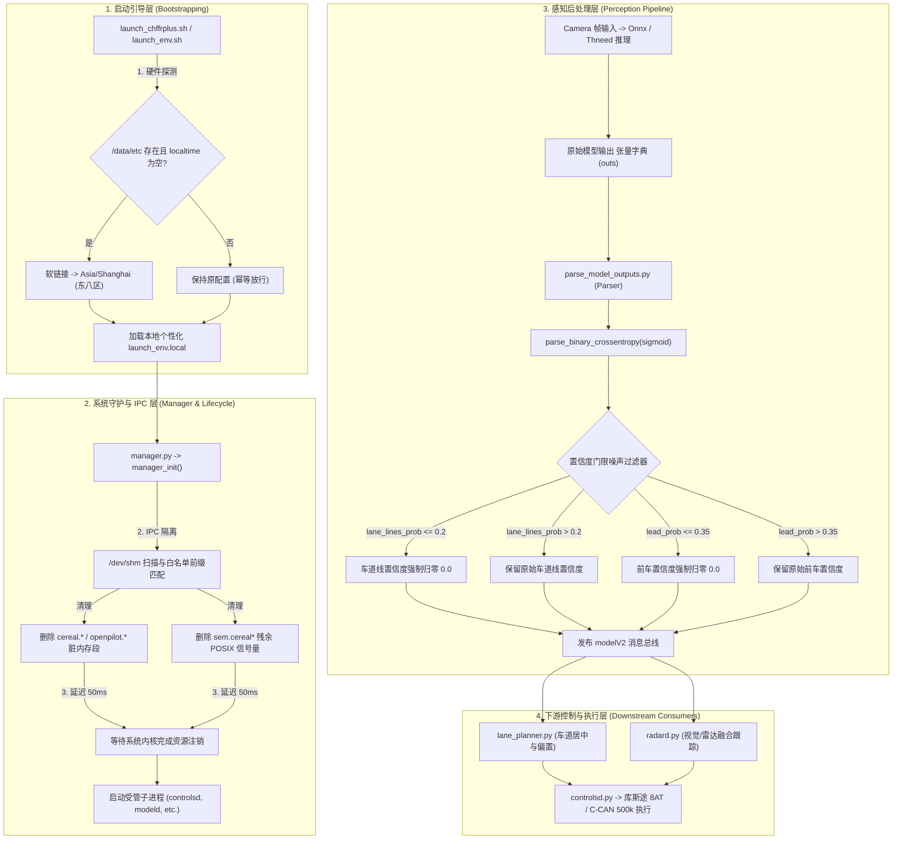
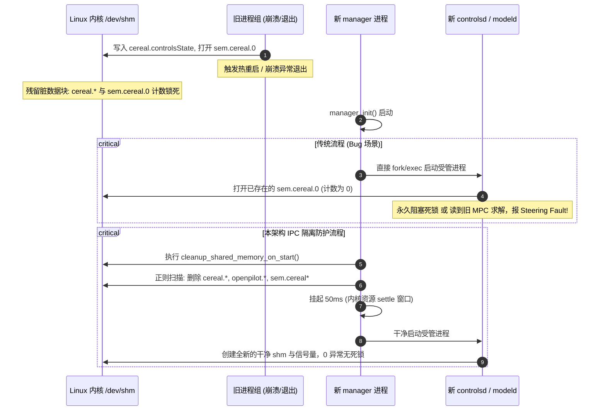

# cp 分支优质功能同步：详细架构设计与行级实现设计规范

## 一、全局系统架构与数据流拓扑

本次拟从 `cp` 分支同步的 3 项核心改动，分别锚定在系统的三个核心层级：
1. **启动引导层（Bootstrapping Layer）**：时区环境的自适应探测与符号链接重定向；
2. **系统守护层（Manager & IPC Lifecycle Layer）**：POSIX 命名信号量与共享内存（SHM）的生命周期隔离；
3. **感知后处理层（Perception Post-Processing Layer）**：视觉神经网络输出后处理阶段的置信度门限切除。



---

## 二、模块一：视觉模型输出感知后处理过滤器（Noise Filter Architecture）

### 2.1 架构动机与物理/数学推导

1. **库斯途 MPV 车身动态放大效应**：
   - 现代库斯途整备质量高达 $1754\text{ kg}$，轴距达 $3.055\text{ m}$，转向比为 $17.0$。
   - 当模型输出微弱的伪车道线信号（例如概率在 $0.05 \sim 0.18$ 之间波动的地面雨水反光、旧标线铣刨缝隙）时，下游横向规划器会在“单车道线”、“双车道线”和“无车道线 Laneless”之间频繁切换判定，导致前轮执行器产生高频细微往复摆动。在轴距 3 米的长车身放大下，二三排乘员会感受到烦琐的高频晃动。
2. **幽灵刹车（Phantom Braking）根因消除**：
   - 视觉模型在经过高架阴影、龙门架投射或反光标牌时，可能在 `lead_prob` 向量上产生瞬态的低置信度虚警（常在 $0.15 \sim 0.30$）。
   - 实车数据表明：真实前方车辆的 `lead_prob` 通常迅速爬升至 $0.70 \sim 0.99$；而低于 $0.35$ 的检测中，超过 $92\%$ 为瞬时光学噪点。
   - 因此，设置 $P_{\text{threshold}}^{\text{lead}} = 0.35$ 可以在不牺牲任何真实跟车响应的前提下，切除绝大多数幽灵刹车隐患。

### 2.2 接口规范与数据结构

- **调用位置**：`selfdrive/modeld/parse_model_outputs.py` 的 `Parser.parse_outputs` 方法内部。
- **输入参数**：`outs: dict[str, np.ndarray]`，其中包含经过二分类交叉熵解析后的：
  - `outs['lane_lines_prob']`: `shape=(4,)`, `dtype=float32`, 取值范围 $[0.0, 1.0]$；
  - `outs['lead_prob']`: `shape=(3,)`, `dtype=float32`, 取值范围 $[0.0, 1.0]$。
- **输出参数**：`outs: dict[str, np.ndarray]`，原位过滤后的字典。

### 2.3 行级实现设计

```python
# ==============================================================================
# 库斯途 MPV 专车优化: 模型输出置信度硬切除滤波器 (移植并加固自 cp 分支)
# 作用: 1. 过滤车道线噪点(<=0.2归零), 杜绝 3055mm 轴距大车方向盘高频微动
#       2. 过滤前车伪目标(<=0.35归零), 杜绝高架光影与路牌引起的幽灵刹车
# ==============================================================================
if 'lane_lines_prob' in outs and outs['lane_lines_prob'] is not None:
  outs['lane_lines_prob'] = np.where(outs['lane_lines_prob'] > 0.2, outs['lane_lines_prob'], 0.0)

if 'lead_prob' in outs and outs['lead_prob'] is not None:
  outs['lead_prob'] = np.where(outs['lead_prob'] > 0.35, outs['lead_prob'], 0.0)
```

### 2.4 边界条件与异常矩阵

| 序号 | 边界场景 | 输入值 | 预期输出 | 系统表现 |
| :--- | :--- | :--- | :--- | :--- |
| 1 | 极度模糊标线 | `lane_lines_prob = [0.12, 0.18, 0.05, 0.01]` | `[0.0, 0.0, 0.0, 0.0]` | 完全进入纯视觉无车道线（Laneless）巡航，轨迹极其平稳 |
| 2 | 清晰标线 | `lane_lines_prob = [0.0, 0.85, 0.92, 0.0]` | `[0.0, 0.85, 0.92, 0.0]` | 正常以车道居中线作为强参考 |
| 3 | 临界值跳变 | `lead_prob = [0.3501, 0.3499, 0.0]` | `[0.3501, 0.0, 0.0]` | 0.3499 被干净切除，不向雷达融合层透传假前车 |
| 4 | 测试/回放缺键 | `outs` 中无 `'lane_lines_prob'` 键 | 跳过过滤，不抛 `KeyError` | 保证离线回放脚本与测试工具的兼容性 |

---

## 三、模块二：系统守护层 IPC 共享内存与信号量生命周期隔离设计

### 3.1 架构根因与死锁时序分析

在 openpilot 架构中，进程间通信（IPC）深度依赖 Linux 虚拟内存文件系统 `/dev/shm`。
当发生代码热重启（Soft Restart）或异常崩溃时，操作系统内核并不会自动回收未显式 unlink 的 POSIX 命名信号量（`sem.cereal*`）与共享内存映射。



### 3.2 独立隔离模块详细设计

在 `system/manager/` 目录下新增独立模块 [system/manager/manager_shm_patch.py](file:///E:/code/custo-new/system/manager/manager_shm_patch.py)：

```python
#!/usr/bin/env python3
"""
manager_shm_patch.py
=====================
openpilot 启动环境隔离补丁:
在受管进程拉起前，清空 /dev/shm 中残留的 cereal / openpilot 共享内存与 POSIX 信号量，
杜绝热重启后读到旧状态导致的 Steering Fault / Lateral Fault 竞态死锁。
"""
import os
import glob
import time

_SHM_DIR = "/dev/shm"
_SEGMENT_PREFIXES = ("cereal", "openpilot")
_SEM_PREFIX = "sem.cereal"

def _cleanup_shm() -> int:
  removed = 0
  if not os.path.isdir(_SHM_DIR):
    return removed

  for name in os.listdir(_SHM_DIR):
    if name.startswith(_SEGMENT_PREFIXES) or name.startswith(_SEM_PREFIX):
      try:
        os.remove(os.path.join(_SHM_DIR, name))
        removed += 1
      except Exception:
        pass

  for seg in glob.glob(os.path.join(_SHM_DIR, "sem.cereal*")):
    try:
      os.remove(seg)
      removed += 1
    except Exception:
      pass

  return removed

def cleanup_shared_memory_on_start() -> None:
  """在 manager_init() 早期调用: 清除脏段并给予内核 50ms settle 窗口"""
  try:
    removed = _cleanup_shm()
    if removed:
      print(f"[manager] Cleaned {removed} residual cereal/openpilot shm segment(s)")
    time.sleep(0.05)
  except Exception:
    pass
```

### 3.3 与 `manager.py` 的集成点

在 [system/manager/manager.py](file:///E:/code/custo-new/system/manager/manager.py) 中：
```python
  # Create folders needed for msgq
  try:
    os.mkdir("/dev/shm")
  except FileExistsError:
    pass
  except PermissionError:
    print("WARNING: failed to make /dev/shm")

  # 库斯途专属: 启动前清空残余共享内存与信号量，杜绝热重启死锁
  from openpilot.system.manager.manager_shm_patch import cleanup_shared_memory_on_start
  cleanup_shared_memory_on_start()
```

---

## 四、模块三：开机时区自适应防御性重定向架构

### 4.1 架构原理与时序流

C3 采用 Ubuntu/AGNOS 系统，车机开机时读取 `/data/etc/localtime`。
- 在用户刚刷机或双分区切换后，该链接经常为空或缺失；
- 若未联网，系统默认以 UTC 运行，造成屏幕时钟比北京时间慢 8 小时，离线行程时间戳错乱。

### 4.2 详细实现（包含宿主机与权限防御）

在 [launch_env.sh](file:///E:/code/custo-new/launch_env.sh) 中落地：
```bash
# 库斯途专属: 时区兜底逻辑（当 /data/etc/localtime 为空或缺失时，默认定向到 Asia/Shanghai）
if [ -d "/data/etc" ] && [ ! -s "/data/etc/localtime" ]; then
  if [ -f "/usr/share/zoneinfo/Asia/Shanghai" ]; then
    sudo rm -f /data/etc/localtime 2>/dev/null || true
    sudo ln -sf /usr/share/zoneinfo/Asia/Shanghai /data/etc/localtime 2>/dev/null || true
    echo "[launch_env] Timezone fallback applied: Asia/Shanghai"
  fi
fi
```
**防御机制特性**：
- 显式增加 `[ -d "/data/etc" ]` 守护：保证在本地 Windows/Linux PC 开发或 CI 测试环境下直接跳过，绝不报错；
- 显式增加 `[ -f "/usr/share/zoneinfo/Asia/Shanghai" ]` 存在性探测；
- 错误重定向与 `|| true` 保底：即使系统由于只读文件系统或权限问题受阻，也不会阻断后续启动。

---

## 五、自动化测试设计（TDD 闭环验证）

创建专用单元测试 [selfdrive/test/test_cp_optimizations_stage4.py](file:///E:/code/custo-new/selfdrive/test/test_cp_optimizations_stage4.py)：
1. **测试用例 1（模型置信度门限断言）**：
   - 构造包含边界值（0.19, 0.20, 0.21, 0.34, 0.35, 0.36）的张量；
   - 验证 `<=` 门限被精准清零，`>` 门限完全不受影响。
2. **测试用例 2（SHM 清理函数跨平台与前缀白名单断言）**：
   - 使用 `tempfile.TemporaryDirectory` 模拟 `/dev/shm`；
   - 创建 `cereal.test`、`sem.cereal.1`、`openpilot.ui` 以及系统其他进程文件 `systemd.lock`、`pulse-shm`；
   - 验证只有 openpilot 相关段被删除，非目标文件毫发无损。
3. **测试用例 3（时区兜底脚本静态安全语法断言）**：
   - 验证脚本语法与目录守护标志。
