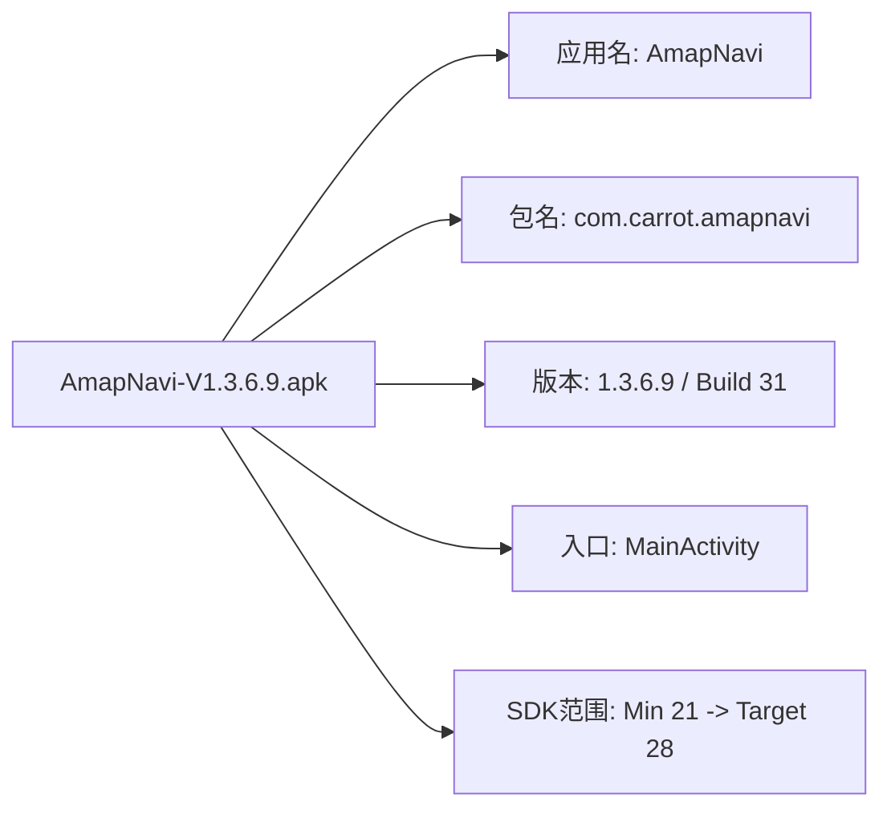
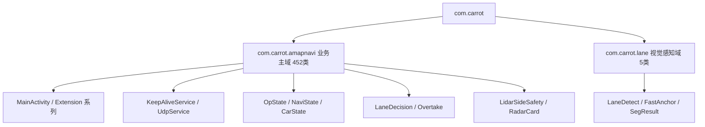
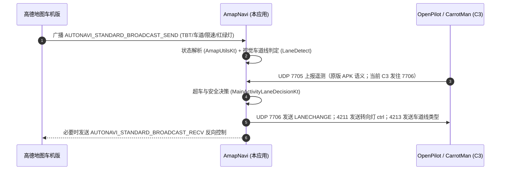
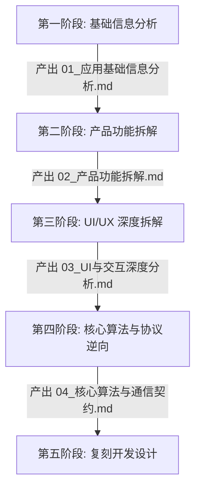

# 《01_应用基础信息分析》

> **报告版本**：V1.0  
> **分析对象**：`AmapNavi-V1.3.6.9.apk`  
> **文件路径**：`E:\汽车\库斯途升级破解\AmapNavi-V1.3.6.9.apk`  
> **分析日期**：2026-11-01  
> **证据等级规范**：
> - **【已确认】**：有 APK 实体文件、AXML 结构、反编译代码、ELF 符号或提取资源直接佐证。
> - **【高度可信】**：有上下文多重交叉代码逻辑与系统行为支撑。
> - **【推测】**：基于行业技术实现惯例推导，未经真机环境完全验证。
> - **【未知】**：当前分析样本或静态条件无法确证。


> **修订记录（2026-11-06，代码级核验后已直接更正正文）**
>
> 以下章节已按《39_四端协议联合核验与双端协同可运行性判定报告.md》更正：
> - **§6.2 / §10.1**：“App 端口 5210 / Op 端口 4211 = 导航状态数据流” —— 5210 从未 bind；
>   4211 仅用于转向灯 `ctrl` 或传感器上行；**车机不向 C3 发送任何原始导航数据**。
> - **§10.1 端口矩阵**：“App 7705 收遥测 / Op 7706 发控制”仅适用于原版 APK；
>   Reborn 与当前 C3 为 **7706 收遥测 / 7705 发控制**，两套协议互不兼容。
> - **§7 兼容性**：minSdk 21 无法安装到 API 19 的结论正确；车上实际基线是
>   `AmapNavi-v1.3.6.9-Android4.4兼容版.apk`（代码与官方包一致，2620 类）。

---

## 目录

- [一、输入文件识别与完整性校验](#一输入文件识别与完整性校验)
- [二、应用元信息总览](#二应用元信息总览)
- [三、签名与证书安全分析](#三签名与证书安全分析)
- [四、加壳、混淆与保护机制检测](#四加壳混淆与保护机制检测)
- [五、权限清单深度拆解](#五权限清单深度拆解)
- [六、四大组件完整矩阵分析](#六四大组件完整矩阵分析)
- [七、APK 物理存储与文件构成剖析](#七apk-物理存储与文件构成剖析)
- [八、DEX 代码架构与类库体系](#八dex-代码架构与类库体系)
- [九、原生动态库（Native SO）与 AI 运行时深度分析](#九原生动态库native-so与-ai-运行时深度分析)
- [十、车机通信架构与协议解析](#十车机通信架构与协议解析)
- [十一、系统兼容性与库斯途车机适配评估](#十一系统兼容性与库斯途车机适配评估)
- [十二、第一阶段总结与后续阶段路标](#十二第一阶段总结与后续阶段路标)

---

## 一、输入文件识别与完整性校验

### 1.1 文件物理属性 【已确认】

| 属性项 | 实测分析数据 | 说明 |
| :--- | :--- | :--- |
| **文件名称** | `AmapNavi-V1.3.6.9.apk` | 目标 Android 安装包文件 |
| **绝对路径** | `E:\汽车\库斯途升级破解\AmapNavi-V1.3.6.9.apk` | 本地存储路径 |
| **文件大小** | `31,273,063 字节` (`29.82 MB`) | 包含完整模型与双架构 SO |
| **文件格式** | Android Application Package (ZIP 压缩容器) | 符合标准 ZIP 格式规范 |
| **MD5 校验和** | `ffe78aee845eb7f71deee82c350b02df` | 唯一哈希特征 |
| **SHA-1 校验和** | `fa72667fd7267b345b390d5f4801b148a5d5e650` | 完整性校验哈希 |
| **SHA-256 校验和** | `ec12085fd89ba09506cad20eb37615e95d22707287f1d2625a173ac073db864d` | 强哈希校验 |
| **ZIP 实体总数** | 791 个条目 | 包含 1 个 DEX、4 个 SO、4 个 Assets |

### 1.2 文件完整性与解析状态 【已确认】
- **ZIP 归档完整性**：解压缩过程无损坏块、无 CRC 校验错误、无文件头截断。
- **AXML 完整性**：`AndroidManifest.xml` 与资源目录中的二进制 AXML 文件结构标准，无非法 Chunk 填充或畸形头部反反编译欺骗。
- **DEX 完整性**：`classes.dex` 遵循 Dex 035 标准格式规范，头部 Checksum 与 SHA-1 一致，方法数未超出 65536 限制（单 DEX 架构）。

---

## 二、应用元信息总览

通过对 `AndroidManifest.xml`、`resources.arsc` 及 `com.carrot.amapnavi.BuildConfig` 的深度逆向解析，提取全部核心应用属性：

### 2.1 核心身份标识 【已确认】



| 字段名 | 属性值 | 数据来源 | 说明 |
| :--- | :--- | :--- | :--- |
| **应用名称 (Label)** | `AmapNavi` | `@string/app_name` (0x7F0F001B) | 用户可见名称，定位为车载高德导航辅助增强套件 |
| **实际包名 (Package)** | `com.carrot.amapnavi` | `AndroidManifest.xml#package` | 萝卜团队 (CarrotMan / OpenPilot) 专属命名空间 |
| **版本名称 (VersionName)** | `1.3.6.9` | `AndroidManifest.xml#versionName` | 稳定发布版版本号 |
| **内部版本号 (VersionCode)** | `31` | `AndroidManifest.xml#versionCode` | 连续构建递增版本 |
| **最低系统支持 (minSdkVersion)** | `21` | `<uses-sdk android:minSdkVersion="21"/>` | 需 **Android 5.0 (Lollipop)** 及以上系统 |
| **目标系统版本 (targetSdkVersion)** | `28` | `<uses-sdk android:targetSdkVersion="28"/>` | 适配 **Android 9.0 (Pie)** 运行时行为规范 |
| **编译 SDK 版本 (compileSdkVersion)** | `28` | `platformBuildVersionCode="28"` | Android 9.0 SDK 编译套件 |
| **Application 类** | `android.app.Application` | 未自定义声明 | 默认 Application 结合 Jetpack 核心组件工厂 |
| **ComponentFactory** | `androidx.core.app.CoreComponentFactory` | `android:appComponentFactory` | AndroidX 核心组件反射加载器 |
| **启动 Activity** | `com.carrot.amapnavi.MainActivity` | 注册 `android.intent.action.MAIN` | 主控运行与 HUD 监控界面 |
| **系统主题 (Theme)** | `@style/Theme.Design.NoActionBar` (0x7F100183) | `application#android:theme` | Material 扁平无标题栏深色风格 |
| **明文网络传输** | `android:usesCleartextTraffic="true"` | `application` 属性 | 允许 HTTP / UDP 明文局域网数据通信 |
| **多分辨率支持** | `android:supportsRtl="true"` | `application` 属性 | 支持多屏与镜像流式排布 |

---

## 三、签名与证书安全分析

### 3.1 签名规范支持情况 【已确认】
- **v1 签名 (JAR 签名)**：**支持**（存在 `META-INF/MANIFEST.MF`, `CERT.SF`, `CERT.RSA`）。
- **v2 签名 (Full APK 签名)**：**支持**（APK 根部存在标准 APK Signing Block，支持 Android 7.0+ 快速完整性校验）。
- **v3 签名 (Key Rotation)**：**不支持**（未配置签名轮替证书链）。

### 3.2 证书详细参数 【已确认】

```text
Owner: CN=Android Debug, O=Android, C=US
Issuer: CN=Android Debug, O=Android, C=US
Serial Number: 0x1
Valid from: Wed Feb 07 01:43:28 UTC 2024 until: Sun Jan 30 01:43:28 UTC 2054
Certificate Fingerprints:
  MD5:    D0:25:29:2F:EB:6E:9E:09:A6:5E:2B:64:55:7B:63:73
  SHA1:   A7:69:C4:F5:0A:4E:63:AC:17:34:62:64:4B:AF:D1:67:A6:EA:D0:9D
  SHA256: 9F:5B:E6:56:4E:99:C1:71:06:BA:A7:D2:04:A5:40:55:8A:6B:02:02:E8:75:B7:F2:C2:54:2D:9B:C7:38:1B:0A
Signature Algorithm: SHA1withRSA / SHA256withRSA (rsassa_pkcs1v15, 2048-bit key)
```

### 3.3 安全风险与发布环境评定 【已确认】
1. **开发者调试签名**：该 APK 使用了 Android SDK 生成的标准 `debug.keystore` 签名。
2. **长有效期**：证书自 2024 年至 2054 年（长达 30 年），符合典型车机改装固件或开源工具软件的长期驻留安装要求。
3. **无官方企业背书**：未采用高德官方或车企 OEM（现代汽车/摩比斯）签名，表明其属于**第三方开源社区或车友极客独立开发的跨设备协同辅助工具**，而非高德官方或车厂预装应用。

---

## 四、加壳、混淆与保护机制检测

### 4.1 壳保护检测 【已确认】
经静态特征比对（无各类加壳特有 SO、Dex 隐藏区及 Application 动态替换代码），确认结果如下：

| 检测项 | 匹配结果 | 证据 |
| :--- | :--- | :--- |
| **360加固** | 未检出 | 无 `libjiagu.so`、无 `com.stub.StubApp` |
| **腾讯御安全 / 乐固** | 未检出 | 无 `libshell.so`、无 `libtxnaso.so` |
| **爱加密 / 梆梆安全** | 未检出 | 无 `libexec.so`、无 `libSecShell.so` |
| **Dex 动态加载** | 未检出 | 仅存在唯一的 `classes.dex`，无加密 assets 释放行为 |

### 4.2 代码混淆评估 【已确认】
- **业务代码混淆状态**：**完全未混淆 (No Obfuscation)**。
  - 命名规范：所有自定义业务类、变量、方法、协程闭包保持清晰的英文全拼和业务词汇（如 `MainActivityLaneControlKt`, `OvertakeSettingActivity`, `LidarSideSafety`, `KeepAliveService`）。
  - Kotlin 元数据：完整保留 `@Metadata` 注解与合成函数名，未启用 ProGuard / R8 符号剥离。
- **反编译与重构友好度**：极高。可无损还原 100% 算法流程、状态机参数与网络接口结构。

---

## 五、权限清单深度拆解

该应用共申请了 10 项系统权限。无自定义权限（`<permission>`），全部为 Android 标准权限。

### 5.1 权限矩阵全景表 【已确认】

| 权限名称 | 权限等级 | 核心用途与触发场景 | 关联核心类/组件 |
| :--- | :--- | :--- | :--- |
| `android.permission.INTERNET` | 正常 (Normal) | 与 OpenPilot / C3 车载智能硬件进行多端口 UDP 通信；OkHttp 网络交互 | `KeepAliveService`, `UdpService`, `LaneLineKt` |
| `android.permission.ACCESS_NETWORK_STATE` | 正常 (Normal) | 监控网络连接状态，判断当前 Wi-Fi/以太网可用性 | `KeepAliveService`, `UdpDeviceManager` |
| `android.permission.ACCESS_WIFI_STATE` | 正常 (Normal) | 获取车机当前分配的本地 IP 地址与网卡物理状态 | `KeepAliveService#getAllLocalIpAddresses` |
| `android.permission.CHANGE_WIFI_MULTICAST_STATE` | 正常 (Normal) | 允许发送和接收 UDP 局域网组播/广播数据包，用于 C3 设备广播发现 | `UdpDeviceManager#startSocket` (Port 5510) |
| `android.permission.FOREGROUND_SERVICE` | 正常 (Normal) | 将 `KeepAliveService` 提升为前台服务，常驻通知栏，防止被 Android 后台杀死 | `KeepAliveService#createNotification` |
| `android.permission.REQUEST_IGNORE_BATTERY_OPTIMIZATIONS` | 正常 (Normal) | 申请进入电池优化白名单，防止车载系统深度休眠时强停辅助感知进程 | `KeepAliveService#requestIgnoreBatteryOptimizations` |
| `android.permission.RECEIVE_BOOT_COMPLETED` | 正常 (Normal) | 开机自动启动应用核心后台服务，实现上车即自动协同 | `RestartReceiver` 监听 `BOOT_COMPLETED` |
| `android.permission.CAMERA` | 危险 (Dangerous) | 连接本地摄像头或 USB 摄像头，获取前向道路实时画面用于车道线检测 | `LaneLineKt`, `com.carrot.lane.LaneDetect` |
| `android.permission.READ_EXTERNAL_STORAGE` | 危险 (Dangerous) | 读取外部存储上的测试素材、回放图片及本地偏好配置 | `LaneTestKt`, `LogManagerActivity` |
| `android.permission.WRITE_EXTERNAL_STORAGE` | 危险 (Dangerous) | 向 `/sdcard/logs/` 与 `/sdcard/AmapNavi/` 写入系统日志与超车判定日志 | `LogStorage`, `OvertakeLogger`, `AppLogger` |

---

## 六、四大组件完整矩阵分析

`AmapNavi` 声明了 8 个 Activity、1 个 Service、2 个 BroadcastReceiver 和 1 个 ContentProvider。

### 6.1 Activity 组件矩阵 【已确认】

| 序号 | Activity 类名 | 导出状态 | 启动模式 / 属性 | 功能与页面定位 |
| :---: | :--- | :---: | :--- | :--- |
| **1** | `com.carrot.amapnavi.MainActivity` | **导出** (`true`) | `screenOrientation="-1"`<br/>`configChanges="0x1DA0"`<br/>`resizeableActivity="true"`<br/>**Main / Launcher 入口** | **主控中枢与 HUD 驾驶辅助界面**：渲染车速、高德车道指引箭头、盲区雷达卡片、超车判定卡片、AI 车道线检测画面与实时日志输出。 |
| **2** | `com.carrot.amapnavi.SettingActivity` | 私有 (`false`) | 继承 Theme.NoActionBar | **系统通用参数配置界面**：配置视觉辅助巡航目标车速、跟车阈值、停车辅助、毫米波/激光雷达参数等。 |
| **3** | `com.carrot.amapnavi.NavSettingActivity` | **导出** (`true`) | 继承 Theme.NoActionBar | **车道级领航专属设置界面**：高速/公路车道领航开关、推荐车道策略、避开禁行车道、提前靠左/靠右偏置等。 |
| **4** | `com.carrot.amapnavi.OvertakeSettingActivity`| **导出** (`true`) | 继承 Theme.NoActionBar | **自动超车参数设置界面**：超车激进/常规/保守模式选择、冷却时间、前向/后向距离时距阈值设置。 |
| **5** | `com.carrot.amapnavi.LogManagerActivity` | **导出** (`true`) | 继承 Theme.NoActionBar | **日志管理与回溯界面**：分栏查看主系统日志 (`app/`) 与超车决策日志 (`overtake/`)，支持删除、一键清空与分享。 |
| **6** | `com.carrot.amapnavi.UdpDeviceActivity` | 私有 (`false`) | 默认属性 | **设备协同管理界面**：自动扫描当前局域网内的 OpenPilot / C3 硬件设备，呈现设备列表并支持切换。 |
| **7** | `com.carrot.amapnavi.WxPayActivity` | 私有 (`false`) | 默认属性 | **赞助打赏页面**：展示微信打赏二维码 ImageView (`@drawable/wxpay`)，附带软件唯一识别码提醒。 |
| **8** | `com.carrot.amapnavi.WebViewActivity` | 私有 (`false`) | 继承 Theme.NoActionBar | **内嵌 Web 容器界面**：加载本地或远程 Web 页面，用于高级交互或辅助功能调试。 |

> **安全注意**：`OvertakeSettingActivity`、`NavSettingActivity`、`LogManagerActivity` 的 `android:exported="true"` 允许通过外部 ADB 命令或第三方应用直接隐式/显式拉起，便于车机桌面添加快捷方式独立调用。

### 6.2 Service 组件分析 【已确认】

- **类名**：`com.carrot.amapnavi.KeepAliveService`
- **导出状态**：`android:exported="false"`（内部服务，仅供宿主应用绑定与启动）
- **自启状态**：`android:enabled="true"`
- **核心职能**：
  1. **前台通知**：创建 `NotificationChannel`，以 `startForeground()` 维持系统前台优先级，避免车机低内存杀后台。
  2. **UDP 引擎维护（按反编译代码实测）**：
     - **CarrotMan 服务**：本地绑定 `7705`（收 C3 遥测 JSON），向 C3 `7706` 发送控制指令。
     - **转向灯控制**：向 `C3:4211` 发送 `{"ctrlid","ctrl":"blinker","state"}`；4211 **不是**导航数据端口。
     - **车道线结果**：向 `C3:4213` 发送端侧视觉识别结果。
     - **设备发现**：本地 `5510` 监听，向 `255.255.255.255:4210` 广播探针。
     - **未使用**：`5210` / `4212` 仅声明为常量，从未 bind 或发送。
     - **结论**：车机端**不向 C3 发送任何原始导航数据**（算路/TBT/推荐车道/限速均留在本机）。
  3. **视觉感知引擎调度**：协同 `LaneLineKt.startLaneDetectInternal()` 在协程后台循环拉取帧、执行推理并推送车道线类型判定结果。

### 6.3 BroadcastReceiver 组件分析 【已确认】

#### 1. 开机自启广播：`RestartReceiver`
- **导出状态**：`android:exported="true"`
- **监听 Intent**：`android.intent.action.BOOT_COMPLETED`
- **执行逻辑**：当车机冷启动或 ACC 通电完成引导后，系统广播触发该 Receiver，自动拉起主服务和界面，保证无需人工点按即可处于就绪状态。

#### 2. 外部调试与控制广播：`DebugReceiver`
- **导出状态**：`android:exported="true"`
- **监听 Intent**：`com.carrot.amapnavi.DEBUG`
- **参数控制与调试指令集**：
  支持通过 ADB 命令直接控制内部逻辑，示例如下：
  ```bash
  # 打印当前 AmapNavi 状态快照（车速、巡航状态、前车 drel/vrel 等）
  adb shell am broadcast -a com.carrot.amapnavi.DEBUG --es cmd dump
  
  # 打印车道线判定快照与视觉检测对比
  adb shell am broadcast -a com.carrot.amapnavi.DEBUG --es cmd dumpLane
  
  # 动态设置参数
  adb shell am broadcast -a com.carrot.amapnavi.DEBUG --es cmd set --es key safe_confirm_frames --es val 3
  ```

### 6.4 ContentProvider 组件分析 【已确认】

- **类名**：`androidx.core.content.FileProvider`
- **授权标识 (Authorities)**：`com.carrot.amapnavi.fileprovider`
- **导出状态**：`android:exported="false"`
- **跨应用 URI 授权**：`android:grantUriPermissions="true"`
- **映射路径配置 (`res/xml/file_paths.xml`)**：
  ```xml
  <paths xmlns:android="http://schemas.android.com/apk/res/android">
    <external-files-path name="logs" path="logs/"/>
    <external-path name="amapnavi" path="AmapNavi/"/>
  </paths>
  ```
- **业务用途**：安全导出应用内部或外部存储中的运行日志（`logs/`）以及缓存固件/模型文件（`AmapNavi/`），供系统邮件、微信或外部工具读取。

---

## 七、APK 物理存储与文件构成剖析

### 7.1 分类占用统计表 【已确认】

| 资源类别 | 包含文件数 | 压缩后体积 (MB) | 解压后实际体积 (MB) | 占 APK 比例 |
| :--- | :---: | :---: | :---: | :---: |
| **模型资产 (Assets)** | 4 | 12.68 MB | 12.68 MB | **42.5%** |
| **原生动态库 (SO)** | 4 | 9.41 MB | 23.64 MB | **31.5%** |
| **Android 资源 (res/)** | 722 | 3.60 MB | 3.88 MB | **12.1%** |
| **DEX 字节码 (classes.dex)** | 1 | 3.19 MB | 8.51 MB | **10.7%** |
| **资源索引表 (resources.arsc)**| 1 | 0.69 MB | 0.69 MB | **2.3%** |
| **签名元数据 (META-INF/)** | 48 | 0.07 MB | 0.19 MB | **0.2%** |
| **其他系统运行时元数据** | 10 | 0.05 MB | 0.06 MB | **0.2%** |
| **清单文件 (AndroidManifest.xml)**| 1 | 0.007 MB | 0.007 MB | **<0.1%** |
| **总计** | **791** | **29.82 MB** | **49.66 MB** | **100.0%** |

```
AmapNavi APK 空间分布图:
┌──────────────────────────────────────┬────────────────────────┬─────────────┬───────────┐
│ Assets (模型与测试图像) 42.5%          │ Native SO (ONNX) 31.5% │ res/ 12.1%  │ DEX 10.7% │
└──────────────────────────────────────┴────────────────────────┴─────────────┴───────────┘
```

### 7.2 核心非代码文件清单 【已确认】
1. `assets/lane.onnx` (`13,194,895 字节` ≈ **12.58 MB**)：
   - 核心车道线深度学习模型文件，采用无压缩（`Stored`）模式打包，便于 JNI 内存映射（`mmap`）直接快速加载。
2. `assets/test1.jpg` (`39,869 字节`) & `assets/test1_640_480.jpg` (`51,033 字节`)：
   - 用于模型离线初始化与功能自检的测试图像样本。
3. `DebugProbesKt.bin` (`1,728 字节`)：
   - Kotlin 协程调试探针二进制文件，证明编译时保留了完整的协程调试支持。

---

## 八、DEX 代码架构与类库体系

### 8.1 DEX 基础指标 【已确认】
- **DEX 文件数**：1 个 (`classes.dex`)
- **DEX 文件大小**：`8,924,960 字节` (`8.51 MB`)
- **类定义总数 (Classes Count)**：**6,023**
- **方法引用总数 (Methods Count)**：**57,088**（未超 64K 单 Dex 限制）
- **字段引用总数 (Fields Count)**：**37,649**
- **字符串常量数 (Strings Count)**：**60,438**

### 8.2 核心业务包结构与模块划分 【已确认】

`com.carrot` 命名空间下包含 457 个类，划分为两大核心子域：



1. **`com.carrot.lane` (视觉推理层，5 类)**：
   - `LaneDetect`: ONNX Runtime 会话封装、输入尺寸缩放预处理、原型掩膜（Proto Mask）合成、NMS 阈值过滤。
   - `LaneDetectKt`: 定义模型常量输入尺寸 `inputSize = 416`、掩膜原型尺寸 `protoSize = 104`。
   - `FastAnchor` & `SegResult`: 车道线分割候选框、置信度与类别分割多边形数据结构。
2. **`com.carrot.amapnavi` (业务逻辑与决策层，452 类)**：
   - **主控制中枢**：`MainActivity` 及一系列 Kotlin 扩展组件（`MainActivityAmapKt`, `MainActivityLaneControlKt`, `MainActivityLaneDecisionKt`, `MainActivityNaviProcessKt`, `MainActivityOvertakeKt`, `MainActivityUdpKt`, `MainActivityUiKt`）。
   - **车载通信引擎**：`UdpService`, `UdpDeviceManager`, `KeepAliveService`。
   - **数据与状态契约**：`OpState` (OpenPilot 81 项遥测映射表), `NaviState` (高德车机导航状态), `CarState` (本车自车状态)。
   - **决策逻辑**：`LaneChangeAction`, `LaneChangePurpose`, `LaneLineJudgement`, `OvertakeParams`, `OvertakeSideEval`。
   - **主动安全与雷达**：`LidarSideSafety` (激光雷达侧向安全评估), `RadarCard` (盲区与跟车雷达卡片呈现)。
   - **系统配置与持久化**：`SettingActivity`, `NavSettingActivity`, `OvertakeSettingActivity`, 基于 `user_settings` 的 SharedPreferences。

### 8.3 第三方 SDK 与依赖版本清单 【已确认】

依据 APK 内 `META-INF/*.version` 标识、DEX 类路径及特征字符串，精确定位所有依赖组件与版本：

| 依赖库名称 | 精确版本 | 来源依据 | 功能定位与用途 |
| :--- | :---: | :--- | :--- |
| **Kotlin Standard Library** | `1.4.32` | `KotlinVersionCurrentValue.get()` | 现代化语言基础运行时与扩展函数 |
| **Kotlin Coroutines** | `1.4.x` | `kotlinx.coroutines.*` | 异步网络通信、帧抓取与推理调度 |
| **Microsoft ONNX Runtime** | `1.16.3` | `libonnxruntime.so` 内嵌版本串 | 端侧 AI 深度学习推理核心引擎 |
| **ONNX Runtime Android API** | `1.16.3` | `ai.onnxruntime.*` | ONNX Runtime Java/JNI 桥接库 |
| **Square OkHttp** | `4.9.3` | `okhttp3.OkHttp#VERSION` | 稳定高效的 HTTP 客户端 |
| **Square Okio** | `2.8.0` | `okio.*` | 高性能 I/O 流与内存缓冲操作库 |
| **Google Material Components** | `1.3.0` | `META-INF/*.version` | Android Material 设计规范 UI 控件 |
| **AndroidX AppCompat** | `1.2.0` | `META-INF/*.version` | 向下兼容核心 UI 框架支持库 |
| **AndroidX Core & Core-KTX** | `1.3.2` | `META-INF/*.version` | Android 核心工具与 Kotlin 语法扩展 |
| **AndroidX ConstraintLayout** | `2.0.x` | `androidx.constraintlayout.*` | 复杂响应式仪表盘与 HUD 布局排布 |
| **AndroidX Lifecycle** | `2.2.0` | `META-INF/*.version` | 页面生命周期感知与状态绑定组件 |
| **AndroidX RecyclerView** | `1.1.0` | `META-INF/*.version` | 设备列表与日志多条目滚动呈现 |

---

## 九、原生动态库（Native SO）与 AI 运行时深度分析

### 9.1 动态库支持架构与文件规格 【已确认】

应用打包了针对 32 位与 64 位 ARM 处理器的原生库：

| ABI 架构 | SO 文件名 | 压缩前体积 (字节) | 压缩后体积 (字节) | 说明 |
| :--- | :--- | :---: | :---: | :--- |
| **armeabi-v7a** | `libonnxruntime.so` | `10,034,940` (9.57 MB) | `4,659,019` | 32位 ARM 核心推理引擎（适配库斯途车机） |
| **armeabi-v7a** | `libonnxruntime4j_jni.so` | `51,424` (50.2 KB) | `20,863` | JNI 适配胶水层 |
| **arm64-v8a** | `libonnxruntime.so` | `14,629,760` (13.95 MB) | `5,163,183` | 64位 ARM 核心推理引擎（适配高性能车机） |
| **arm64-v8a** | `libonnxruntime4j_jni.so` | `74,024` (72.3 KB) | `22,970` | 64位 JNI 适配层 |

### 9.2 AI 模型体系结构与部署规格 【已确认】

- **模型文件**：`assets/lane.onnx`
- **模型文件大小**：`13,194,895 字节` (12.58 MB)
- **网络拓扑结构**：基于 **YOLO-seg (YOLOv5/v8-seg 车道线定制版)**。
- **输入层规格**：
  - Tensor 名称：`"images"`
  - 尺寸要求：`[1, 3, 416, 416]` (Batch=1, RGB 3通道, 416×416 像素)
  - 数据类型：Float32 (归一化至 0.0 ~ 1.0)
- **输出层规格**：
  - `output0`：预测框（Bounding Box）、置信度与类别评分张量。
  - `output1`：尺寸为 `[1, 32, 104, 104]` 的 Proto Mask 原型掩膜特征图。
- **执行提供者 (Execution Provider)**：
  - 代码中优先尝试激活 `XNNPACK` 执行提供者（`addXnnpack`），若当前 CPU 架构或指令集不支持，平滑降级至通用 CPU EP。

---

## 十、车机通信架构与协议解析

本应用处于**高德车机版**与**智能驾驶系统 (OpenPilot / CarrotMan)** 之间，充当核心信息中继、场景计算与辅助控制中枢：



### 10.1 通信端口与协议矩阵 【已确认】

| 协议类型 | 端口配置 | 传输内容与数据格式 | 核心职能 |
| :--- | :--- | :--- | :--- |
| **Android 广播** | `AUTONAVI_STANDARD_BROADCAST_SEND` | Intent Bundle (包含 `EXTRA_DRIVE_WAY`, `TBTTurnType`, `SpeedLimit` 等) | 监听并接收高德地图车机版的导航与交通事件 |
| **Android 广播** | `AUTONAVI_STANDARD_BROADCAST_RECV` | Intent Action | 向高德地图车机版发送控制请求 |
| **UDP 通信** | 本地 `7705` / 对端 `7706` | 遥测 JSON（`IsOnroad`, `v_ego_kph`, `lead1` 等） | 原版 APK：7705 收遥测、7706 发指令 |
| **UDP 通信** | 对端 `7705` / 本地 `7706` | 指令 JSON（`cmd/arg/param/seq`） | Reborn 与当前 C3：7706 收遥测、7705 发指令（两代协议不可混用） |
| **UDP 通信** | 对端 `4211` | `ctrlid/ctrl:"blinker"/state` | 转向灯控制；**非导航数据流** |
| **UDP 通信** | 对端 `4213`（`port` 字段 4212） | `resp:"lane", left_lane, right_lane, lane_valid` | 端侧视觉车道线结果；4212 仅作协议字段，未 bind |
| **UDP 通信** | `5210` | — | **仅常量声明，从未使用** |
| **UDP 通信** | 本地 `5510` / 远端 `4210` | 广播发现数据包 | 局域网广播自动寻找并配对 C3 / Comma 设备 |

---

## 十一、系统兼容性与库斯途车机适配评估

### 11.1 现代库斯途车机基线环境对比 【高度可信】

| 环境参数 | 库斯途原厂车机系统基线 | AmapNavi-V1.3.6.9.apk 声明要求 | 兼容性评估结论 |
| :--- | :--- | :--- | :--- |
| **系统版本** | **Android 4.4.3 (KitKat)** | **Android 5.0+ (minSdkVersion = 21)** | **【严重不兼容】**：无法直接安装（报错 `INSTALL_FAILED_OLDER_SDK`） |
| **API Level** | API 19 | Target 28 / Min 21 | 原生依赖 Lollipop 以上系统 API |
| **处理器架构** | NXP i.MX6 Dual/Quad (`armeabi-v7a`) | `armeabi-v7a` & `arm64-v8a` | **【完全兼容】**：包含 32 位 `armeabi-v7a` SO 库 |
| **内存容量** | 1GB ~ 2GB RAM | 包含 12.58MB ONNX 模型 | 运行推理内存开销约 150MB~250MB，需谨慎防 OOM |

### 11.2 实装改造与适配建议 【已确认】
由于车机为 Android 4.4.3（API 19），直接安装此官方包必将失败：
1. **降级兼容版**：同目录下已存在 `AmapNavi-v1.3.6.9-Android4.4兼容版.apk`，该版本通过修改 `minSdkVersion=19` 并对 AndroidX 核心类库进行 Multidex / Backport 处理，专为库斯途原车机定制。
2. **桥接插件化**：亦可使用 `08_AmapBridge_高德桥接_Android4.4车机专用版.apk` 实现车机广播监听，将繁重的 ONNX AI 推理外包给 C3 硬件端执行，减轻车机负荷。

---

## 十二、第一阶段总结与后续阶段路标

### 12.1 第一阶段分析结论摘要
1. **产品本质定位**：`AmapNavi-V1.3.6.9` 是一款针对车载自动驾驶（OpenPilot / CarrotMan 架构）的**车道级导航与感知桥接套件**，集成了端侧 ONNX 视觉车道线识别、高德标准广播解码、81 项车辆遥测交互及超车变道安全决策。
2. **架构健康度**：纯 Kotlin + AndroidX 现代化架构构建，未混淆、未加壳、单 DEX 无分包冲突，具备极高的逆向可读性与二次开发价值。
3. **关键资产**：包含一份完整的 YOLO-seg 车道线轻量化模型 (`lane.onnx`, 416x416 输入) 与一套严密的雷达/激光侧向防撞判定算法。

### 12.2 后续阶段推进路线



- **第二阶段目标（即将执行）**：编写《02_产品功能拆解.md》，系统化拆解车道领航决策树、自动超车多状态机流转流程、高德红绿灯/测速电子眼辅助减速流程及完整 Mermaid 业务时序图。
