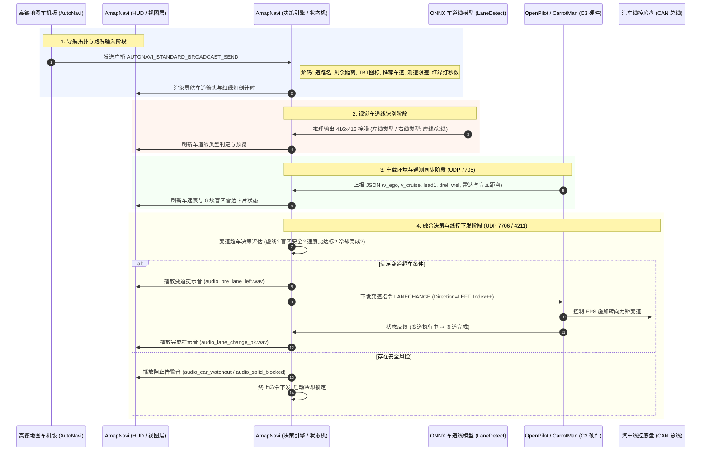
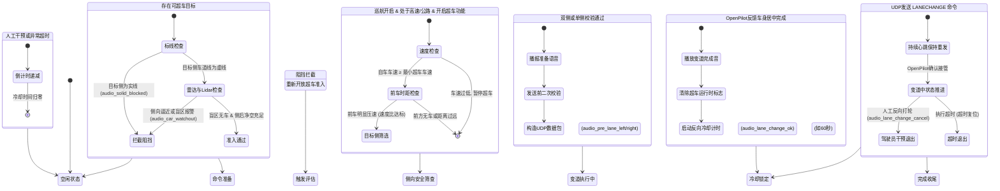
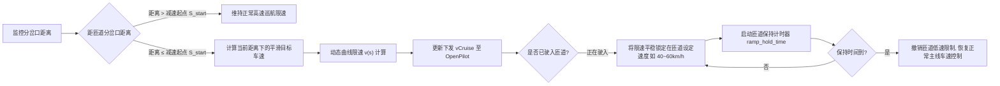
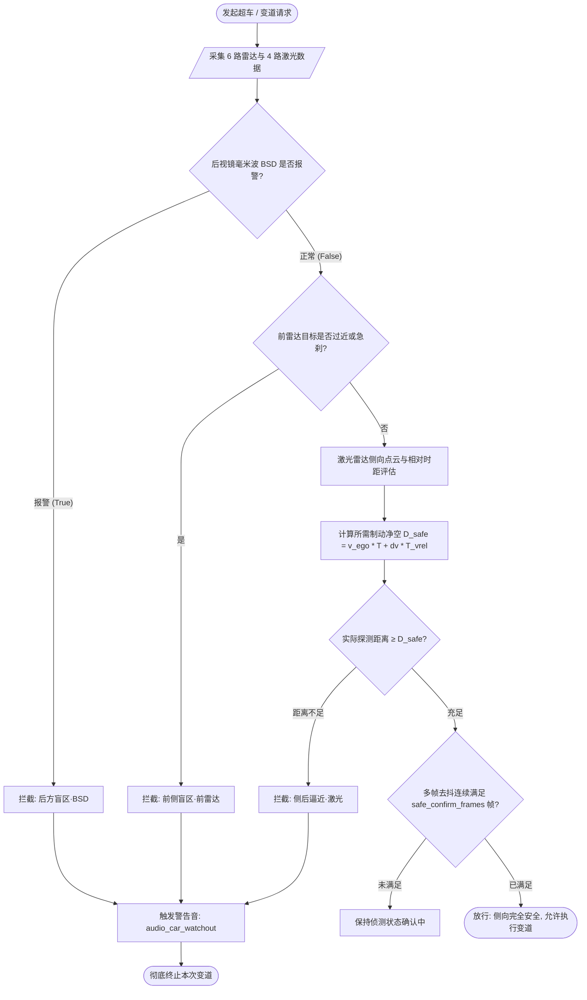
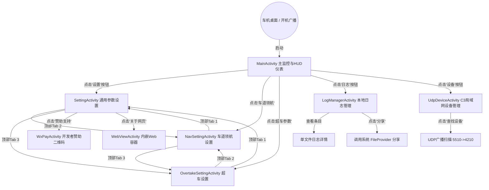

# 《02_产品功能拆解》

> **报告版本**：V1.0  
> **分析对象**：`AmapNavi-V1.3.6.9.apk` (`com.carrot.amapnavi`)  
> **分析日期**：2026-11-01  
> **证据等级规范**：
> - **【已确认】**：有反编译代码、资源配置、布局文件、状态枚举或文本直接佐证。
> - **【高度可信】**：由多个关联方法、调用链、通信端口与状态机流转强力证明。
> - **【推测】**：基于车机智能驾驶工程惯例推断，未经全工况真车实测。

---

## 目录

- [一、产品定位与商业模式剖析](#一产品定位与商业模式剖析)
- [二、系统全景功能树](#二系统全景功能树)
- [三、核心业务功能深度拆解](#三核心业务功能深度拆解)
  - [3.1 视觉感知与车道线识别引擎](#31-视觉感知与车道线识别引擎)
  - [3.2 高德车道级导航与智能领航决策 (NOP)](#32-高德车道级导航与智能领航决策-nop)
  - [3.3 智能自主超车与多阶段状态机 (Overtake)](#33-智能自主超车与多阶段状态机-overtake)
  - [3.4 巡航限速与特殊工况控速 (Scene Speed Control)](#34-巡航限速与特殊工况控速-scene-speed-control)
  - [3.5 盲区与侧向主动安全防御系统 (Lateral Safety)](#35-盲区与侧向主动安全防御系统-lateral-safety)
  - [3.6 智能驾驶硬件互联与设备管理 (C3 / OP UDP)](#36-智能驾驶硬件互联与设备管理-c3--op-udp)
  - [3.7 车辆运行监控与 HUD 仪表呈现](#37-车辆运行监控与-hud-仪表呈现)
  - [3.8 系统调试、日志回放与外部控制](#38-系统调试日志回放与外部控制)
  - [3.9 开发者赞助与关于机制](#39-开发者赞助与关于机制)
- [四、核心业务全景流程图 (Mermaid)](#四核心业务全景流程图-mermaid)
  - [4.1 跨系统协同数据流向图](#41-跨系统协同数据流向图)
  - [4.2 智能自主超车完整状态机流转图](#42-智能自主超车完整状态机流转图)
  - [4.3 车道级领航变道决策流转图](#43-车道级领航变道决策流转图)
  - [4.4 匝道提前减速曲线控制流程图](#44-匝道提前减速曲线控制流程图)
  - [4.5 侧向与盲区安全防御逻辑流程图](#45-侧向与盲区安全防御逻辑流程图)
  - [4.6 界面路由与操作跳转流转图](#46-界面路由与操作跳转流转图)
- [五、第二阶段总结与后续阶段路标](#五第二阶段总结与后续阶段路标)

---

## 一、产品定位与商业模式剖析

### 1.1 产品解决的核心痛点 【已确认】
在中国本土汽车改装与后装智能驾驶领域，长期存在两大技术割裂：
1. **车载导航地图的“盲目性”**：高德地图车机版（AutoNavi 车机版）具备极其优秀的中国本土高精道路拓扑、实时车道引导、红绿灯读秒、测速电子眼与动态拥堵路况，但它只是一个 Android 导航展示应用，无法直接介入车辆底盘线控（CAN 总线）。
2. **开源智能驾驶的“本土化缺失”**：Comma 3 / OpenPilot（特别是针对现代起亚车系的 CarrotMan 专属分支）具备强大的端到端视觉横纵向控制与线控控车能力，但缺乏中国本土道路拓扑、高德红绿灯与限速预警、匝道提前靠边以及车道级路径规划支持。

**AmapNavi 的产品定位**：
**专为 OpenPilot (CarrotMan) 智能驾驶套件研发的“高德车道级导航中继大脑与智能领航协同系统”**。它驻留在车机端（或车机伴侣 Android 设备），实时监听高德车机版的导航广播，融合本地轻量级 AI 视觉车道线识别，解算前车时距、盲区雷达与高精度地图车道，通过局域网 UDP 高速链路向 C3 / OpenPilot 下发自主变道、自动超车、红绿灯制动、匝道/隧道降速等线控决策指令，实现媲美原厂高阶辅助驾驶（NOP / NOA）的本土化智能领航体验。

### 1.2 目标用户画像 【已确认】
- **硬核改装车友**：现代库斯途 (Custo)、伊兰特、索纳塔、起亚嘉华等车系的车主，已在车上加装了 Comma 3 / Comma 3X 智能驾驶硬件。
- **长途高速通勤人群**：频繁行驶高速公路，渴望在巡航过程中实现“自动根据导航选车道”、“前车过慢自动超车”、“出高速自动变入匝道”的解放双脚体验。
- **智能化升级需求**：原厂车机系统落后（如库斯途原厂 Android 4.4 车机），希望通过低成本车机软件升级获得现代化新势力座舱的辅助驾驶感知与交互。

### 1.3 核心使用场景 【已确认】
1. **高速公路车道级领航 (Highway NOP)**：根据高德导航指令，自动规划最优推荐车道，在距分岔路口 1~2 公里处提前向右变道靠拢匝道，避开导流线与禁止通行车道。
2. **高速自主超车 (Auto Overtake)**：自车巡航受阻（前车速度显著低于巡航设定且跟车时距压缩），在侧向激光雷达无车、盲区 BSD 安全、标线允许（虚线）的前提下，自主开启转向灯并下发变道命令完成超车。
3. **特定路况智能减速 (Scene Speed Control)**：
   - **高速匝道**：分岔前依据平滑曲线自动降速（例如从 120km/h 梯次降至 40~60km/h）。
   - **隧道工况**：进入隧道前自动压低目标车速，出隧道恢复。
   - **红绿灯路口**：结合高德红绿灯倒计时，在红灯且自车滑行时配合 OpenPilot 执行辅助减速制动。
   - **收费站/服务区**：提前降速至安全车速。
4. **侧向盲区防撞防御**：实时聚合车载毫米波雷达、BSD 盲区检测、激光雷达（Lidar）距离/相对速度数据，当存在碰撞风险时立即熔断超车命令并强制回位。

### 1.4 商业模式与付费策略 【已确认】
- **商业模式**：**完全免费的极客开源/社群互助模式**。
- **付费机制**：应用无任何商业付费网关，无会员体系，无功能订阅锁死。
- **捐赠与赞助**：内嵌 `WxPayActivity`，以“赞助请扫下方二维码，赞助请备注软件ID”的形式向开发者自愿打赏（仅展示个人微信收款二维码静态图片 `@drawable/wxpay`，不调用任何微信支付 SDK）。

---

## 二、系统全景功能树

依据应用 8 个 Activity、1 个常驻 Service、底层算法包与 XML 布局，提取完整功能拓扑树：

```
AmapNavi 智能领航辅助套件
├── 1. 核心驾驶交互 (HUD / 主监控)
│   ├── 1.1 车速与巡航状态监控 (vEgo, vCruise)
│   ├── 1.2 高德导航 HUD 车道指引 (推荐车道高亮 / 禁行车道置灰)
│   ├── 1.3 TBT 转弯与红绿灯读秒展示 (转向图标 / 剩余距离 / 信号灯秒数)
│   ├── 1.4 雷达与盲区安全卡片 (自车 / 前车 / 侧向毫米波 / 激光雷达)
│   ├── 1.5 超车状态卡片 (超车模式 / 目标车道 / 抑制原因)
│   └── 1.6 实时推理车道线浮层预览
├── 2. 车道级智能领航 (Nav Control)
│   ├── 2.1 高速公路车道领航开关
│   ├── 2.2 普通公路车道领航开关
│   ├── 2.3 走推荐车道策略 (Suggest Lane)
│   ├── 2.4 避开禁行/故障车道 (Disable Lane Avoidance)
│   ├── 2.5 靠左/靠右策略偏好 (Keep Left / Keep Right)
│   ├── 2.6 道路中心隔离带自适应
│   └── 2.7 推荐车道停留超时恢复策略
├── 3. 智能自主超车 (Auto Overtake)
│   ├── 3.1 超车模式选择 (激进 / 常规 / 保守)
│   ├── 3.2 高速超车开关与公路超车开关
│   ├── 3.3 前车触发门限判定 (前车车速比 / 最小车速 / 跟车时距)
│   ├── 3.4 侧向变道条件判定 (虚实线识别 / 激光雷达净空 / 后方逼近速度)
│   ├── 3.5 驾驶员接管与干预熔断 (反向变道冷却时间控制)
│   └── 3.6 超车全生命周期状态机推进
├── 4. 场景智能限速与控速 (Speed Control)
│   ├── 4.1 道路限速跟随与偏置设定 (绝对值偏置 / 百分比偏置)
│   ├── 4.2 匝道平滑减速曲线控制 (分岔距离 / 阶梯降速 / 维持时间)
│   ├── 4.3 隧道智能减速策略
│   ├── 4.4 收收费站/服务区提前减速
│   └── 4.5 红绿灯辅助减速与起步提醒
├── 5. 视觉感知引擎 (Vision Lane AI)
│   ├── 5.1 ONNX YOLO-seg 车道线分割推理 (416x416 输入)
│   ├── 5.2 车道线类型判别 (实线 / 虚线 / 双黄线 / 导流线)
│   ├── 5.3 掩膜图像重构与车道锚点提取 (FastAnchor)
│   └── 5.4 视觉推理基准性能自测与回放
├── 6. 侧向主动安全防御 (Lateral Safety)
│   ├── 6.1 前向雷达盲区防撞
│   ├── 6.2 毫米波 BSD 侧后盲区检测
│   ├── 6.3 侧向激光雷达 (Lidar) 距离与时距防碰评估
│   └── 6.4 变道前二次多传感器综合校验
├── 7. 智能硬件互联 (UDP Engine)
│   ├── 7.1 局域网广播设备自动发现 (Port 5510 / 4210)
│   ├── 7.2 OpenPilot 车身遥测数据接收 (Port 7705, 81 项指标)
│   ├── 7.3 控制指令下发通道 (Port 7706 / 4211 / 4213)
│   └── 7.4 心跳维系与网络掉线自动重连
├── 8. 系统设置与调试管理
│   ├── 8.1 通用参数配置 (设置界面 Tab 1)
│   ├── 8.2 领航参数配置 (设置界面 Tab 2)
│   ├── 8.3 超车参数配置 (设置界面 Tab 3)
│   ├── 8.4 本地多通道日志管理 (App 日志 / 超车日志)
│   ├── 8.5 外部广播调试控制 (DebugReceiver 指令集)
│   └── 8.6 全局多通道声音音效系统 (SoundCenter, 40+ WAV 音效)
└── 9. 开发者支持
    └── 9.1 微信打赏赞助 (软件 ID 关联展示)
```

---

## 三、核心业务功能深度拆解

对功能树中的各核心业务模块，按照 14 个工程维度进行深度剖析：

### 3.1 视觉感知与车道线识别引擎 【已确认】

| 维度 | 分析内容 |
| :--- | :--- |
| **功能名称** | 视觉车道线实时感知与标线类型判别 (`LaneDetect`) |
| **功能目的** | 实时识别当前自车两侧车道线属于“虚线”还是“实线”，为自主变道决策提供交通法规硬性准入判定。 |
| **使用场景** | 车辆在高速或公路上行驶，准备发起变道、超车或车道居中时。 |
| **入口位置** | 系统后台常驻服务启动即自启；主界面展示实时检测画面；`MainActivity` 提供“车道测试”入口。 |
| **前置条件** | 具备本地摄像头或视频帧流输入；`libonnxruntime.so` 初始化成功；`assets/lane.onnx` 成功挂载。 |
| **操作步骤** | 1. `JpegFrameFetcher` 捕获当前摄像头图像。<br/>2. 缩放至 `416×416` RGB 浮点张量。<br/>3. 调用 ONNX Runtime 运行 session 推理。<br/>4. 后处理解析 `output0`（边界框）与 `output1`（104×104 原型掩膜）。<br/>5. 生成两侧车道线类型（虚线/实线/无）。 |
| **输入参数** | 图像 Bitmap，模型推理尺寸（`inputSize=416`，`protoSize=104`），置信度阈值。 |
| **处理逻辑** | 详见 `com.carrot.lane.LaneDetect#postProcess`：通过矩阵点积提取车道分割轮廓，按车道中心线坐标划分为左线与右线，计算线形连续度，输出 `LaneLineJudgement`。 |
| **输出结果** | `left_lane_type`、`right_lane_type`（实线 / 虚线 / 未知）、掩膜叠加位图。 |
| **异常情况** | 摄像头掉线：标记 `lane_detect_valid = false`；ONNX 初始化异常：降级至仅依赖高德地图静态车道数据。 |
| **关联模块** | `MainActivityLaneControlKt`, `KeepAliveService`, `MainActivityUiKt` |
| **依赖网络** | **完全离线**（基于端侧 NPU/CPU 离线推理）。 |
| **需要登录** | 否。 |
| **涉及付费** | 否。 |

### 3.2 高德车道级导航与智能领航决策 (NOP) 【已确认】

| 维度 | 分析内容 |
| :--- | :--- |
| **功能名称** | 车道级导航引导与变道建议 (`decideLaneWithAction`) |
| **功能目的** | 解码高德地图车道指引，与视觉车道线匹配，自动计算当前自车处于第几车道，并生成目标变道指令。 |
| **使用场景** | 高速公路长途巡航、复杂枢纽立交桥分岔前、出主路进匝道前。 |
| **入口位置** | 主界面全自动运行；`NavSettingActivity` 提供参数调校。 |
| **前置条件** | 高德车机版在后台/前台运行且处于规划导航中；AmapNavi 收到高德广播。 |
| **操作步骤** | 1. 监听 `AUTONAVI_STANDARD_BROADCAST_SEND` 广播。<br/>2. 解析 `EXTRA_DRIVE_WAY` 字符串（如 `"s|s|S|X"`，大写表示推荐，X 表示禁行）。<br/>3. 比对视觉车道索引 `visualLaneIdx`。<br/>4. 综合“走推荐车道”、“靠左/靠右优先”配置。<br/>5. 生成变道动作 `LaneChangeAction`（`LEFT` / `RIGHT` / `KEEP`）。 |
| **输入参数** | 导航车道数组 `NavLane`、分岔路口距离 `nTBTDist`、车道领航开关（`app_navi`、`app_road_navi`）。 |
| **处理逻辑** | 距离分岔较远（>1.5km）时，优先保持在巡航车道；进入分岔缓冲区（500m~1.5km）时，强制向推荐车道靠拢；若已处于推荐车道超过 5 秒，暂停动作避免频繁横跳。 |
| **输出结果** | 下发打转向灯指令 `sendBlinkerCtrlComm` 及变道命令 `sendLaneCmd`；播放对应语音提示音。 |
| **异常情况** | 高德导航停止：立即清除引导车道，恢复人工驾驶巡航；高德广播中断超时：看门狗触发超时告警。 |
| **关联模块** | `MainActivityAmapKt`, `MainActivityLaneDecisionKt`, `SoundCenter` |
| **依赖网络** | 车机高德本身联网，AmapNavi 与高德间为本地进程间广播通信。 |
| **需要登录** | 否。 |
| **涉及付费** | 否。 |

### 3.3 智能自主超车与多阶段状态机 (Overtake) 【已确认】

| 维度 | 分析内容 |
| :--- | :--- |
| **功能名称** | 智能自主变道超车系统 (`autoOvertake`) |
| **功能目的** | 在高速巡航被慢速前车压车阻挡时，全自动完成“路况确认 -> 虚线判别 -> 侧后盲区安全确认 -> 打灯变道 -> 提速超车 -> 变回车道”的全自动超车闭环。 |
| **使用场景** | 高速/公路上自车以设定巡航车速（如 120km/h）行驶，前车过慢（如 90km/h）。 |
| **入口位置** | `MainActivity` 主界面悬浮按钮及 `OvertakeSettingActivity` 配置面板。 |
| **前置条件** | 1. 车辆在高速公路且已开启巡航（`engaged = true`，`vCruise >= 60km/h`）。<br/>2. 超车功能处于启用状态（`app_overtake = true`）。<br/>3. 不处于反向冷却锁定期中。 |
| **操作步骤** | 1. `evaluateOvertakeTrigger` 检测前车车速比与时距。<br/>2. `evaluateOvertakeSide` 分别评估左侧与右侧超车可行性。<br/>3. 选定目标侧后，调用 `doOvertakeAction` 推进多阶段状态机。<br/>4. 经发送前二次校验通过后，UDP 发送 `LANECHANGE` 指令。<br/>5. 监控 OpenPilot 变道执行反馈，完成后触发冷却与状态复位。 |
| **输入参数** | 前车相对距离 `drel`、前车相对速度 `vrel`、自车车速 `v_ego_kph`、超车模式（激进/常规/保守）。 |
| **处理逻辑** | 状态机分 9 步推进：触发评估 -> 侧向净空筛选 -> 变道前二次校验 -> 下发变道命令 -> 持续心跳保持 -> 变道执行中 -> 变道完成中 -> 完成并结算 -> 启动冷却计时（防止反复变道）。 |
| **输出结果** | 触发转向灯、推送 OpenPilot 转向力矩执行、播放 `audio_lane_change_ok.wav`。 |
| **异常情况** | 变道过程中驾驶员打反向方向盘干预：立即触发 `audio_lane_change_cancel` 终止并进入冷冻期。 |
| **关联模块** | `MainActivityOvertakeKt`, `MainActivityLaneDecisionKt`, `LidarSideSafety` |
| **依赖网络** | 否（车载局域网通信）。 |
| **需要登录** | 否。 |
| **涉及付费** | 否。 |

### 3.4 巡航限速与特殊工况控速 (Scene Speed Control) 【已确认】

| 维度 | 分析内容 |
| :--- | :--- |
| **功能名称** | 场景自适应限速与平滑控速系统 (`rampSlowdownProcess` / `smoothSpeedLimit`) |
| **功能目的** | 解除人工反复拨轮调整巡航车速的繁琐操作，根据高德地图真实限速、测速电子眼、匝道分岔、隧道、收费站等工况动态平滑调节车辆巡航设定车速。 |
| **使用场景** | 临近高速出入口匝道、进入隧道、通过区间测速起点、路口红灯刹停。 |
| **入口位置** | 主界面限速浮层及 `SettingActivity` 通用参数设置。 |
| **前置条件** | 自车处于巡航激活状态；高德持续输出电子眼或路段信息。 |
| **操作步骤** | 1. 实时提取高德道路限速 `nRoadLimitSpeed`。<br/>2. 叠加用户偏置设定（如高速偏置 +5km/h 或 +10%）。<br/>3. 若侦测到前方进入匝道区间，计算规划减速起点：<br/>$$S_{start} = S_{dist} + \frac{v_0^2 - v_{ramp}^2}{2a}$$<br/>4. 动态递减 `vCruise` 下发至 OpenPilot。<br/>5. 通过后恢复常规巡航车速。 |
| **输入参数** | `nRoadLimitSpeed`、`nTBTDist`、`nSdiSpeedLimit`、`ramp_slowdown_speed_h`。 |
| **处理逻辑** | 采用缓和加减速曲线，防止骤冷骤热式刹车，避免乘客顿挫感；红灯工况下结合倒计时与滑行距离辅助减速。 |
| **输出结果** | 实时更新 `v_cruise_kph` 并推送到 C3 控制单元。 |
| **异常情况** | 高德限速数据跳变：触发限速平滑滤波机制（`smoothSpeedLimit`），限制变化加速度。 |
| **关联模块** | `MainActivityNaviProcessKt`, `MainActivityAmapKt` |
| **依赖网络** | 否。 |
| **需要登录** | 否。 |
| **涉及付费** | 否。 |

### 3.5 盲区与侧向主动安全防御系统 (Lateral Safety) 【已确认】

| 维度 | 分析内容 |
| :--- | :--- |
| **功能名称** | 多传感器融合侧向防撞与熔断安全网 (`LidarSideSafety` / `sideBlockCause`) |
| **功能目的** | 在发起变道或超车时，对侧前方、侧后方、盲区盲点进行全方位防御判定，若有任何安全隐患，100% 熔断变道指令。 |
| **使用场景** | 变道决策发出前瞬间、变道命令执行维持阶段全程。 |
| **入口位置** | 底层决策拦截钩子；主界面呈现 4 路激光雷达与 2 路毫米波雷达卡片。 |
| **前置条件** | 车载雷达及后装激光雷达（如有）在线并持续上报 UDP 数据。 |
| **操作步骤** | 1. 收集 `lidar_lfblind`、`lidar_rfblind`、`lidar_lbblind`、`lidar_rbblind` 激光盲区指标。<br/>2. 收集侧向相对速度 `lf_vrel`、`lb_vrel`、`rf_vrel`、`rb_vrel`。<br/>3. 收集盲区毫米波雷达 `left_blindspot`、`right_blindspot`。<br/>4. 判定后方车辆所需制动净空：<br/>$$D_{safe} = v_{ego} \cdot T_{safe} + \Delta v \cdot T_{vrel}$$<br/>5. 若净空不足或盲区触发，抛出 `BlockCause` 拦截并报警。 |
| **输入参数** | 81 项车身遥测 JSON 字段中的全部雷达指标。 |
| **处理逻辑** | 严谨的防误报去抖机制（Debounce）：连续多帧（`safe_confirm_frames`）安全方可放行；任意一帧报警立即熔断变道。 |
| **输出结果** | 拦截变道动作；主界面呈现阻挡原因；播放 `audio_car_watchout.wav` 告警音。 |
| **异常情况** | 激光雷达传感器掉线：视同侧向存在未探明风险，禁止盲目超车。 |
| **关联模块** | `MainActivityLaneControlKt`, `RadarCard`, `BlockCause` |
| **依赖网络** | 否。 |
| **需要登录** | 否。 |
| **涉及付费** | 否。 |

### 3.6 智能驾驶硬件互联与设备管理 (C3 / OP UDP) 【已确认】

| 维度 | 分析内容 |
| :--- | :--- |
| **功能名称** | 局域网智能驾驶套件自动握手与数据同步 (`UdpDeviceManager`) |
| **功能目的** | 实现车机与 Comma 3 / C3X 硬件的热点或局域网无线免配对自动连接。 |
| **使用场景** | 车辆上电、手机热点开启、两端接入同一 Wi-Fi 网段时。 |
| **入口位置** | `UdpDeviceActivity`（主界面右上角“设备”按钮进入）。 |
| **前置条件** | 车机与 C3 硬件连接在同一个车载 Wi-Fi 热点局域网。 |
| **操作步骤** | 1. `UdpDeviceManager` 在本地 5510 端口启动组播广播。<br/>2. 向 255.255.255.255:4210 发送探针心跳。<br/>3. C3 接收后回应自身 IP 地址与设备唯一码 `device_id`。<br/>4. 车机捕获应答，建立数据链路，开启 7705/7706 业务通道。 |
| **输入参数** | 局域网广播地址、本地端口 5510、远端端口 4210。 |
| **处理逻辑** | 5000ms 定时心跳刷新；维护活跃设备列表；断线自动退避重连。 |
| **输出结果** | `tvDevicID` 状态由断开变为已连接；设备 IP 自动同步至底层通信实例。 |
| **异常情况** | 局域网 IP 变动：自动刷新机制感知并更新对端 Socket 地址。 |
| **关联模块** | `UdpService`, `KeepAliveService`, `MainActivityUdpKt` |
| **依赖网络** | 仅依赖车载局域网 Wi-Fi，无需外网连通性。 |
| **需要登录** | 否。 |
| **涉及付费** | 否。 |

### 3.7 车辆运行监控与 HUD 仪表呈现 【已确认】

| 维度 | 分析内容 |
| :--- | :--- |
| **功能名称** | 车载全景实时 HUD 监控界面 (`MainActivityUiKt`) |
| **功能目的** | 为驾驶员提供直观、低延迟的高阶智能驾驶信息可视化仪表盘。 |
| **使用场景** | 车辆行驶全过程，悬挂于车机中控屏幕或分屏显示。 |
| **入口位置** | 应用启动默认呈现界面 (`MainActivity`)。 |
| **前置条件** | 应用正常启动并获取前台焦点。 |
| **操作步骤** | 1. 界面绘制：大号字体显示车速 `vEgo`、巡航设定 `vCruise`。<br/>2. 动态渲染高德 TBT 图标与推荐车道小箭头（↑、→、⛔）。<br/>3. 左下侧展示 6 块雷达卡片，绿/黄/红三色标示盲区安全状态。<br/>4. 右侧提供悬浮快捷调控按钮（限速微调 ±、超车开关、领航设置）。<br/>5. 底部滚动输出系统决策 Trace 日志，便于实时掌控系统思维。 |
| **输入参数** | `CarState`, `NaviState`, `RadarCard` 数据包。 |
| **处理逻辑** | 100ms 级别轻量刷新循环；通过 UI Handler 与 Coroutine 隔离计算与渲染。 |
| **输出结果** | 响应流畅的车载 HUD 视图。 |
| **异常情况** | 屏幕横竖屏旋转或车机分屏：`configChanges` 处理尺寸重塑，避免界面销毁重构。 |
| **关联模块** | `MainActivity`, `activity_main.xml` |
| **依赖网络** | 否。 |
| **需要登录** | 否。 |
| **涉及付费** | 否。 |

### 3.8 系统调试、日志回放与外部控制 【已确认】

| 维度 | 分析内容 |
| :--- | :--- |
| **功能名称** | 多模块实时日志存贮与外部 ADB 控制通道 (`LogManagerActivity` / `DebugReceiver`) |
| **功能目的** | 供极客车主排查变道失败原因、调试算法参数并回溯偶发异常。 |
| **使用场景** | 调试超车逻辑、分析变道抖动、路测后导出数据。 |
| **入口位置** | `LogManagerActivity` 或通过命令行发送 `com.carrot.amapnavi.DEBUG` 广播。 |
| **前置条件** | 应用已获得外部存储写入权限；已配置日志开关。 |
| **操作步骤** | 1. `OvertakeLogger` 与 `AppLogger` 双线程分流写入 `/sdcard/logs/`。<br/>2. 打开日志管理界面，支持查看按时间倒序排列的日志文件。<br/>3. 支持点击单选日志查看具体判定明细。<br/>4. 支持调用系统分享（FileProvider）或一键全部清除。 |
| **输入参数** | 日志条目字符串、调试广播参数（`cmd`、`key`、`val`）。 |
| **处理逻辑** | 文件写入采用异步缓冲区队列（`enqueue`），避免频繁磁盘 I/O 阻塞主线程。 |
| **输出结果** | 生成规范的时序决策日志文件。 |
| **异常情况** | 磁盘空间不足：提示清理并限制最大行数（`RAW_LOG_MAX_LINES`）。 |
| **关联模块** | `OvertakeLogger`, `LogStorage`, `DebugReceiver` |
| **依赖网络** | 否。 |
| **需要登录** | 否。 |
| **涉及付费** | 否。 |

### 3.9 开发者赞助与关于机制 【已确认】

| 维度 | 分析内容 |
| :--- | :--- |
| **功能名称** | 开发者赞助支持界面 (`WxPayActivity`) |
| **功能目的** | 向认可软件价值的车友提供自愿技术赞助打赏渠道。 |
| **使用场景** | 用户主动在设置界面点击“赞助作者”按钮。 |
| **入口位置** | `SettingActivity` 中的关于/赞助入口。 |
| **前置条件** | 无。 |
| **操作步骤** | 1. 打开页面，呈现黑色背景高对比度布局。<br/>2. 顶部提示：“赞助请扫下方二维码”。<br/>3. 中间展示个人微信收款二维码静态图片。<br/>4. 底部提示：“赞助请备注软件ID，感谢您的支持”。<br/>5. 点击“关闭”按钮返回原设置页面。 |
| **输入参数** | 软件生成或读取的设备特征 ID（`android_id` / MAC 组合）。 |
| **处理逻辑** | 纯静态页面展示，无任何支付回调监听、网络扣费或权限授权。 |
| **输出结果** | 提示用户如果打赏可在备注中附带自身软件 ID。 |
| **异常情况** | 无。 |
| **关联模块** | `activity_wxpay.xml`, `SettingActivity` |
| **依赖网络** | 否。 |
| **需要登录** | 否。 |
| **涉及付费** | **自愿打赏**，不限制任何核心功能的免费使用。 |

---

## 四、核心业务全景流程图 (Mermaid)

### 4.1 跨系统协同数据流向图 【已确认】



---

### 4.2 智能自主超车完整状态机流转图 【已确认】



---

### 4.3 车道级领航变道决策流转图 【已确认】

```mermaid
flowchart TD
    Start([收到高德车机导航广播]) --> Parse[AmapUtilsKt 解析 EXTRA_DRIVE_WAY]
    Parse --> CheckNav[自车当前是否处于导航路段?]
    
    CheckNav -- 否 --> End([保持当前车道])
    CheckNav -- 是 --> DistCheck{距分岔路口距离 nTBTDist}
    
    DistCheck -- > 1500米 远距离巡航 --> StrategyFar[靠左/靠右巡航偏好控制]
    DistCheck -- 500米 ~ 1500米 变道缓冲区 --> StrategyMid[核心领航变道判定]
    DistCheck -- < 500米 临界强制区 --> StrategyNear[强制变入出口车道]
    
    StrategyMid --> CheckLaneMatch{自车当前车道是否属于推荐车道?}
    CheckLaneMatch -- 已在推荐车道 --> Stay[在推荐车道持续行驶]
    Stay --> TimerCheck{是否已连续行驶 > 5秒?}
    TimerCheck -- 是 --> PauseAction[暂停动作, 保持稳定]
    TimerCheck -- 否 --> End
    
    CheckLaneMatch -- 处于非推荐车道 --> CalcDir[计算向推荐车道靠拢方向 (向左 / 向右)]
    CalcDir --> SolidCheck{侧向车道标线是否为实线?}
    SolidCheck -- 是实线 --> BlockSolid[禁止变道: 播报 audio_solid_blocked]
    SolidCheck -- 是虚线 --> SafetyCheck{侧向雷达与激光盲区是否安全?}
    
    SafetyCheck -- 存在危险 --> BlockHazard[暂缓变道: 保持当前车道跟随]
    SafetyCheck -- 安全无险 --> SendNavCmd[下发导航建议变道指令 sendLaneCmd]
    SendNavCmd --> End
```

---

### 4.4 匝道提前减速曲线控制流程图 【已确认】



---

### 4.5 侧向与盲区安全防御逻辑流程图 【已确认】



---

### 4.6 界面路由与操作跳转流转图 【已确认】



---

## 五、第二阶段总结与后续阶段路标

### 5.1 第二阶段拆解结论摘要
1. **产品技术本质**：AmapNavi 绝不仅是一个简单的导航查看器，而是一个**将高德地图车机版升级为 L2+ 高阶导航辅助驾驶中枢（NOP / NOA）的算法引擎**。
2. **严密的状态机设计**：自动超车实现了完备的 9 步状态推进闭环与反向变道冷却机制，充分规避频繁横跳，在工程安全设计上极其谨慎。
3. **全方位的安全防御网**：融合了视觉车道标线（虚实线判别）、前雷达、毫米波 BSD、侧向激光雷达多传感器数据，配备了多帧去抖与瞬间熔断机制。
4. **场景自适应能力**：细致考虑了中国道路特有的高速匝道、隧道、红绿灯倒计时读秒与收费站场景，并实现了速度平滑过渡控制。

### 5.2 后续推进路标
- **第一阶段产出**：`01_应用基础信息分析.md`（已完成）
- **第二阶段产出**：`02_产品功能拆解.md`（本报告）
- **第三阶段（下一阶段）**：**UI/UX 深度拆解**，编写《03_UI与交互深度分析.md》，系统还原应用 8 个页面的 XML 视觉规范、设计系统、颜色配色值、尺寸间距与车机端横屏触控交互规范。
