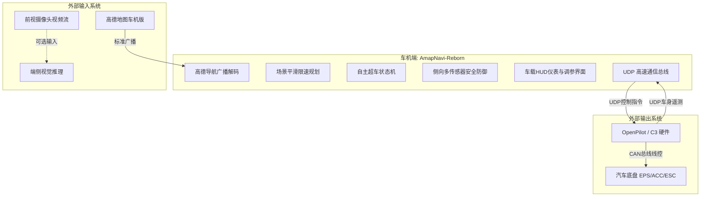

# 《06_概要设计说明书 (HLD)》

> **项目名称**：`AmapNavi-Reborn` (车载高德车道级导航与智能驾驶协同中继套件)  
> **文档版本**：V1.0  
> **面向对象**：系统架构师、研发工程师、下游开发智能体 (AI Coding Agents)  
> **目标基线**：现代库斯途 (Android 4.4.3 / API 19，armeabi-v7a) 及现代 Android 车机系统  
> **编写日期**：2026-11-02  

---

## 目录

- [一、项目背景与系统定位](#一项目背景与系统定位)
- [二、业务范围与功能边界](#二业务范围与功能边界)
- [三、运行环境与硬件约束](#三运行环境与硬件约束)
- [四、典型使用场景与用户用例](#四典型使用场景与用户用例)
- [五、系统总体功能架构与模块划分](#五系统总体功能架构与模块划分)
- [六、外部系统接口与通信边界](#六外部系统接口与通信边界)
- [七、非功能性需求与质量属性](#七非功能性需求与质量属性)

---

## 一、项目背景与系统定位

### 1.1 背景阐述
在后装开源智能驾驶（以 Comma 3 / OpenPilot CarrotMan 分支为主）与量产汽车（如北京现代库斯途 Custo、伊兰特、索纳塔等车系）的融合实装中，开源智能驾驶系统缺乏中国本土道路导航拓扑、红绿灯读秒与车道级实线/虚线引导；而原车搭载的高德地图车机版具备高精车道导航数据，却无法控制底盘转向与巡航纵向线控。

### 1.2 系统定位
`AmapNavi-Reborn` 是一个**软硬件协同的边缘导航决策中继大脑**。它部署于车机 Android 系统内部：
1. **下行**：实时监听并解码高德车机版的标准导航广播（包含车道级指引、红绿灯读秒、道路限速与分岔距离）；
2. **旁路**：聚合车载毫米波雷达、激光雷达与自车动力学指标（通过局域网 UDP 接收 OpenPilot 上报的 81 项遥测 JSON）；
3. **决策**：通过内置的“车道级领航状态机”与“自主超车状态机”，解算目标车道、打灯变道时机与安全净空；
4. **上行**：向 OpenPilot 下发线控控制指令（变道方向、目标车速、转向灯请求），实现类似华为 NCA / 小鹏 NGP 的车道级领航辅助驾驶（NOP）。

---

## 二、业务范围与功能边界



### 2.1 范围内功能 (In-Scope)
- **高德导航广播自动化解析**：车道推荐字符（`EXTRA_DRIVE_WAY`）、转向图标、分岔路口距离、区间测速与红绿灯。
- **局域网免配置设备发现**：5510 / 4210 端口组播探针自动握手，锁定 Comma 3 IP 地址。
- **81 项底盘遥测数据模型构建**：自车轮速、巡航速度、前车雷达距离/相对速度、盲区 BSD、激光雷达时距。
- **自主超车全生命周期管理**：前车压速评估、侧向净空计算、虚实线准入、指令下发、反向变道冷却（20~60秒）。
- **特异路况自适应控速**：匝道平滑匀减速曲线规划、隧道降速、红绿灯制动协同。
- **车载横屏 HUD 仪表盘**：自车大字车速、巡航车速、车道高亮指示、6 块雷达卡片阵列、实时决策 Trace 滚动区。
- **多通道音频心智反馈**：40 余个 WAV 音效精准事件播报（变道预备、实线阻挡、注意车辆、打断取消等）。
- **Android 4.4.3 (API 19) 降级实装适配**：免动态权限弹窗、MultiDex 分包优化、系统开机自启。

### 2.2 范围外功能 (Out-of-Scope)
- **底盘线控 CAN 信号收发**：由 Comma 3 硬件（C3 Panda）直接通过 OBD-II / CAN 总线线控执行，本软件不直接操作 CAN 驱动。
- **高精度地图绝对定位绘制**：由高德地图车机版自身负责渲染，本软件仅提取其数据包，不自建瓦片地图渲染引擎。
- **重型 AI 车道线训练**：仅支持加载预训练好的轻量化 ONNX 模型，不涉及模型重训练工具链。

---

## 三、运行环境与硬件约束

| 约束维度 | 现代库斯途 (原厂老车机基线) | 现代化升级车机 (扩展基线) |
| :--- | :--- | :--- |
| **操作系统** | **Android 4.4.3 (KitKat, API 19)** | Android 9.0 ~ 13.0 (API 28 ~ 33) |
| **处理器架构** | **NXP / Freescale i.MX6 Quad (`armeabi-v7a`, 32位)** | 高通 8155 / 紫光展锐 (`arm64-v8a`, 64位) |
| **RAM 内存** | **1.0 GB ~ 2.0 GB** (系统可用内存 $\le 600\text{MB}$) | 4.0 GB ~ 8.0 GB |
| **存储介质** | eMMC 4.5 慢速闪存 (随机读写性能有限) | UFS 2.1 / 3.1 高速闪存 |
| **屏幕分辨率** | 1024×600 或 1280×720 横向车载宽屏 | 1920×1080 / 2K 悬浮屏 |
| **网络环境** | 车载 Wi-Fi 热点局域网 (`192.168.43.0/24`) | Wi-Fi 5 / 车机 4G/5G 全时在线 |
| **资源配额红线**| **CPU 占用 $\le 8\%$，内存常驻 $\le 80\text{MB}$** | CPU 占用 $\le 15\%$，内存常驻 $\le 200\text{MB}$ |

---

## 四、典型使用场景与用户用例

### 场景一：高速长途巡航与智能超车 (Auto Overtake)
1. 车辆在高速公路上巡航（设定 `vCruise = 120km/h`），自车巡航处于接管激活状态（`engaged = true`）。
2. 正前方出现慢速大卡车，车速仅 `85km/h`，自车跟车距离缩进至 `35m`（满足前车压速条件：$\Delta v \ge 10\text{km/h}$）。
3. 系统评估左侧车道：高德导航显示左侧为有效通行车道，视觉检测左侧标线为虚线（Dashed），毫米波 BSD 盲区无车，激光雷达测得左后方 50m 内净空充足。
4. 系统播报语音提示“即将向左变道”（`audio_pre_lane_left.wav`），经二次安全核验通过后，通过 UDP 7706 发送 `LANECHANGE (LEFT)` 指令。
5. Comma 3 控制方向盘平滑变入左侧车道，提速超越大卡车。
6. 变道完成后播报确认音（`audio_lane_change_ok.wav`），系统启动 20 秒反向变道冷却时间，防止频繁横跳。

### 场景二：进出高速匝道自适应控速 (Ramp Deceleration)
1. 车辆在主线上行驶，距出口匝道分岔路口剩余 `1500m`。
2. 高德车道指引显示右侧车道为出口专用车道，系统发出靠右行驶提示。
3. 距分岔路口剩余 `400m`（规划减速起点），系统启动匝道匀减速规划曲线，将巡航设定车速由 `120km/h` 平滑递减至 `60km/h`。
4. 车辆平稳驶入匝道弯道，系统维持低速限速 10 秒（`ramp_hold_time`），确保弯道安全通行。

### 场景三：驾驶员主动接管防撞 (Driver Intervention)
1. 变道执行过程中，后方突然有激进车辆超速贴近，或驾驶员察觉路面抛洒物，手动反向大力转动方向盘。
2. 系统监测到物理方向盘转角变化率异常升高，且转向扭矩突破设定阈值，在 $20\text{ms}$ 内立即撤销变道请求。
3. 立即下发指令恢复车道居中，播报取消提示音（`audio_lane_change_cancel.wav`），并强制进入 60 秒冷却锁死。

---

## 五、系统总体功能架构与模块划分

系统拆分为六大核心功能模块：

```
AmapNavi-Reborn 功能模块架构:
├── Module 1: 车载数据通信中枢 (Transport Core)
│   ├── AmapBroadcastReceiver: 高德车机版广播监听与解码
│   ├── UdpDeviceDiscovery: 5510 局域网组播设备自动配对
│   └── CarrotUdpClient: 7705/7706 车辆遥测接收与控制下发
├── Module 2: 车道领航决策引擎 (Navigation Decision)
│   ├── LaneMatchEngine: 高德车道推荐与视觉车道匹配
│   ├── ForkGuidancePlanner: 分岔路口前向距离分级响应
│   └── PreferredLaneStrategy: 推荐车道走停与靠左/靠右策略
├── Module 3: 自主超车状态机引擎 (Overtake Engine)
│   ├── LeadVehicleEvaluator: 前车压速门限与时距判定
│   ├── LateralSafetyEvaluator: 虚实线/BSD/激光雷达综合防御
│   ├── OvertakeStateController: 9阶段状态机跃迁控制
│   └── ReverseCooldownWatchdog: 反向变道防横跳冷却看门狗
├── Module 4: 场景控速与平滑规划 (Speed Planning)
│   ├── SmoothSpeedFilter: 道路限速平滑滤波与偏置叠加
│   ├── RampDecelerationPlanner: 匝道自适应平滑减速曲线生成
│   └── TrafficLightSpeedAssist: 隧道/收费站/红绿灯制动协同
├── Module 5: 表现层与人机交互 (Presentation & HUD)
│   ├── DashboardHUDActivity: 双表盘车速与全景仪表
│   ├── RadarDrawerFragment: 6卡片盲区与激光雷达阵列
│   ├── SettingsActivityFamily: 通用/领航/超车参数调校面板
│   └── SoundFeedbackEngine: SoundPool 多通道低延迟音效调度
└── Module 6: 平台保活与底层兼容 (Platform & Backport)
    ├── KeepAliveForegroundService: 常驻前台通知与内存防杀
    ├── BootAutoStarter: 系统通电自启挂载
    └── Android44BackportSuite: MultiDex、Java8脱糖与TLS1.2套件
```

---

## 六、外部系统接口与通信边界

### 6.1 高德车机版广播接口契约
- **下行广播 Action**：`"AUTONAVI_STANDARD_BROADCAST_SEND"`
- **传输载荷**：Android 标准 `Intent.getExtras()`。
- **核心读取字段**：`EXTRA_DRIVE_WAY` (车道指引字符串), `EXTRA_ROAD_LIMIT_SPEED` (限速), `EXTRA_SEG_REMAIN_DIS` (分岔距离), `EXTRA_TURN_TYPE` (转向图标), `EXTRA_TRAFFIC_LIGHT_SECONDS` (红灯倒计时)。

### 6.2 Comma 3 / OpenPilot UDP 接口契约
- **探针握手**：车机绑定 UDP `5510`，向广播地址 `255.255.255.255:4210` 发送心跳探针，获取 C3 IP。
- **遥测上报**：车机在 UDP `7705` 端口以 10~20Hz 接收 C3 广播的 81 项底盘 JSON 数据。
- **控制指令**：车机向 C3 的 UDP `7706` 端口发送控制包（JSON 格式：包含 `cmd`, `direction`, `index`, `v_cruise`, `blinker`）。

---

## 七、非功能性需求与质量属性

1. **确定性实时性 (Determinism)**：
   - 遥测包反序列化处理时间 $\le 5\text{ms}$；
   - 决策状态机单个计算周期耗时 $\le 10\text{ms}$；
   - 驾驶员接管打断响应时间 $\le 20\text{ms}$。
2. **极高可用性与健壮性 (Robustness)**：
   - 网络偶发丢包率在 15% 以内时，状态机保持稳定，不发生指令误发或重复执行；
   - 前台通知保证在低内存环境下不被 Android 4.4 LMK (Low Memory Killer) 误杀。
3. **免侵入与安装友好性 (Installability)**：
   - 采用标准 `targetSdkVersion 22` 设定，避免库斯途车机弹出任何无法触控的运行时权限对话框，安装即就绪。
