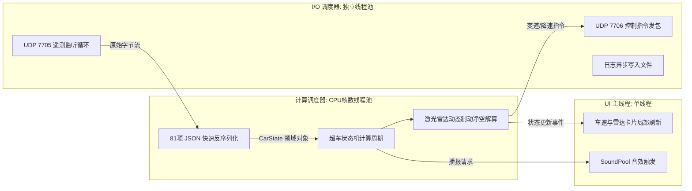
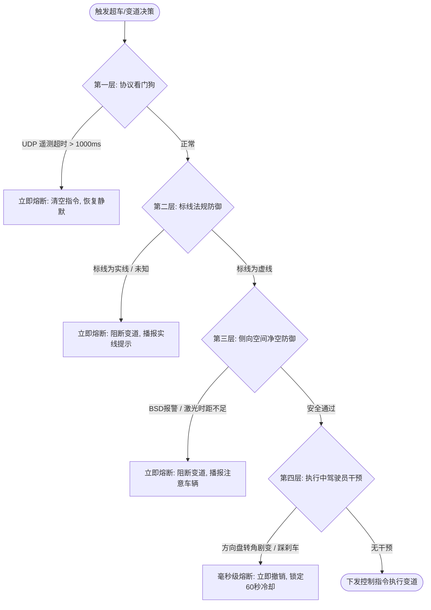

# 《07_软件架构设计说明书 (SAD)》

> **项目名称**：`AmapNavi-Reborn`  
> **文档版本**：V1.0  
> **面向对象**：系统架构师、研发工程师、下游开发智能体 (AI Coding Agents)  
> **设计基准**：整洁架构 (Clean Architecture)、单向数据流 (UDF)、故障安全 (Fail-safe)、Android 4.4.3 Dalvik 极限兼容  
> **编写日期**：2026-11-02  

---

## 目录

- [一、架构设计原则与约束](#一架构设计原则与约束)
- [二、系统逻辑架构与分层设计](#二系统逻辑架构与分层设计)
- [三、并发、线程模型与进程生命周期](#三并发线程模型与进程生命周期)
- [四、响应式数据流与领域状态机总线](#四响应式数据流与领域状态机总线)
- [五、故障安全 (Fail-safe) 与熔断降级架构](#五故障安全-fail-safe-与熔断降级架构)
- [六、跨版本 (Android 4.4 vs Android 9+) 双轨兼容架构](#六跨版本-android-44-vs-android-9-双轨兼容架构)
- [七、存储与日志异步分流架构](#七存储与日志异步分流架构)

---

## 一、架构设计原则与约束

### 1.1 核心设计原则
1. **依赖倒置与单向依赖 (Dependency Inversion)**：领域层（Domain Layer）是纯粹的业务实体与决策算法，严禁依赖 Android 平台特定组件（如 Activity、Context、View 等）。
2. **单向数据流 (Unidirectional Data Flow)**：状态由底层数据源（广播/UDP）产生，经过领域状态机聚合，单向流动至 UI 呈现层；UI 层只发动作（Actions/Events），不直接修改状态。
3. **故障安全设计 (Fail-safe by Default)**：任何传感器超时、通信断开、标线模糊，状态机默认跃迁至保守安全态（禁止变道）。
4. **轻量中继架构 (Thin Relay Architecture)**：针对库斯途 i.MX6（32位 ARM，1GB RAM）车机，彻底剥离端侧重型 AI 推理负担，车机仅做数据协议中继与状态判定，将重型视觉推理旁路给 C3，实现极低资源开销。

---

## 二、系统逻辑架构与分层设计

```
AmapNavi-Reborn 逻辑架构四层模型:
┌─────────────────────────────────────────────────────────────────┐
│ 1. 表现层 (Presentation Layer)                                  │
│  ├─ DashboardHUDActivity (仪表HUD / 双表盘 / 车道指引)          │
│  ├─ OvertakeDrawer (6卡片盲区雷达阵列)                          │
│  ├─ SettingsActivity (通用 / 领航 / 超车参数界面)               │
│  └─ SoundFeedbackManager (多通道低延迟音效调度器)               │
└───────────────────────────────▲─────────────────────────────────┘
                                │ StateFlow / 观察者单向通知
┌───────────────────────────────┴─────────────────────────────────┐
│ 2. 领域层 (Domain Layer) - 纯 Kotlin 算法与业务逻辑             │
│  ├─ OvertakeStateMachine (9 阶段自主超车核心状态机)             │
│  ├─ LateralSafetyEvaluator (多传感器融合制动净空防撞引擎)       │
│  ├─ LaneDecisionEngine (高德车道级推荐与变道意图决策)           │
│  └─ SpeedLimitPlanner (匝道平滑匀减速 / 隧道红灯控速曲线)       │
└───────────────────────────────▲─────────────────────────────────┘
                                │ 汇集状态事实 (Domain Models)
┌───────────────────────────────┴─────────────────────────────────┐
│ 3. 数据契约与传输层 (Data & Transport Layer)                   │
│  ├─ AmapBroadcastReceiver (高德标准广播解码与归一化)            │
│  ├─ CarrotUdpClient (7705 遥测接收 / 7706 控制下发)             │
│  ├─ DeviceDiscoveryService (5510 局域网组播握手发现)            │
│  └─ UserSettingsRepository (参数持久化抽象存储)                 │
└───────────────────────────────▲─────────────────────────────────┘
                                │ 硬件与系统能力
┌───────────────────────────────┴─────────────────────────────────┐
│ 4. 平台与兼容基础设施层 (Platform & Backport Layer)             │
│  ├─ KeepAliveService (前台通知保活守护进程)                    │
│  ├─ MultiDexApplication (Android 4.4 Dalvik 64K 分包引导)       │
│  └─ DesugarJdkLibs (Java 8 核心语言特性脱糖兼容层)              │
└─────────────────────────────────────────────────────────────────┘
```

---

## 三、并发、线程模型与进程生命周期

### 3.1 进程设计
- **单进程架构 (`:main`)**：整个应用运行在主进程中，通过前台服务（Foreground Service）挂载常驻通知栏，将进程 OOM 优先级提升至 `FOREGROUND_APP`（`adj = 0`），防止被 Android 4.4 LMK (Low Memory Killer) 杀死。

### 3.2 协程线程池划分 (Coroutines Dispatchers)
系统严格隔离 I/O、计算与 UI 渲染，防止车机单核性能瓶颈卡死主线程：



---

## 四、响应式数据流与领域状态机总线

### 4.1 单向状态总线
系统核心维护三个不可变的 `StateFlow`，作为全局状态总线：
1. `naviStateFlow: StateFlow<NaviState>`：高德导航产生的静态道路与车道引导状态；
2. `carStateFlow: StateFlow<CarState>`：C3 上报的车身动力学、前车雷达与盲区指标；
3. `overtakeStateFlow: StateFlow<OvertakeState>`：自主超车引擎当前阶段与决策原因。

### 4.2 状态机时钟节拍 (Tick-based Processing)
不同于事件驱动导致的偶发竞态，系统采用**时钟周期驱动 (Tick-based)**：
- 每接收到一个新的 UDP 遥测包（约 50ms~100ms），触发一次 `OvertakeStateMachine.tick(carState, naviState)`；
- 状态机在确定性的时钟片内依序执行：`超时检查` $\to$ `反向冷却检查` $\to$ `前车压速条件计算` $\to$ `侧向多传感器安全审计` $\to$ `动作下发/状态跃迁`。

---

## 五、故障安全 (Fail-safe) 与熔断降级架构

自动驾驶协同系统必须具备多层次的防御熔断架构：



1. **瞬时打断撤销通道**：一旦检测到驾驶员干预，不等待协程排队，直接通过专用的同步急停通道下发 `CANCEL_LANE_CHANGE`，并在车机端播放打断提示。
2. **反向变道物理冷却锁**：在完成一次超车后，强制锁定 20~60 秒，期间硬件层面禁止生成相反方向的变道请求，从数学根源上杜绝“画龙横跳”。

---

## 六、跨版本 (Android 4.4 vs Android 9+) 双轨兼容架构

为了让复刻系统既能在现代库斯途原厂 Android 4.4.3 上流畅运行，又能在高性能 Android 9.0+ 车机上发挥完整算力，架构采用**双轨自适应模式**：

| 架构切面 | 库斯途车机模式 (Android 4.4.3 / i.MX6) | 高性能车机模式 (Android 9.0+ / 高通8155) |
| :--- | :--- | :--- |
| **视觉车道线推理** | **旁路中继模式**：车机关闭本地 ONNX，由 C3 自带摄像头与骁龙 845 直接推理车道线，车机只接收结果。 | **本地推理模式**：车机挂载 USB 前视摄像头，本地运行 416×416 YOLO-seg ONNX 实例分割。 |
| **Dalvik 分包** | 采用 `MultiDexApplication`，通过预生成 Keep 类清单保证核心类常驻主 DEX。 | 原生 ART 自动 AOT 编译，无需关注 64K 限制。 |
| **内存管理** | 严格限制 Bitmap 缓存，图片复用 `inBitmap`，关闭窗口复杂过渡动画。 | 标准 AndroidX 视图动画与平滑高帧率渲染。 |
| **权限系统** | `targetSdkVersion 22`，安装即赋予全部权限，无权限弹窗阻断。 | 动态请求危险权限，优雅降级。 |

---

## 七、存储与日志异步分流架构

车机 eMMC 存储在频繁 I/O 时极易引起全系统卡顿（导致导航播报卡音）。为此，架构设计了专用的**内存环形缓冲异步写队列**：

```
日志与数据存储架构:
[业务模块产生Trace] ──> [ConcurrentLinkedQueue (无锁内存队列)]
                               │ (后台低优先级单线程消费)
                               ▼
                    [批量聚合为 4KB Buffer]
                               │
                               ▼ (每 2 秒或达到 4KB 时单次 flush)
                  [写入 /sdcard/logs/ 存储区]
```
- **双通道归档**：系统日志写入 `logs/app/`，超车决策日志独立写入 `logs/overtake/`；
- **自适应滚动覆盖**：单个日志文件最大限制 5MB，超过 5 个文件自动轮替删除最旧记录，严防挤占车机有限的存储空间。
