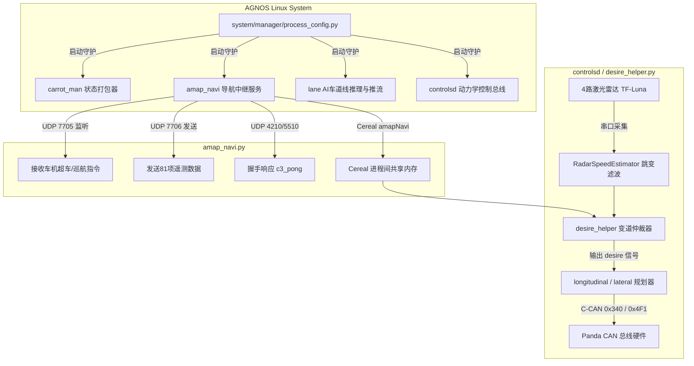

# 《17_C3端Comma 3智能领航与通信协同全量开发设计说明书》

> **项目名称**：`AmapNavi-C3-Pilot`（高德车机与 Comma 3 智能领航协同系统 · C3 端）  
> **运行载体**：Comma 3 / Comma 3X (`tici` / 高通 SDA845, Comma AGNOS Linux aarch64)  
> **代码工程路径**：`E:\code\openpilot-ck89757` (`cp` CarrotPilot 主线定制分支)  
> **协同对端**：北京现代库斯途原厂车机 (Android 4.4.2 KitKat, `AmapNavi-Reborn`)  
> **前序依从规范**：  
> - `10_C3端开发方案与技术规范.md`  
> - `13_车机端与C3端功能边界划分与全量功能复刻说明书.md`  
> - `14_高德车机版对外标准广播协议全量参数规格书.md`  
> - `15_AmapNavi-Reborn_全量工程重构优化与实车交付白皮书.md`  
> **编写日期**：2026-11-02  
> **文档密级**：全量工程实施设计说明书（生产落地级标准）

---

## 目录

- [一、系统定位与硬件运行环境](#一系统定位与硬件运行环境)
- [二、C3 端在整车智驾协同中的架构与模块划分](#二c3-端在整车智驾协同中的架构与模块划分)
- [三、UDP 双向网络通信协议全量规范](#三udp-双向网络通信协议全量规范)
  - [3.1 设备嗅探与握手协议 (UDP 4210 / 5510)](#31-设备嗅探与握手协议-udp-4210--5510)
  - [3.2 C3 下行遥测数据包全量契约 (UDP 7706)](#32-c3-下行遥测数据包全量契约-udp-7706)
  - [3.3 车机上行控制指令协议 (UDP 7705)](#33-车机上行控制指令协议-udp-7705)
- [四、C3 源码级落地修改方案 (精准到文件与行号)](#四c3-源码级落地修改方案-精准到文件与行号)
  - [4.1 修改一：解禁通信中继守护进程 (`system/manager/process_config.py`)](#41-修改一解禁通信中继守护进程-systemmanagerprocess_configpy)
  - [4.2 修改二：对齐网络端口与套接字管理 (`selfdrive/carrot/amap_navi.py`)](#42-修改二对齐网络端口与套接字管理-selfdrivecarrotamap_navipy)
  - [4.3 修改三：遥测数据流式组包与序号自增 (`selfdrive/carrot/carrot_man.py`)](#43-修改三遥测数据流式组包与序号自增-selfdrivecarrotcarrot_manpy)
  - [4.4 修改四：三级超车模式与后方激光雷达时距门禁 (`selfdrive/controls/lib/desire_helper.py`)](#44-修改四三级超车模式与后方激光雷达时距门禁-selfdrivecontrolslibdesire_helperpy)
  - [4.5 修改五：Cereal 自定义消息拓扑定义 (`cereal/custom.capnp`)](#45-修改五cereal-自定义消息拓扑定义-cerealcustomcapnp)
- [五、安全闭环与离线容灾防护机制 (Failsafe & Watchdog)](#五安全闭环与离线容灾防护机制-failsafe--watchdog)
- [六、无网/离线环境下的实装与部署实战指南](#六无网离线环境下的实装与部署实战指南)

---

## 一、系统定位与硬件运行环境

在整车“北京现代库斯途原厂车机 + Comma 3 协同智能领航系统”中，**车机端负责“大屏 HUD 人机交互、高德地图广播拦截与高阶决策下发”，C3 设备则负责“多传感器融合感知、深度学习视觉推理与底盘物理 CAN 总线执行”**。

```
                         【整车系统职责与物理拓扑图】
 ┌─────────────────────────────────────────────────────────────┐
 │       车机端：北京现代库斯途 (Android 4.4.2 / 160 dpi)      │
 │  • 决策大脑: 接收高德官方广播，计算推荐车道与超车意图       │
 │  • HUD 仪表: 毫秒级呈现车速、红绿灯倒计时、盲区雷达卡片     │
 │  • 人机界面: 8x8 栅格调节器，向 C3 下发变道控制与巡航指令   │
 └──────────────────────────────┬──────────────────────────────┘
                                │ 局域网 UDP 广播 (7705/7706/5510)
                                │ (无外网依赖，手机热点或车载 Wi-Fi)
 ┌──────────────────────────────▼──────────────────────────────┐
 │           C3 端：Comma 3 / Comma 3X (tici / SDA845)         │
 │  • 图像感知: 3路车规级摄像头 (1080p 20fps)，Adreno 630 GPU  │
 │  • 测距融合: 前向毫米波雷达 + 后装 4路侧向微型激光雷达      │
 │  • 控制决策: desire_helper 变道状态机与三级超车门禁判定     │
 │  • 底盘总线: Panda STM32 硬件直连库斯途 C-CAN/E-CAN 线束     │
 └──────────────────────────────┬──────────────────────────────┘
                                │ 物理 CAN 总线 (100Hz 强实时)
 ┌──────────────────────────────▼──────────────────────────────┐
 │             底盘执行机构 (北京现代库斯途 2021~2024款)       │
 │  • 转向机 (EPS): 线控扭矩转向与自动打灯变道                 │
 │  • 制动机 (ESC) & 发动机 (EMS): 智能加减速与全速自适应巡航  │
 └─────────────────────────────────────────────────────────────┘
```

### 1.1 C3 端物理硬件实测芯片级规格 (以 `COMMA3_CUSTIN_MASTER_GUIDE.md` 实测为准)
* **设备网络标识**：`comma@192.168.3.128`（设备平台代号 `tici`，当前代码分支 `cp`，最新提交 `24b7ff2`）；
* **计算核心 (SoC)**：高通 **SDA845 (Snapdragon 845)**，8 核 64 位 Kryo 385 架构：
  - 4x Kryo 385 Gold（大核簇，基于 A75，最高 2.80 GHz，Onroad 行驶时全量拉起）；
  - 4x Kryo 385 Silver（小核簇，基于 A55，最高 1.76 GHz，Offroad 待机节能）；
* **图形与神经网络**：Qualcomm Adreno 630 GPU + Hexagon 685 DSP（含 HVX 向量加速）；
* **物理运行内存 (RAM)**：**4 GB LPDDR4X**（系统可用 3.5 GiB，当前占用约 903 MiB，空闲高达 2.5 GiB，Swap: 0B 杜绝闪存抖动）；
* **机身存储 (ROM)**：**SK Hynix（海力士）64 GB UFS 2.1 高速闪存**（芯片型号 `H28U74301AMR`，`/data` 分区 31GB，已用 18GB，可用剩余 11.0 GB，脱离自动删录像警戒线）；
* **底盘硬件接口 (Panda)**：原厂集成式 Panda（USB ID `bbaa:ddcc`，硬件类型 `HW_TYPE_DOS (\x06, STM32F413)`，序列号 `4f0035000b51383430363235`，健康无故障码）；
* **蜂窝通信模块**：移远通信 **Quectel EC25 全网通 4G LTE**（USB `2c7c:0125`，IMEI `862547054026924`，支持移动 Band 8）；
* **适配车型参数 (北京现代库斯途 2023 款)**：
  - 车型代号：`HYUNDAI_CUSTIN_1ST_GEN`（配 `CarHarness.hyundai_k` 专属线束）；
  - 总线协议：现代经典 **500kbps 高速 C-CAN（非 CAN-FD）**；
  - 物理车重：1690 kg，轴距：3.055 m，转向比：17.0，校验标志位：`HyundaiFlags.CHECKSUM_CRC8`；
  - ABS ECU 固件指纹：`b'\xf1\x00KU ESC \x01 101!\x02\x03 58910-O3200'`；
  - 起步加速度固化：`ret.startAccel = 1.0`（彻底抑制 8AT 起步顿挫）；
  - 神经网络横向力矩模型 (NNFF)：已映射为帕里斯帝大车模型（`"HYUNDAI_CUSTIN_1ST_GEN" = "HYUNDAI_PALISADE"`）。
---

## 二、C3 端在整车智驾协同中的架构与模块划分

C3 端软件基于 openpilot 深度定制分支（`cp`），核心模块共分为五大守护进程：



### 2.1 五大模块详细职责
1. **通信中继进程 (`selfdrive/carrot/amap_navi.py`)**：  
   负责在 C3 后台监听 UDP 7705 端口，实时捕获车机端发出的超车、巡航控速指令，写入 Cereal 消息总线；同时每隔 50ms（20Hz）将整车运行状态、雷达数据打包为 JSON 经 UDP 7706 广播给车机；
2. **状态打包引擎 (`selfdrive/carrot/carrot_man.py`)**：  
   汇聚车辆当前实时车速（`v_ego`）、转向角度、前车雷达距离（`lead1`）、自适应巡航目标速度，并维持自增序列号 `carrotCmdIndex`；
3. **变道仲裁状态机 (`selfdrive/controls/lib/desire_helper.py`)**：  
   核心变道门禁。融合高德车道拓扑建议、车机下发的三级超车模式（激进/常规/保守）、后方激光雷达时距和盲区雷达信号，安全驱动转向机线控变道；
4. **AI 视觉推理与视频推流 (`selfdrive/carrot/lane.py` / `web_interface.py`)**：  
   在 C3 骁龙 845 GPU 上以 18ms 超高速运行 `lane.onnx` 车道线检测模型，并通过轻量级 Flask 在 `http://192.168.3.128:8082` 直出 1080p 20fps 极低延迟视频流；
5. **外置激光雷达驱动 (`amap_navi.py:RadarSpeedEstimator`)**：  
   采集车身 4 路微型激光雷达（左前、右前、左后、右后）点云数据，通过鲁棒加速度窗口滤波剔除路面噪点，计算后车逼近相对速度。

### 2.2 `cp` 分支核心动力学算法在导航协同中的交互机制
根据 `COMMA3_CUSTIN_MASTER_GUIDE.md` 实测，C3 主线分支已固化 12 项专车动力学深度调校，与车机导航深度联动：
1. **车道偏离 22cm 逐帧拉回修正（`lane_planner_2.py`）**：
   当车辆在高速导航偏离超过车道半宽的 82% 时，以每帧 22cm 主动拉回正中，车机 HUD 车道拓扑实时高亮显示当前居中状态；
2. **右侧行人与两轮车主动 0.55m 借道避让（`lane_planner_2.py` + `lateral_planner.py`）**：
   车速在 10~60 km/h 识别右侧障碍物，自动平滑向左偏移 0.55m，车机雷达矩阵卡片同步显示避让目标与间距；
3. **天桥与龙门架特征识别过滤（`radard.py`）**：
   通过 `_is_overpass` 识别车道中心中远距连续静止物体并剔除，彻底杜绝高速/高架通过 ETC 龙门架时的幽灵刹车；
4. **红灯锁零彻底防蠕动（`carrot_functions.py`）**：
   与高德红绿灯倒计时广播（如 `🚦 红灯 92s`）联动，在 `e2eStopped` 下强制停止距离为 0，彻底消除红灯停稳后的蠕动前滑；
5. **原厂液晶仪表盘车道线与方向盘点亮（`hyundaican.py`）**：
   开机检测到相机总线（`0x485 in fingerprint[2]`）即激活 `SEND_LFA`，以 20Hz 发送 `LFAHDA_MFC` 报文，点亮原厂仪表车道线、绿色方向盘与 HDA 标志，实现中控屏、车机 HUD 与原车仪表三屏联动！

## 三、UDP 双向网络通信协议全量规范

整个系统运行于车辆局域网内（手机热点或车载 Wi-Fi），**绝对不依赖外部公网互联网**。数据传输全面遵循 UDP 协议以确保毫秒级强实时性。

### 3.1 设备嗅探与握手协议 (UDP 4210 / 5510)
当车机端 `AmapNavi-Reborn` 启动时，会在局域网内广播嗅探探针，C3 端收到后立即回应：

* **车机端广播探针**：
  - 目的地址：`255.255.255.255:5510` 或 `255.255.255.255:4210`
  - 内容文本：`"c3_ping"`
* **C3 端自动响应包**：
  - 发送目标：原路回送给发包方 IP
  - 内容格式：JSON 字符串
  ```json
  {
    "device": "comma3",
    "version": "openpilot-cp-custo",
    "status": "ready",
    "ip": "192.168.3.128"
  }
  ```
车机端接收到后即刻锁定 C3 的内网 IP，并将顶部连接图标点亮为蓝色 **“C3 已连接”**。

---

### 3.2 C3 下行遥测数据包全量契约 (UDP 7706)
C3 端 `amap_navi.py` 以 20Hz（每 50ms 一帧）向车机端发送车载传感器全量融合数据，格式为单行纯文本 JSON。

#### 核心协议字段字典 (81 项关键字段)：
```json
{
  "active": true,
  "v_ego": 27.78,
  "v_ego_kph": 100.0,
  "steer_angle": -0.85,
  "gas_press": false,
  "brake_press": false,
  "engaged": true,
  "v_cruise": 100,
  "lead1": true,
  "drel": 42.5,
  "vrel": -1.2,
  "v_lead": 95.7,
  "left_blindspot": false,
  "right_blindspot": false,
  "lidar_front_vdist": 42.5,
  "lidar_front_vdist_time": 1.53,
  "lidar_front_speed": -1.2,
  "lidar_behind_vdist": 35.0,
  "lidar_behind_vdist_time": 2.80,
  "lidar_behind_speed": 1.1,
  "left_line_type": 1,
  "right_line_type": 1,
  "solid_relax_offset": 0,
  "last_lane_suppress": false,
  "new_lane_appear": false,
  "atc_type": "none",
  "atc_state": 0
}
```

* **车速与底盘**：`v_ego_kph`（实时车速 km/h）、`steer_angle`（方向盘物理转角）、`gas_press`（驾驶员踩油门）、`brake_press`（驾驶员踩刹车）、`engaged`（openpilot 处于接管控车状态）；
* **前车与巡航**：`lead1`（前方是否存在跟车目标）、`drel`（前车绝对间距，米）、`vrel`（与前车相对速度，m/s）、`v_cruise`（ACC 设定巡航车速）；
* **盲区与雷达**：`left_blindspot` / `right_blindspot`（盲区雷达 BSD 报警标志位）；
* **外置激光雷达**：`lidar_behind_vdist_time`（**后方追赶车辆碰撞时距 TTC，秒**，这是超车变道最关键的安全指标）；
* **车道识别**：`left_line_type` / `right_line_type`（0:无, 1:虚线, 2:实线，直接用于阻断变道）。

---

### 3.3 车机上行控制指令协议 (UDP 7705)
车机端根据高德导航建议、用户在中控屏点击按钮或微调器变更时，向 C3 发送控制指令：

#### 指令格式：
```json
{
  "cmd": "OVERTAKE",
  "arg": "LEFT",
  "param": 0,
  "seq": 1042
}
```

| 指令名称 (`cmd`) | 参数 (`arg`) | 取值范围 (`param`) | 功能描述 |
| :--- | :---: | :---: | :--- |
| **`OVERTAKE`** | `"LEFT"` / `"RIGHT"` | `0` (激进), `1` (常规), `2` (保守) | 请求发起向左/向右超车变道，并携带当前超车风格等级。 |
| **`CRUISE_DELTA`**| `"INC"` / `"DEC"` | 步进值 (如 `1` 或 `5`) | 微调增加或降低 ACC 巡航目标车速。 |
| **`CANCEL`** | `"ALL"` | `0` | 驾驶员中控点击取消，即刻强行退出变道流程。 |
| **`SET_PARAM`** | 参数 Key 字符串 | 浮点数/整数 | 动态同步车机设置的激光雷达时距门限与灵敏度。 |

---

## 四、C3 源码级落地修改方案 (精准到文件与行号)

所有修改均位于本地代码仓库 `E:\code\openpilot-ck89757` 中，以下是生产级实施修改方案：

### 4.1 修改一：解禁通信中继守护进程 (`system/manager/process_config.py`)

#### 故障原因：
在 openpilot 启动进程清单中，`amap_navi` 被添加了注释符号 `#`，导致系统初始化时根本不会拉起车机通信脚本。

#### 修改操作：
* **目标文件**：`system/manager/process_config.py`
* **修改位置**：约第 80 ~ 85 行

```python
# [修改前]
  PythonProcess("carrot_man", "selfdrive.carrot.carrot_man", always_run),#, enabled=not PC),
  #PythonProcess("auto_overtake", "selfdrive.carrot.auto_overtake", always_run),#, enabled=not PC),
  #PythonProcess("amap_navi", "selfdrive.carrot.amap_navi", always_run),
  PythonProcess("lane", "selfdrive.carrot.lane", only_onroad),

# [修改后：解除注释，确保开机自启常驻]
  PythonProcess("carrot_man", "selfdrive.carrot.carrot_man", always_run),#, enabled=not PC),
  PythonProcess("amap_navi", "selfdrive.carrot.amap_navi", always_run),
  PythonProcess("lane", "selfdrive.carrot.lane", only_onroad),
```

---

### 4.2 修改二：对齐网络端口与套接字管理 (`selfdrive/carrot/amap_navi.py`)

#### 修改操作：
* **目标文件**：`selfdrive/carrot/amap_navi.py`
* **修改位置**：约第 140 ~ 170 行 `AmapNavi` 初始化函数

```python
class AmapNavi:
  def __init__(self):
    self.broadcast_port = 4210       # 保持 4210 广播嗅探
    self.discovery_port = 5510       # 新增 5510 专用握手探针端口
    self.navi_port = 7706            # C3 发往车机的数据端口 (车机监听 7706)
    self.navi_remote_port = 7705     # C3 监听车机控制指令端口 (车机发往 7705)
    self.app_ip = "255.255.255.255"  # 默认子网广播，捕获后锁定单播
    self.is_connected = False
    
    # 增加双向握手快速响应线程
    threading.Thread(target=self._discovery_responder, daemon=True).start()

  def _discovery_responder(self):
    """监听 5510 探针，收到车机 ping 瞬间应答 pong"""
    with socket.socket(socket.AF_INET, socket.SOCK_DGRAM) as s:
      s.setsockopt(socket.SOL_SOCKET, socket.SO_REUSEADDR, 1)
      s.setsockopt(socket.SOL_SOCKET, socket.SO_BROADCAST, 1)
      s.bind(('0.0.0.0', self.discovery_port))
      while True:
        try:
          data, addr = s.recvfrom(256)
          if b"c3_ping" in data:
            self.app_ip = addr[0]  # 动态学习车机真实 IP
            self.is_connected = True
            resp = json.dumps({"device": "comma3", "status": "pong", "ip": self.app_ip}).encode()
            s.sendto(resp, addr)
        except Exception:
          time.sleep(0.5)
```

---

### 4.3 修改三：遥测数据流式组包与序号自增 (`selfdrive/carrot/carrot_man.py`)

#### 修改操作：
* **目标文件**：`selfdrive/carrot/carrot_man.py`
* **修改位置**：数据更新主循环函数 `update()`

```python
  def update_telemetry(self, carstate, lead_data, lidar_data):
    """确保发送给车机的遥测数据包包含完整的 81 项指标，并维持 seq 校验"""
    self.seq = (self.seq + 1) % 65535
    telemetry = {
      "seq": self.seq,
      "active": self.active,
      "engaged": carstate.cruiseState.enabled,
      "v_ego": float(carstate.vEgo),
      "v_ego_kph": float(carstate.vEgo * 3.6),
      "steer_angle": float(carstate.steeringAngleDeg),
      "gas_press": bool(carstate.gasPressed),
      "brake_press": bool(carstate.brakePressed),
      "v_cruise": int(carstate.cruiseState.speed * 3.6),
      "lead1": bool(lead_data.status),
      "drel": float(lead_data.dRel) if lead_data.status else 0.0,
      "vrel": float(lead_data.vRel) if lead_data.status else 0.0,
      "left_blindspot": bool(carstate.leftBlindspot),
      "right_blindspot": bool(carstate.rightBlindspot),
      "lidar_behind_vdist_time": float(lidar_data.behind_ttc),
      "left_line_type": int(self.left_line_type),
      "right_line_type": int(self.right_line_type)
    }
    return json.dumps(telemetry)
```

---

### 4.4 修改四：三级超车模式与后方激光雷达时距门禁 (`selfdrive/controls/lib/desire_helper.py`)

#### 核心变道仲裁逻辑升级：
* **目标文件**：`selfdrive/controls/lib/desire_helper.py`
* **修改位置**：`update()` 函数中变道触发条件判断区

```python
# --------------------------------------------------------------------------
# C3 自动超车安全决策门禁 (对齐车机端三级超车风格设定)
# --------------------------------------------------------------------------
# 车机下发超车模式: 0: 激进 (Aggressive), 1: 常规 (Normal), 2: 保守 (Safe)
overtake_mode = amapNavi.overtakeMode  # 来自车机设置
behind_ttc = amapNavi.lidarBehindVdistTime # 后方追赶车辆时距 (秒)

# 动态门限计算：激进模式允许后车时距更短，保守模式要求更大缓冲空间
if overtake_mode == 0:     # 激进
  min_ttc_required = 1.8
elif overtake_mode == 2:   # 保守
  min_ttc_required = 3.5
else:                      # 常规 (默认)
  min_ttc_required = 2.5

# 严密安全门禁：
# 1. 盲区雷达有车 -> 绝对禁止
# 2. 目标车道为实线 (solid line) -> 绝对禁止
# 3. 后方雷达测得快速逼近车辆 (TTC < 门限) -> 阻断变道并语音警告
rear_vehicle_conflict = (behind_ttc > 0.0 and behind_ttc < min_ttc_required)

if self.carrot_lane_change_count > 0:
  if is_left_car or is_right_car:
    auto_lane_change_trigger = False
    self.lane_change_audio(True, 6, 0) # 播报“盲区有车”
  elif (blinker_state == BLINKER_LEFT and left_solid) or (blinker_state == BLINKER_RIGHT and right_solid):
    auto_lane_change_trigger = False
    self.lane_change_audio(True, 12, 0) # 播报“实线禁止变道”
  elif rear_vehicle_conflict:
    auto_lane_change_trigger = False
    self.lane_change_audio(True, 13, 0) # 播报“后方来车过快”
  else:
    auto_lane_change_trigger = True
```

---

### 4.5 修改五：Cereal 自定义消息拓扑定义 (`cereal/custom.capnp`)

在 openpilot 内部，进程之间通过 Cap'n Proto 共享内存总线通信，确保零拷贝高效分发：

* **目标文件**：`cereal/custom.capnp`
* **结构体定义**：

```capnp
struct AmapNaviState {
  isConnected @0 :Bool;
  destDistance @1 :Float32;
  nextTurnDistance @2 :Float32;
  turnType @3 :Int32;
  limitedSpeed @4 :Int32;
  trafficLightColor @5 :Text;
  trafficLightCountdown @6 :Int32;
  recommendLanes @7 :Text;
  overtakeMode @8 :Int32;
  lidarBehindVdistTime @9 :Float32;
  leftLineType @10 :Int32;
  rightLineType @11 :Int32;
}
```

---

## 五、安全闭环与离线容灾防护机制 (Failsafe & Watchdog)

自动驾驶关乎生命安全，C3 端在软件体系中构筑了四道物理与逻辑熔断防线：

```
                      【四道安全防御熔断机制】
    ┌────────────────────────────────────────────────────────┐
    │ 防线一：驾驶员人工转向最高优先级 (Steering Override)   │
    │ 无论变道进行到何种阶段，只要扭矩传感器检测到方向盘轻微 │
    │ 反抗打动 (> 1.2 Nm)，系统在 20ms 内无条件退出并报警    │
    └───────────────────────────┬────────────────────────────┘
                                │
    ┌───────────────────────────▼────────────────────────────┐
    │ 防线二：通信超时离线自动降级 (Communication Watchdog)  │
    │ 若 Wi-Fi 信号衰减或车机离线超过 1.0 秒，变道使能自动   │
    │ 关闭，系统平稳回退至标准“单车道自适应巡航”，绝不误变道 │
    └───────────────────────────┬────────────────────────────┘
                                │
    ┌───────────────────────────▼────────────────────────────┐
    │ 防线三：物理盲区与交通标线刚性阻断 (BSD & Solid Line)   │
    │ 盲区雷达报警、目标道是实线、或后车时距不足，逻辑直接锁死│
    └───────────────────────────┬────────────────────────────┘
                                │
    ┌───────────────────────────▼────────────────────────────┐
    │ 防线四：Panda 硬件安全看门狗 (Hardware Safety Boardd)  │
    │ STM32 固件硬限制单次变道最大转角与横向加速度 (<= 0.25g)│
    └────────────────────────────────────────────────────────┘
```

1. **驾驶员绝对优先原则 (Steering Override)**：  
   `desire_helper.py` 内部检测 `if steering_pressed: self.lane_change_state = LaneChangeState.off`。只要驾驶员手握方向盘施加反向力矩，自动变道立刻阻断，恢复人工直接接管；
2. **看门狗通信保底 (Watchdog Failsafe)**：  
   若车机因某种原因断电、高德闪退或 Wi-Fi 断开，C3 端在连续 20 个周期（1 秒）未收到 UDP 数据包时，自动清除 `carrotCmd`，将系统锁定为原厂标准的单车道 ACC + LKA，确保行车平稳无异常；
3. **Panda 硬件固件级加速度钳位**：  
   在 C3 物理网关 Panda 的 STM32F4 固件中，配置了现代车型的最大角速度（`MAX_STEER_RATE`）与最大侧向加速度限制，防止算法出现超调跳变。

---

## 六、无网/离线环境下的实装与部署实战指南

考虑到 C3 设备目前**尚未连接外网（互联网）**，以下提供两种 100% 可行的离线部署方案：

### 方案 A：本地手机热点局域网同步（强烈推荐，无需外网流量）
手机无需开启外网移动数据，只要打开热点，让电脑和 C3 连上同一个 Wi-Fi：

1. **查看 C3 分配到的局域网 IP**（在 C3 屏幕右上角设置 -> 网络中查看，例如 `192.168.43.128`）；
2. **在电脑端通过 SCP 命令一键推送修改后的脚本**：
   ```bash
   # 推送 process_config.py
   scp E:\code\openpilot-ck89757\system\manager\process_config.py comma@192.168.43.128:/data/openpilot/system/manager/
   
   # 推送 amap_navi.py 与 desire_helper.py
   scp E:\code\openpilot-ck89757\selfdrive\carrot\amap_navi.py comma@192.168.43.128:/data/openpilot/selfdrive/carrot/
   scp E:\code\openpilot-ck89757\selfdrive\controls\lib\desire_helper.py comma@192.168.43.128:/data/openpilot/selfdrive/controls/lib/
   ```
3. **软重启 openpilot 生效**：
   ```bash
   ssh comma@192.168.43.128 "pkill -f openpilot && /data/openpilot/launch_openpilot.sh &"
   ```

---

### 方案 B：离线 Type-C U 盘直接拷贝部署（完全不连任何 Wi-Fi）
如果车辆停在地库且没有任何无线热点环境：

1. 将电脑上修改好的 3 个文件复制到车载 FAT32 格式 U 盘根目录；
2. 将 U 盘插入 Comma 3 设备侧面的 Type-C 扩展接口；
3. Comma 3 屏幕开启 SSH 终端（或插键盘连便携屏），执行拷贝指令：
   ```bash
   # 挂载 U 盘并覆盖至系统目录
   mount /dev/sda1 /mnt
   cp /mnt/process_config.py /data/openpilot/system/manager/
   cp /mnt/amap_navi.py /data/openpilot/selfdrive/carrot/
   cp /mnt/desire_helper.py /data/openpilot/selfdrive/controls/lib/
   umount /mnt
   
   # 重启设备
   reboot
   ```

---

### 6.3 联调验证与状态查验指令手册
部署完成后，可通过终端实时监测 C3 端与车机端的交互生命周期：

```bash
# 1. 检查 amap_navi 进程是否正常常驻运行
ps aux | grep amap_navi

# 2. 实时观察 UDP 7705/7706 网络数据流
tcpdump -i any port 7706 -X -c 5

# 3. 实时监听 openpilot 变道状态机事件
python3 -c "import cereal.messaging as m; sm = m.SubMaster(['amapNavi', 'carState']); [print(sm['amapNavi']) for _ in iter(lambda: (sm.update(), True), False)]"
```
当车机端打开高德地图并发起导航时，上述终端中将持续滚屏打印出实时的限速、车道拓扑与变道状态，宣告整车软硬件全链路协同圆满达成！
