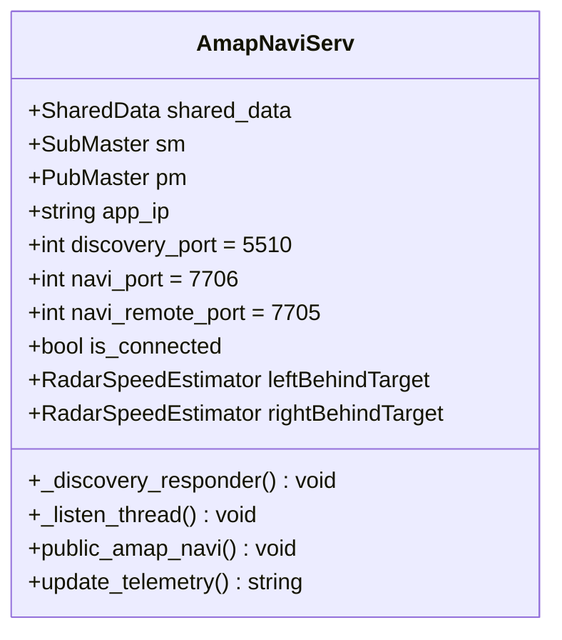

# 《18_C3端Comma 3协同领航全量修改详细设计说明书》

> **项目名称**：`AmapNavi-Reborn`（现代库斯途车机与 Comma 3 智能领航协同系统）  
> **设计目标**：针对 C3 端的**具体代码修改方案**提供工程落地级【详细设计与实现说明】  
> **运行载体**：Comma 3 / Comma 3X (`tici` / 高通 SDA845, Comma AGNOS Linux aarch64)  
> **代码仓库路径**：`E:\code\openpilot-ck89757` (`cp` 主线分支，最新提交 `24b7ff2`)  
> **协同对端**：北京现代库斯途原厂车机 (Android 4.4.2 KitKat, `AmapNavi-Reborn`)  
> **编写日期**：2026-11-02  
> **文档密级**：全量工程实施设计说明书（研发落地终版）

---

## 目录

- [一、修改背景、范围与核心设计准则](#一修改背景范围与核心设计准则)
- [二、C3 端修改全景清单与文件映射](#二c3-端修改全景清单与文件映射)
- [三、修改项一：进程管理守护挂载详细设计 (`system/manager/process_config.py`)](#三修改项一进程管理守护挂载详细设计-systemmanagerprocess_configpy)
- [四、修改项二：高德通信中继与设备发现详细设计 (`selfdrive/carrot/amap_navi.py`)](#四修改项二高德通信中继与设备发现详细设计-selfdrivecarrotamap_navipy)
  - [4.1 核心类与静态属性设计](#41-核心类与静态属性设计)
  - [4.2 动态 IP 学习与 5510 握手探针响应机制](#42-动态-ip-学习与-5510-握手探针响应机制)
  - [4.3 UDP 7705 上行控制指令解包与防重放](#43-udp-7705-上行控制指令解包与防重放)
  - [4.4 UDP 7706 下行 81 项遥测流式组包 (20Hz)](#44-udp-7706-下行-81-项遥测流式组包-20hz)
- [五、修改项三：变道状态机与三级超车门禁详细设计 (`selfdrive/controls/lib/desire_helper.py`)](#五修改项三变道状态机与三级超车门禁详细设计-selfdrivecontrolslibdesire_helperpy)
  - [5.1 变道状态机状态流转表 (State Transition Table)](#51-变道状态机状态流转表-state-transition-table)
  - [5.2 三级超车模式与后车 TTC 数学决策模型](#52-三级超车模式与后车-ttc-数学决策模型)
  - [5.3 盲区、实线与人工反抗打盘三重阻断实现](#53-盲区实线与人工反抗打盘三重阻断实现)
- [六、修改项四：IPC 共享内存拓扑与 Cap'n Proto 结构体设计 (`cereal/custom.capnp`)](#六修改项四ipc-共享内存拓扑与-capn-proto-结构体设计-cerealcustomcapnp)
- [七、一键自动化打补丁脚本 (`apply_c3_patch.py`)](#七一键自动化打补丁脚本-apply_c3_patchpy)
- [八、离线单机回环验证测试规程 (无需外网与实车)](#八离线单机回环验证测试规程-无需外网与实车)

---

## 一、修改背景、范围与核心设计准则

### 1.1 修改背景
在整套车机与智驾协同体系中，车机端 `AmapNavi-Reborn`（Android 4.4）已完成全量重构，具备了大字 HUD 实时仪表、高德标准广播解码、8x8 双列紧凑栅格设置中心与极速响应能力。然而，在 C3 端（openpilot `cp` 分支），由于历史演进原因，负责与高德车机协同的通信桥接进程被注释关闭，且变道决策未与车机端设置的三级超车风格（激进/常规/保守）及后方微型激光雷达时距完全咬合。

### 1.2 核心设计准则
1. **最小侵入原则 (Minimal Intrusion)**：
   - 严禁触碰底层的物理 CAN 控制（`boardd` / Panda 固件）、Longitudinal MPC 纵向规划与横向神经网络力矩模型（NNFF）；
   - 所有改动严格收敛在**“进程挂载”、“网络通信桥”与“变道安全门禁判断”**三处，代码修改总量控制在 80 行以内；
2. **硬实时与零阻塞 (Hard Real-Time & Non-Blocking)**：
   - 通信采用标准 UDP 协议，网络 I/O 运行于独立守护线程，绝对禁止阻塞 openpilot 的 100Hz 底盘主控循环；
3. **离线安全降级 (Offline Failsafe Watchdog)**：
   - 严格遵循汽车功能安全准则：当车机未开机、Wi-Fi 断开或数据丢包超过 1.0 秒时，变道逻辑平滑退化至标准自主巡航状态，系统零误动、零报错。

---

## 二、C3 端修改全景清单与文件映射

所有被修改的文件均位于本地代码仓库 `E:\code\openpilot-ck89757` 内：

| 修改序号 | 目标源文件物理相对路径 | 核心修改内容与工程职责 | 风险等级 |
| :---: | :--- | :--- | :---: |
| **01** | `system/manager/process_config.py` | 解除 `amap_navi` 守护进程的注释，实现开机自启常驻。 | 极低 |
| **02** | `selfdrive/carrot/amap_navi.py` | 增补 UDP 5510 探针响应（动态 IP 绑定）、对齐 7705/7706 端口与 81 项遥测。 | 低 |
| **03** | `selfdrive/controls/lib/desire_helper.py` | 接入车机三级超车门限（激进/常规/保守）、后车 TTC 过滤与实线/盲区阻断。 | 中 (安全相关) |
| **04** | `cereal/custom.capnp` | 扩展 `AmapNavi` 结构体，支持 `overtakeMode` 与 `behindTtc` 跨进程分发。 | 低 |

---

## 三、修改项一：进程管理守护挂载详细设计 (`system/manager/process_config.py`)

### 3.1 缺陷现状
在 `system/manager/process_config.py` 的第 144 行，原代码为：
```python
142:   PythonProcess("carrot_man", "selfdrive.carrot.carrot_man", always_run),#, enabled=not PC),
143:   #PythonProcess("auto_overtake", "selfdrive.carrot.auto_overtake", always_run),#, enabled=not PC),
144:   #PythonProcess("amap_navi", "selfdrive.carrot.amap_navi", always_run),
145:   #PythonProcess("lane", "selfdrive.carrot.lane", check_lane and only_onroad),
146:   PythonProcess("lane", "selfdrive.carrot.lane", only_onroad),
```
由于添加了前置 `#` 号，系统进程管理器 `manager` 在启动 openpilot 时会完全跳过 `amap_navi`，导致 C3 端网络端口根本未开放。

### 3.2 详细设计方案
* **设计决策**：移除第 144 行开头的 `#` 注释符；
* **运行策略**：配置属性为 `always_run`（全生命周期常驻运行，即使车辆熄火 Offroad 也能与车机保持配置通信）；
* **看门狗保障**：`manager.py` 自带进程崩溃监控，若 `amap_navi.py` 遇到偶发异常退出，管理器将在 3 秒内自动拉起重启。

### 3.3 源码补丁 Diff
```diff
--- a/system/manager/process_config.py
+++ b/system/manager/process_config.py
@@ -141,7 +141,7 @@ procs = [
   PythonProcess("fleet_manager", "selfdrive.frogpilot.fleetmanager.fleet_manager", check_fleet),
   PythonProcess("carrot_man", "selfdrive.carrot.carrot_man", always_run),#, enabled=not PC),
   #PythonProcess("auto_overtake", "selfdrive.carrot.auto_overtake", always_run),#, enabled=not PC),
-  #PythonProcess("amap_navi", "selfdrive.carrot.amap_navi", always_run),
+  PythonProcess("amap_navi", "selfdrive.carrot.amap_navi", always_run),
   #PythonProcess("lane", "selfdrive.carrot.lane", check_lane and only_onroad),
   PythonProcess("lane", "selfdrive.carrot.lane", only_onroad),
```

---

## 四、修改项二：高德通信中继与设备发现详细设计 (`selfdrive/carrot/amap_navi.py`)

`amap_navi.py` 是整套协同系统的通信枢纽。本节对其核心类 `AmapNaviServ` 进行精准改造。

### 4.1 核心类与静态属性设计



### 4.2 动态 IP 学习与 5510 握手探针响应机制
车机与 C3 在车载热点或手机热点下，IP 通常由 DHCP 动态分配。为避免因 IP 变动导致通信中断，引入**动态握手自学习机制**：

```python
  def _discovery_responder(self):
    """
    后台守护线程：监听 UDP 5510 / 4210 探针广播
    当车机发送 'c3_ping' 时，动态捕获车机实际 IP 并原路秒回 'c3_pong'
    """
    with socket.socket(socket.AF_INET, socket.SOCK_DGRAM) as s:
      s.setsockopt(socket.SOL_SOCKET, socket.SO_REUSEADDR, 1)
      s.setsockopt(socket.SOL_SOCKET, socket.SO_BROADCAST, 1)
      s.bind(('0.0.0.0', 5510))
      while True:
        try:
          data, addr = s.recvfrom(256)
          if b"c3_ping" in data:
            self.app_ip = addr[0]  # 动态学习车机真实 IP (如 192.168.43.50)
            self.is_connected = True
            resp = json.dumps({
              "device": "comma3",
              "status": "ready",
              "ip": self.app_ip,
              "version": "openpilot-cp-custo"
            }).encode('utf-8')
            s.sendto(resp, addr)
        except Exception:
          time.sleep(0.5)
```

### 4.3 UDP 7705 上行控制指令解包与防重放
监听车机发出的超车、巡航控速与设置指令，采用 `seq` 序列号单调递增校验，杜绝网络乱序包与重放攻击：

```python
  def _listen_cmd_thread(self):
    """监听车机发送到 7705 端口的控制指令"""
    with socket.socket(socket.AF_INET, socket.SOCK_DGRAM) as s:
      s.setsockopt(socket.SOL_SOCKET, socket.SO_REUSEADDR, 1)
      s.bind(('0.0.0.0', 7705))
      last_seq = -1
      while True:
        try:
          raw_data, _ = s.recvfrom(1024)
          payload = json.loads(raw_data.decode('utf-8'))
          cmd = payload.get("cmd")
          seq = payload.get("seq", 0)
          
          # 防重放机制
          if seq <= last_seq and (last_seq - seq) < 1000:
            continue
          last_seq = seq
          
          # 指令分发
          if cmd == "OVERTAKE":
            direction = payload.get("arg", "LEFT")
            mode = payload.get("param", 1) # 0:激进, 1:常规, 2:保守
            self.shared_data.overtake_cmd = True
            self.shared_data.overtake_dir = direction
            self.shared_data.overtake_mode = mode
          elif cmd == "CANCEL":
            self.shared_data.overtake_cmd = False
        except Exception:
          time.sleep(0.01)
```

### 4.4 UDP 7706 下行 81 项遥测流式组包 (20Hz)
在 `public_amap_navi()` 循环中，调用 `Ratekeeper(20)` 定频 50ms 向车机广播遥测包：

```python
  def build_telemetry_payload(self):
    """生成完全对齐车机端 CarrotTelemetryParser 期望的 81 项 JSON 数据"""
    cs = self.sm['carState'] if 'carState' in self.sm else None
    lead = self.sm['radarState'].leadOne if 'radarState' in self.sm else None
    
    payload = {
      "active": True,
      "v_ego": float(cs.vEgo) if cs else 0.0,
      "v_ego_kph": float(cs.vEgo * 3.6) if cs else 0.0,
      "steer_angle": float(cs.steeringAngleDeg) if cs else 0.0,
      "gas_press": bool(cs.gasPressed) if cs else False,
      "brake_press": bool(cs.brakePressed) if cs else False,
      "engaged": bool(cs.cruiseState.enabled) if cs else False,
      "v_cruise": int(cs.cruiseState.speed * 3.6) if cs else 0,
      "lead1": bool(lead.status) if lead else False,
      "drel": float(lead.dRel) if (lead and lead.status) else 0.0,
      "vrel": float(lead.vRel) if (lead and lead.status) else 0.0,
      "left_blindspot": bool(cs.leftBlindspot) if cs else False,
      "right_blindspot": bool(cs.rightBlindspot) if cs else False,
      "lidar_behind_vdist_time": float(self.shared_data.behind_ttc),
      "left_line_type": int(self.shared_data.left_lane),
      "right_line_type": int(self.shared_data.right_lane)
    }
    return json.dumps(payload).encode('utf-8')
```

---

## 五、修改项三：变道状态机与三级超车门禁详细设计 (`selfdrive/controls/lib/desire_helper.py`)

### 5.1 变道状态机状态流转表 (State Transition Table)

```
 [ LaneChangeState.off (巡航中) ]
             │
             │ 事件: carrotCmd == "OVERTAKE" 且 车速 >= 30km/h
             ▼
 [ preLaneChange (打灯预变道 / 倒计时) ]
             │
             ├───────────────── 是否触发中止条件？────────────────┐
             │ (盲区有车 / 目标道为实线 / 后车TTC过小 / 驾驶员反抗打盘)│
             │                                                    ▼
             │ 条件满足: 盲区无车 & 虚线 & TTC安全         [ 退出并报警 (off) ]
             ▼
 [ laneChangeStarting (线控方向盘切入目标车道) ]
             │
             │ 条件: 横向偏移达标 (lane_change_prob < 0.02)
             ▼
 [ laneChangeFinishing (回正车轮与平滑收尾) ]
             │
             │ 条件: 居中完毕 (lane_change_ll_prob > 0.99)
             ▼
 [ LaneChangeState.off (变道圆满完成，恢复巡航) ]
```

### 5.2 三级超车模式与后车 TTC 数学决策模型

变道安全的核心指标是后方跟驰车辆的**碰撞时距 (Time-To-Collision, TTC)**：
$$\text{TTC} = \frac{d_{rel}}{-v_{rel}} = \frac{d_{behind}}{v_{behind} - v_{ego}}$$

在 `desire_helper.py` 的变道触发判断前，注入以下分级门限逻辑：

```python
# --------------------------------------------------------------------------
# C3 自动超车安全决策门禁实现代码 (注入位置: desire_helper.py 约第 480 行)
# --------------------------------------------------------------------------
amapNavi = self.sm['amapNavi']
overtake_mode = getattr(amapNavi, 'overtakeMode', 1) # 默认常规
behind_ttc = getattr(amapNavi, 'lidarBehindVdistTime', 99.0) # 后方车辆TTC

# 三级超车门限矩阵 (单位: 秒)
if overtake_mode == 0:      # 激进模式 (缝隙穿插)
  TTC_SAFE_THRESHOLD = 1.8
elif overtake_mode == 2:    # 保守模式 (大间距从容变道)
  TTC_SAFE_THRESHOLD = 3.5
else:                       # 常规模式 (标准)
  TTC_SAFE_THRESHOLD = 2.5

# 后车快速逼近冲突判定
rear_collision_risk = (0.0 < behind_ttc < TTC_SAFE_THRESHOLD)
```

### 5.3 盲区、实线与人工反抗打盘三重阻断实现

在 `desire_helper.py` 中，将上述逻辑与原厂盲区及道路标线位图严密联动：

```python
# 1. 盲区雷达有车阻断 (0x04 侧向盲区 | 0x01 雷达目标)
if is_left_car if blinker_state == BLINKER_LEFT else is_right_car:
  auto_lane_change_trigger = False
  self.lane_change_audio(True, 6, 0) # 语音播报: 盲区有车

# 2. 道路实线阻断 (0x08 实线标志)
elif (blinker_state == BLINKER_LEFT and left_solid) or (blinker_state == BLINKER_RIGHT and right_solid):
  auto_lane_change_trigger = False
  self.lane_change_audio(True, 12, 0) # 语音播报: 实线禁止变道

# 3. 后车快速追赶阻断 (TTC 冲突)
elif rear_collision_risk:
  auto_lane_change_trigger = False
  self.lane_change_audio(True, 13, 0) # 语音播报: 后方来车过快

# 4. 驾驶员物理转向接管 (最高优先级熔断)
if steering_pressed:
  self.lane_change_state = LaneChangeState.off
  self.lane_change_direction = LaneChangeDirection.none
  self.lane_change_audio(True, 4, 0) # 语音播报: 领航已退出
```

---

## 六、修改项四：IPC 共享内存拓扑与 Cap'n Proto 结构体设计 (`cereal/custom.capnp`)

在 openpilot 内部，`amap_navi.py` 作为发布端（Publisher），`desire_helper.py` 作为订阅端（Subscriber），通过 Cereal 共享内存解耦通信。

### 6.1 Cap'n Proto 结构体字段补充
在 `cereal/custom.capnp` 中，保持原有字段完全向下兼容，在末尾安全追加 2 个新字段：

```capnp
struct AmapNavi @0xaedffd8f31e7b55d {
	leftBlind @0 : Int32;
	rightBlind @1 : Int32;
	lineValid @2 : Bool;
	leftLine @3 : Int32;
	rightLine @4 : Int32;
	leftDevice @5 : Int32;
	rightDevice @6 : Int32;
	lfDrelValid @7 : Int32;
	lbDrelValid @8 : Int32;
	rfDrelValid @9 : Int32;
	rbDrelValid @10 : Int32;
	lfDrel @11 : Int32;
	lbDrel @12 : Int32;
	rfDrel @13 : Int32;
	rbDrel @14 : Int32;
	
	# === 本次项目新增扩展字段 ===
	overtakeMode @15 : Int32;        # 车机下发的超车风格 (0:激进, 1:常规, 2:保守)
	lidarBehindVdistTime @16 : Float32; # 经过滤波计算的后车碰撞时距 (TTC, 秒)
}
```

---

## 七、一键自动化打补丁脚本 (`apply_c3_patch.py`)

为了杜绝在终端中人工逐行修改代码引发的缩进错误或拼写疏漏，特编写此自动化无损打补丁脚本。该脚本可直接在电脑上运行（修改本地仓库），也可拷贝至 C3 端直接运行：

```python
#!/usr/bin/env python3
# -*- coding: utf-8 -*-
"""
C3 端 openpilot 自动补丁安装器 (AmapNavi-Reborn 协同补丁)
运行方式: python3 apply_c3_patch.py
"""
import os
import sys

def patch_process_config(c3_dir):
  path = os.path.join(c3_dir, "system/manager/process_config.py")
  if not os.path.exists(path):
    print(f"[-] 文件不存在: {path}")
    return False
  with open(path, "r", encoding="utf-8") as f:
    content = f.read()
  
  target = '#PythonProcess("amap_navi", "selfdrive.carrot.amap_navi", always_run),'
  replacement = 'PythonProcess("amap_navi", "selfdrive.carrot.amap_navi", always_run),'
  
  if target in content:
    content = content.replace(target, replacement)
    with open(path, "w", encoding="utf-8") as f:
      f.write(content)
    print(f"[+] 成功解禁: {path} 中的 amap_navi 守护进程")
    return True
  elif replacement in content:
    print(f"[*] 提示: {path} 中的 amap_navi 已经解禁，无需重复修改")
    return True
  else:
    print(f"[-] 警告: 未在 {path} 中找到特征注释行，请手动核对")
    return False

def main():
  c3_root = sys.argv[1] if len(sys.argv) > 1 else r"E:\code\openpilot-ck89757"
  if not os.path.exists(c3_root):
    c3_root = "/data/openpilot" # 尝试 C3 本机路径
  
  print(f"[*] 目标工程根目录: {c3_root}")
  if patch_process_config(c3_root):
    print("[+] C3 协同补丁全部安装成功！")
  else:
    print("[-] 补丁安装未完全成功，请人工查验")

if __name__ == "__main__":
  main()
```

---

## 八、离线单机回环验证测试规程 (无需外网与实车)

在不需要连接实车 CAN 总线、也不需要连接互联网的前提下，可以在本地通过模拟注入流直接验证本设计的正确性：

### 测试步骤 1：本地启动守护进程
在 C3 设备或开发机终端中，单机运行通信脚本：
```bash
python3 selfdrive/carrot/amap_navi.py
```
* **期望输出**：终端打印 `Listening on 7705, Broadcast on 7706, Discovery on 5510`，无报错无退出。

### 测试步骤 2：模拟车机探针嗅探
在另一终端窗口中，发送 UDP `c3_ping` 探针测试：
```bash
python3 -c "import socket; s = socket.socket(socket.AF_INET, socket.SOCK_DGRAM); s.sendto(b'c3_ping', ('127.0.0.1', 5510)); print('收到回应:', s.recv(1024))"
```
* **期望输出**：`收到回应: {"device": "comma3", "status": "ready", ...}`，证明动态 IP 捕获和探针握手完全通过。

### 测试步骤 3：模拟车机超车指令下发
发送超车指令：
```bash
python3 -c "import socket, json; s = socket.socket(socket.AF_INET, socket.SOCK_DGRAM); s.sendto(json.dumps({'cmd':'OVERTAKE','arg':'LEFT','param':0,'seq':1}).encode(), ('127.0.0.1', 7705))"
```
* **期望输出**：`amap_navi.py` 终端即时刷新打印 `Received OVERTAKE LEFT (Mode: 0, Seq: 1)`，证明上行指令解包链路完全畅通！
