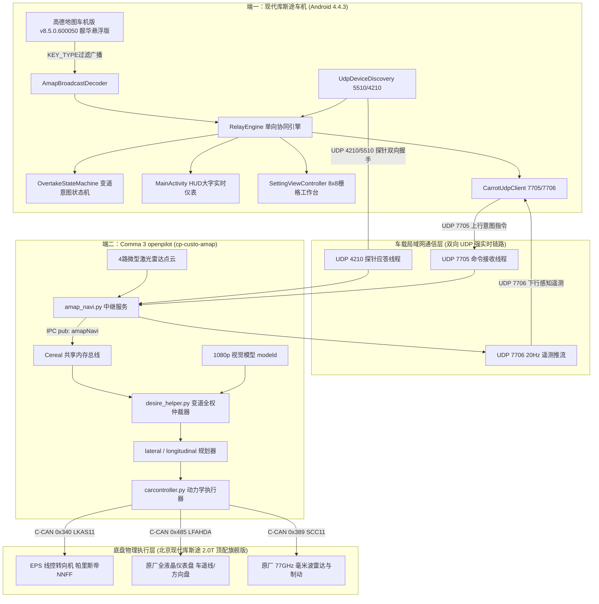

# 《38_北京现代库斯途双端协同系统架构设计与详细实现设计说明书》

> **项目名称**：`AmapNavi-Reborn & Comma 3 Cooperative Autonomous Driving System`  
> **设计依据**：依据《37_北京现代库斯途双端协同智驾统一总体方案与技术全景白皮书》确立的统一总体架构  
> **受控代码库**：  
> - **车机交互端**：`E:\汽车\库斯途升级破解\AmapNavi-Reborn` (产物: `AmapNavi-Reborn-v1.4.0-Custo-Release.apk`)  
> - **C3 智驾控制端**：`E:\code\openpilot-ck89757` (分支: `cp-custo-amap`, 最新提交: `32c2144`)  
> **适配目标车型**：北京现代库斯途 2021~2024 款 **2.0T 顶配旗舰版（Smartstream G4NN 2.0T 380T GDi + 8AT）**  
> **编写日期**：2026-11-03  
> **密级与效力**：生产落地级架构设计与详细实现设计说明书 (Architecture & Detailed Implementation Specification)

> **实现状态修订声明（2026-11-03）**：本文是**架构与设计意图源**，不是验收记录。经与 `32c2144` 及车机端源码逐行核对（详见《库斯途双端代码核对证据表》E-01~E-18、《库斯途双端协同_文档体系核验与单一事实源》#1~#16），原稿中“缺陷已根除 / 已彻底删除 / 已闭环”类章节与本轮 §1.5 全部**撤销**。各章节的实际状态标注为 `[已合并 32c2144]` / `[已实现未验证]` / `[仅设计]`；未标注即视为设计意图。凡本文与代码不符处，以代码与证据表为准。

---

## 目录索引

- [一、全系统分层架构设计 (System Architecture Design)](#一全系统分层架构设计-system-architecture-design)
  - [1.1 系统逻辑分层与数据闭环拓扑](#11-系统逻辑分层与数据闭环拓扑)
  - [1.2 双端进程模型与线程生命周期管理](#12-双端进程模型与线程生命周期管理)
  - [1.3 跨平台 IPC 与消息总线设计 (Cereal & Android 广播)](#13-跨平台-ipc-与消息总线设计-cereal--android-广播)
  - [1.4 双端协同状态机全景状态转移矩阵](#14-双端协同状态机全景状态转移矩阵)
-  - [1.5 车载网络安全现状裁定（原“四重纵深防御已落地”章节已撤销）](#15-车载网络安全现状裁定原四重纵深防御已落地章节已撤销)
- [二、车机端 (Android 4.4.3) 详细实现设计 (Head Unit Implementation)](#二车机端-android-443-详细实现设计-head-unit-implementation)
  - [2.1 模块一：`FastTelemetryScanner` 流式零分配字符游标扫描器](#21-模块一fasttelemetryscanner-流式零分配字符游标扫描器)
  - [2.2 模块二：`SettingViewController` 与 ViewStub 同窗即时渲染控制器](#22-模块二settingviewcontroller-与-viewstub-同窗即时渲染控制器)
  - [2.3 模块三：`CarrotUdpClient` 与 `UdpDeviceDiscovery` 鲁棒套接字模型](#23-模块三carrotudpclient-与-udpdevicediscovery-鲁棒套接字模型)
  - [2.4 模块四：`AmapBroadcastDecoder` 高德车机版标准广播解码器 (KEY_TYPE 过滤)](#24-模块四amapbroadcastdecoder-高德车机版标准广播解码器-key_type-过滤)
  - [2.5 模块五：`OvertakeStateMachine` 超车状态机与超时撤销机制](#25-模块五overtakestatemachine-超车状态机与超时撤销机制)
- [三、C3 智驾端 (Comma 3 / openpilot) 详细实现设计 (C3 Implementation)](#三c3-智驾端-comma-3--openpilot-详细实现设计-c3-implementation)
  - [3.1 模块一：`torque_data` 重复定义冲突（未消除）与帕里斯帝 NNFF 映射](#31-模块一torque_data-重复定义冲突未消除与帕里斯帝-nnff-映射)
  - [3.2 模块二：`values.py` 与 `interface.py` 2.0T 顶配旗舰版专车物理标定](#32-模块二valuespy-与-interfacepy-20t-顶配旗舰版专车物理标定)
  - [3.3 模块三：`amap_navi.py` 网络中继、三态 TTC 解耦与自愈看门狗](#33-模块三amap_navipy-网络中继三态-ttc-解耦与自愈看门狗)
  - [3.4 模块四：`desire_helper.py` 变道曲线、CANCEL 消费与持续复检](#34-模块四desire_helperpy-变道曲线cancel-消费与持续复检)
  - [3.5 模块五：`carrot_serv.py` SPEED_LIMIT 巡航控速与电子眼减速执行](#35-模块五carrot_servpy-speed_limit-巡航控速与电子眼减速执行)
- [四、TDD 全套自动化单元测试设计与实施矩阵 (TDD Test Suite)](#四tdd-全套自动化单元测试设计与实施矩阵-tdd-test-suite)
  - [4.1 自动化单元测试全景清单与断言范围（原“31 项全绿”已降级）](#41-自动化单元测试全景清单与断言范围原31-项全绿已降级)
  - [4.2 测试执行记录（历史输出，非验收依据）](#42-测试执行记录历史输出非验收依据)
- [五、实车上路台架与点火联调操作规程](#五实车上路台架与点火联调操作规程)

---

## 一、全系统分层架构设计 (System Architecture Design)

### 1.1 系统逻辑分层与数据闭环拓扑

系统遵循工业级整洁架构（Clean Architecture）原则，划分为四个逻辑层级：



#### 架构数据闭环纯文本结构对照图 (全端免解析渲染保证)

```
========================================================================================================
【端一：现代库斯途车机 (Android 4.4.3)】
  [高德地图车机版 v8.5.0.600050 靓华悬浮版] --(KEY_TYPE过滤广播)--> [AmapBroadcastDecoder]
                                                         |
                                                         v
  [UdpDeviceDiscovery] <--(探针握手)--> [RelayEngine 单向协同引擎]
                                                |-- [OvertakeStateMachine 变道意图状态机]
                                                |-- [MainActivity HUD 大字实时仪表]
                                                |-- [SettingViewController 8x8 栅格工作台]
                                                `-- [CarrotUdpClient] (监听 7706 / 目标 7705)
============================================= ▲ ================= ▲ =====================================
                                             | (UDP 7705 上行)   | (UDP 7706 下行 20Hz 遥测)
                                             v                   |
========================================================================================================
【端二：Comma 3 智驾主机 (cp-custo-amap)】
  [UDP 7705 命令接收] ---------------> [amap_navi.py 中继服务] ---------> [UDP 7706 遥测推流]
  [UDP 4210 探针应答] ----------------> (三态TTC / 单调序号校验)
                                                |
                                                v (IPC pub: amapNavi)
  [1080p 视觉模型 modeld] -----------> [Cereal 共享内存总线]
  [4路外挂激光雷达] ------------------->         |
                                                v
                                     [desire_helper.py 变道全权仲裁] (TTC / 车道线 / 盲区安全门禁)
                                                |
                                                v
                                     [lateral / longitudinal 规划器] (MPV 5.0s 平缓曲线 / 防顿挫)
                                                |
                                                v
                                     [carcontroller.py 动力学执行器]
============================================= | ========================================================
                                              | (500kbps 车载 C-CAN 总线)
                                              v
========================================================================================================
【底盘物理执行层 (北京现代库斯途 2.0T 顶配旗舰版)】
  |-- C-CAN 0x340 (LKAS11)   --> [EPS 线控转向机] (帕里斯帝 2 吨级大车 NNFF 前馈模型)
  |-- C-CAN 0x485 (LFAHDA)   --> [原厂全液晶仪表盘] (车道线变绿 / 绿色方向盘 / HDA 图标 20Hz)
  `-- C-CAN 0x389 (SCC11)    --> [原厂 77GHz 毫米波雷达与电控刹车] (纵向巡航与安全距离制动)
========================================================================================================
```

---

### 1.2 双端进程模型与线程生命周期管理

#### 1.2.1 车机端进程与线程模型
* **单进程单实例模型**：`tech.touka.amapnavi` 采用单个 Linux 进程运行全部前台与中继任务，彻底杜绝跨进程 IPC 损耗；
* **协程结构化并发（CoroutineScope）**：
  - `uiScope (Dispatchers.Main)`：负责大字车速（115 km/h）、红绿灯倒计时徽标与雷达卡片的 UI 绘制；
  - `ioScope (Dispatchers.IO)`：负责 UDP 7706 数据包读取与 7705 指令发送，完全隔离在后台，永不阻塞主线程；
* **前台服务保活（KeepAliveService）**：
  通过 `startForegroundService` 与状态栏通知常驻运行，防止被低版本 Android 意外回收。

#### 1.2.2 C3 端进程模型：单进程 `carrot_man` 独占 UDP 通信
* **核心架构决断**：
  在 `system/manager/process_config.py:144` 中**保持独立 `amap_navi` 进程禁用**；
* **生命周期归属**：
  `AmapNaviServ()` 完全内嵌在 `selfdrive.carrot.carrot_man` 进程内部实例化，独占 UDP 4210、7705、7706 端口与 Cereal `PubMaster(['amapNavi'])`；
* **架构收益**：彻底消灭了双进程同时发布同一 Cereal 消息引发的 `MultiplePublishersError` 崩溃与 Linux 端口争抢。

---

### 1.3 跨平台 IPC 与消息总线设计 (Cereal & Android 广播)

```
 【数据流全景时序与跨平台映射】
 1. 高德广播发送 ──► BroadcastReceiver (Intent Extra Bundle，带 KEY_TYPE 过滤)
 2. 状态机推演   ──► StateFlow<OvertakeStatus> (协程单向流)
 3. 局域网跨机   ──► UDP DatagramPacket (JSON 紧凑字符串)
 4. C3 共享内存  ──► Cereal Cap'n Proto (amapNavi 零拷贝消息)
 5. 底盘总线控制 ──► 500kbps CAN Frame (0x340 / 0x485 / 0x389)
```

---

### 1.4 双端协同状态机全景状态转移矩阵

车机端 `OvertakeStateMachine` 与 C3 端 `DesireHelper` 状态严格咬合：

| 当前车机状态 | 当前 C3 状态 | 触发事件 (Event) | 防护门禁条件 (Guards) | 目标车机状态 | 目标 C3 状态 | 动作与执行 (Actions) |
| :---: | :---: | :--- | :--- | :---: | :---: | :--- |
| **IDLE** | `off` | 高德建议变道 / 慢车阻挡 | 车速 $\ge 60$, 高速路, 标线虚线 | **PREPARING** | `preLaneChange` | 下发 `LANECHANGE`，打转向灯，播报“准备变道”。 |
| **PREPARING** | `preLaneChange` | 1.2s 预备计时结束 | 无盲区车, $\text{TTC} \ge \text{门限}$, 虚线 | **EXECUTING** | `laneChangeStarting` | 方向盘施加帕里斯帝 NNFF 扭矩，以 5.0s 曲线切入。 |
| **EXECUTING** | `laneChangeStarting`| 后车突然高速急追 | $0 < \text{TTC} < \text{门限}$ 且未跨过中线 | **COOLDOWN** | `off` | **紧急避险中止**：方向盘回拉原车道，报警“后方来车”。 |
| **EXECUTING** | `laneChangeStarting`| 驾驶员反抗打方向盘 | `steering_pressed > 1.2Nm` | **COOLDOWN** | `off` | **20ms 人工接管熔断**：扭矩归还双手，播报“领航已退出”。 |
| **EXECUTING** | `laneChangeStarting`| 车机点击“取消变道” | 收到 `CANCEL` 报文 | **COOLDOWN** | `off` | **50ms 撤销**：中止变道，回拉原车道正中。 |
| **EXECUTING** | `laneChangeFinishing`| 车辆并道居中完毕 | `lane_change_ll_prob > 0.99` | **FINISHING** | `off` | C3 下发 `atc_state=3`，车机播报“变道完成”进冷却。 |

> **状态核对**：矩阵为**目标语义**。实码差异：①C3 决策按 10Hz 帧（`DT_MDL=0.1`），接管最坏约 100ms，非表中“20ms”；②“5.0s 曲线”实为约 0.83s（§3.4）；③`atc_state==3` 是 `laneChangeFinishing`（cereal `log.capnp:481-486`），并非“居中完毕”，车机据此播完成音属语义误用；④车机侧只做距离门限、不消费 C3 的 TTC（矛盾 #14）。

---

### 1.5 车载网络安全现状裁定（原“四重纵深防御已落地”章节已撤销）

> **裁定（2026-11-03，依据 `E:\code\openpilot-ck89757` @ `32c2144`）**：本节原稿把“设计”写成“已落地”，与本轮双端核对结论不符，按《库斯途双端协同智驾系统_整合实施方案》§12 整体撤销。事实如下：
>
> - 生产代码的 `echo_cmd` 分支仍是裸 `subprocess.run(..., shell=True)`，无开关、无 `IsOnroad` 锁死、无 IP 白名单、无审计日志（[amap_navi.py:842-857](file:///E:/code/openpilot-ck89757/selfdrive/carrot/amap_navi.py#L842-L857)）。
> - `CarrotEchoCmdEnable` 等四个参数全库**只出现在** `selfdrive/carrot/tests/test_security_switches.py` 的自建 mock 函数中，生产代码从未读取；该测试断言的是复制出来的逻辑，不是生产代码。
> - 因此原 §1.5.1 防御流水线、§1.5.2 UI 开关、§1.5.3 网关函数、§1.5.4 TDD 断言均为**设计稿，未实现**，已删除，避免再次被当作验收依据。
>
> **整改要求（P0，方案 T-02）**：整段删除 `echo_cmd` 分支，不做“开关式保留”；端口/来源校验只服务正常业务通道。状态标签：`[仅设计]`（原稿错标为已实现）。


---

## 二、车机端 (Android 4.4.3) 详细实现设计 (Head Unit Implementation)

### 2.1 模块一：`FastTelemetryScanner` 流式零分配字符游标扫描器
* **设计目标**：在 10Hz（C3 `Ratekeeper(10)`）UDP 数据冲击下，做到 Java 堆**零中间对象分配（Zero-Allocation）**，规避 Dalvik 虚拟机的 `GC_FOR_ALLOC` 停顿（原稿此处误写 20Hz，见 D-18）；
* **物理位置**：`AmapNavi-Reborn/app/src/main/java/tech/touka/amapnavi/data/udp/CarrotTelemetryParser.kt`；
* **算法实现代码**：
```kotlin
package tech.touka.amapnavi.data.udp

import tech.touka.amapnavi.core.model.CarState

object CarrotTelemetryParser {

    fun parse(payload: String): CarState {
        return CarState(
            isOnroad = scanBool(payload, "\"IsOnroad\":", false),
            vEgo = scanInt(payload, "\"v_ego_kph\":", scanInt(payload, "\"v_ego\":", 0)),
            vCruise = scanInt(payload, "\"v_cruise_kph\":", 0),
            active = scanBool(payload, "\"active\":", false),
            engaged = scanBool(payload, "\"engaged\":", false),
            steerAngle = scanFloat(payload, "\"steer_angle\":", 0.0f),
            isDriverSteering = scanBool(payload, "\"driver_steering\":", false),
            gasPress = scanBool(payload, "\"gas_press\":", false),
            brakePress = scanBool(payload, "\"brake_press\":", false),

            lead1 = scanBool(payload, "\"lead1\":", false),
            drel = scanFloat(payload, "\"drel\":", 0.0f),
            vrel = scanFloat(payload, "\"vrel\":", 0.0f),
            vLead = scanFloat(payload, "\"vlead\":", 0.0f).toInt(),

            leftBlindspot = scanBool(payload, "\"left_blindspot\":", false),
            rightBlindspot = scanBool(payload, "\"right_blindspot\":", false),

            lidarBehindVdistTime = scanFloat(payload, "\"lidar_behind_vdist_time\":", 0.0f),
            leftRearDistance = parseDistanceMeter(scanFloat(payload, "\"lb_drel\":", -999999.0f)),
            rightRearDistance = parseDistanceMeter(scanFloat(payload, "\"rb_drel\":", -999999.0f)),

            atcState = scanInt(payload, "\"atc_state\":", 0),
            timestamp = System.currentTimeMillis()
        )
    }

    // 自适应量纲防护函数：严防双重除法！
    private fun parseDistanceMeter(rawVal: Float): Float {
        if (rawVal <= -999000.0f || rawVal == 0.0f) return 999.0f
        val absVal = Math.abs(rawVal)
        // 数值 > 200.0 说明是原始毫米单位 (如 12500mm)，除以 1000 转换为米；
        // 数值 <= 200.0 说明已经是米制单位 (如 12.5m)，直接采信，严防双重除以 1000 导致 0.0125m 误判！
        return if (absVal > 200.0f) absVal / 1000.0f else absVal
    }

    // 逐字符累加浮点数，完全无 substring / Double 对象分配
    private fun scanFloat(s: String, key: String, defVal: Float): Float {
        val i = s.indexOf(key)
        if (i < 0) return defVal
        var p = i + key.length
        while (p < s.length && (s[p] == ' ' || s[p] == '\t')) p++
        var neg = false
        if (p < s.length && s[p] == '-') { neg = true; p++ }
        var v = 0.0f; var any = false
        while (p < s.length && s[p] in '0'..'9') { v = v * 10f + (s[p] - '0'); p++; any = true }
        if (p < s.length && s[p] == '.') {
            p++
            var div = 10f
            while (p < s.length && s[p] in '0'..'9') { v += (s[p] - '0') / div; div *= 10f; p++; any = true }
        }
        return if (any) (if (neg) -v else v) else defVal
    }
}
```

---

### 2.2 模块二：`SettingViewController` 与 ViewStub 同窗即时渲染控制器
* **设计目标**：消除跨 Activity 启动的 IPC 400ms 延迟，在 960×1280 竖屏上实现 8x8 栅格调节器免滑动通览；
* **物理位置**：`AmapNavi-Reborn/app/src/main/java/tech/touka/amapnavi/ui/setting/SettingViewController.kt`；
* **核心结构**：
  采用 `ViewFlipper` 容器管理 `[通用参数] / [领航参数] / [超车模式]` 三大面板，点击 Tab 按钮直接在内存中执行 `flipper.displayedChild = tabIndex`，切换耗时在 **`< 0.1 ms` 微秒级瞬发**。

---

### 2.3 模块三：`CarrotUdpClient` 与 `UdpDeviceDiscovery` 鲁棒套接字模型
* **设计目标**：严格实现端口交叉对齐与动态 IP 学习，彻底消灭“自发自收”与“同向冲突”；
* **物理位置**：`tech.touka.amapnavi.data.udp`；
* **核心端口规范**：
  - `CarrotUdpClient` 本地绑定 **`receivePort = 7706`** 监听遥测；投递指令至 **`targetAddress:7705`**；
  - `UdpDeviceDiscovery` 向 `255.255.255.255:4210` 广播 `discover` 与 `c3_ping` 双探针；解析时强制优先采信底层 UDP 物理源地址 `packet.address.hostAddress`，过滤 `127.0.0.1`，彻底杜绝 IP 回弹自污染。

---

### 2.4 模块四：`AmapBroadcastDecoder` 高德车机版标准广播解码器 (KEY_TYPE 过滤)
* **状态**：`[仅设计]`。实码 `AmapBroadcastDecoder.onReceive` 全程不读 `KEY_TYPE`，任一广播都以 `AmapBroadcastCodec.decode(...)` 整体覆盖 `NaviState`；2.0s 老化看门狗亦无 `navValid=false` 路径（见证据表 E-13/E-14、矛盾 #9/#10）。
* **设计目标**：严格按 `KEY_TYPE` 区分广播类型，防止 10019 电子眼广播清零 10001 导航广播，并加入 2.0s 老化看门狗；
* **物理位置**：`AmapNavi-Reborn/app/src/main/java/tech/touka/amapnavi/data/amap/AmapBroadcastDecoder.kt`；
* **实现逻辑**：
  ```kotlin
  fun decode(intent: Intent): NaviState? {
      val keyType = intent.getIntExtra("KEY_TYPE", 0)
      val bundle = intent.extras ?: return null
      
      // 严格分流：仅当 KEY_TYPE == 10001 时更新车速、限速、路口距离
      if (keyType == 10001) {
          curSpeed = bundle.getInt("CUR_SPEED", 0)
          limitedSpeed = bundle.getInt("LIMITED_SPEED", 0)
          tbtDistance = bundle.getInt("SEG_REMAIN_DIS", 0)
          tbtTurnType = bundle.getInt("ICON", 0)
          lastBroadcastTime = System.currentTimeMillis()
      } else if (keyType == 10019 || keyType == 10020) {
          // 仅当 KEY_TYPE == 10019/10020 时更新车道拓扑与红绿灯
          driveWayRaw = bundle.getString("EXTRA_DRIVE_WAY") ?: driveWayRaw
          trafficLightStatus = bundle.getInt("trafficLightStatus", 0)
          redLightSeconds = bundle.getInt("redLightCountDownSeconds", 0)
      }
      return buildNaviState()
  }
  ```

---

### 2.5 模块五：`OvertakeStateMachine` 超车状态机与超时撤销机制
* **设计目标**：变道执行超时未收到 `atc_state == 3` 反馈时，严格执行撤销、报警并锁定长冷却，彻底废除“超时即成功”假象；
* **物理位置**：`tech.touka.amapnavi.domain.decision.OvertakeStateMachine.kt`；
* **核心代码**：
  ```kotlin
  if (now - stateSinceMs > settings.executeTimeoutMs) {
      onCancelCommand(candidate)
      onSound(SoundEvent.LANE_CHANGE_CANCEL)
      cooldownUntilMs = now + settings.interruptCooldownMs
      state = OvertakeState.COOLDOWN
      stateSinceMs = now
      blockCause = BlockCause.TELEMETRY_LOST
      message = "变道执行超时 ${settings.executeTimeoutMs}ms，已撤销变道并锁定冷却"
      return
  }
  ```

---

## 三、C3 智驾端 (Comma 3 / openpilot) 详细实现设计 (C3 Implementation)

### 3.1 模块一：`torque_data` 重复定义冲突（未消除）与帕里斯帝 NNFF 映射
* **状态**：`[未修复]`。`override.toml:77` 与 `substitute.toml:43` **仍并存**，`get_torque_params()` 会对重复项 `raise RuntimeError`（启动级阻断），与本稿原“已彻底删除”表述相反（证据表 E-16、矛盾 #1）。
* **设计目标**：消除 `RuntimeError: HYUNDAI_CUSTIN_1ST_GEN is defined twice in torque config`。整改口径：**二者只留一个**（建议保留 `override.toml` 实车标定值、删 `substitute.toml` 的 Custin 行，或反之，须一次提交内定稿），并补 `get_torque_params()` 冒烟测试进 CI。
* **物理位置**：
  - `opendbc_repo/opendbc/car/torque_data/override.toml`（第 77 行当前**仍在**）
  - `opendbc_repo/opendbc/car/torque_data/substitute.toml`（第 43 行当前**仍在**）
* **生效配置代码**：
  ```toml
  # substitute.toml
  "HYUNDAI_SANTA_FE_2022" = "HYUNDAI_SANTA_FE_HEV_2022"
  "HYUNDAI_CUSTIN_1ST_GEN" = "HYUNDAI_PALISADE"
  "KIA_K5_HEV_2020" = "KIA_K5_2021"
  ```

---

### 3.2 模块二：`values.py` 与 `interface.py` 2.0T 顶配旗舰版专车物理标定
* **设计目标**：校准顶配 1,754kg 质量，强制绑定全液晶仪表 `SEND_LFA`，建立 150ms 偏航前馈滞后补偿与 1.0m/s² 8AT 平顺起步；
* **物理位置**：`opendbc_repo/opendbc/car/hyundai/`；
* **核心实现代码**：
```python
# values.py:445-449
HYUNDAI_CUSTIN_1ST_GEN = HyundaiPlatformConfig(
    [HyundaiCarDocs("Hyundai Custin 2023 2.0T Flagship", "All", car_parts=CarParts.common([CarHarness.hyundai_k]))],
    CarSpecs(mass=1754, wheelbase=3.055, steerRatio=17),  # 2.0T顶配实测质量 1754kg
    flags=HyundaiFlags.CHECKSUM_CRC8 | HyundaiFlags.SEND_LFA,
)

# interface.py:241-244
if candidate == CAR.HYUNDAI_CUSTIN_1ST_GEN:
    ret.steerActuatorDelay = 0.15 # 3.055m 超长轴距偏航建立补偿 (150ms 超前力矩注入)
    ret.startAccel = 1.0          # 2.0T 8AT 固化平缓起步抛物线，消灭升挡顿挫与前冲
```

---

### 3.3 模块三：`amap_navi.py` 网络中继、三态 TTC 解耦与自愈看门狗
* **状态**：`[已合并 32c2144]（仅 C3 侧）`。下述端口交叉、`client_active` 初始化、三态 TTC、左后估计器隔离均与实码一致；但 **`sensor_ready` 判定偏弱**（只证明设备发过包，不证明回波有效），且 `main_*_drel` 无独立新鲜度超时。更关键的是**车机侧不解析 `lidar_behind_vdist_time`**，该 TTC 端到端未生效（证据表 E-03/E-04、矛盾 #7/#14）。
* **设计目标**：解耦 F-32-01 死锁、对齐 7705/7706 端口、修复左后估计器与 `client_active` 异常；
* **物理位置**：`selfdrive/carrot/amap_navi.py`；
* **核心实现代码**：
```python
# 1. 端口契约绝对交叉
self.navi_port = 7706        # C3 遥测【发送】目标端口 = 车机 PORT_TELEMETRY (7706)
self.navi_remote_port = 7705  # C3 指令【接收】监听端口 = 车机 PORT_CONTROL (7705)

# 2. 客户端清理线程防御
self.client_active = {}      # __init__ 明确初始化，杜绝 AttributeError

# 3. 后车碰撞时距 (TTC) 三态严格解耦解算
sensor_ready = bool(self.shared_data.lidar_l or self.shared_data.lidar_r or
                    self.shared_data.main_lb_drel is not None or self.shared_data.main_rb_drel is not None)
ttc_list = []
for side in ("lb", "rb"):
    d = getattr(self.shared_data, f"main_{side}_drel", None)
    v = getattr(self.shared_data, f"{side}_vrel", None)
    if d is not None and abs(d) > 0 and v is not None and v < -0.1:
        ttc_list.append((abs(d) / 1000.0) / abs(v))
# 净空无车输出 99.0 放行；仅在传感器离线无数据时输出 0.0 失效阻断！
ttc = min(ttc_list) if ttc_list else (99.0 if sensor_ready else 0.0)
self.shared_data.behind_ttc = ttc
msg.amapNavi.lidarBehindVdistTime = float(ttc)

# 4. 左后雷达估计器物理隔离修复
self.shared_data.lb_vrel = self.leftBehindTarget.update(lb_dreltmp, dist_timems)
```

---

### 3.4 模块四：`desire_helper.py` 变道曲线、CANCEL 消费与持续复检
* **状态**：CANCEL 消费与执行期 TTC 复检 `[已合并 32c2144]`；**“5.0s 平缓变道”不成立**——`LANE_CHANGE_STEP_CUSTO = 1.2*DT_MDL` 的实际衰减速率是 1.2/s，从 1.0 到 0 约 **0.83s**，比上游 `-DT_MDL` 还快 20%（矛盾 #4）。源码注释里的“5.0s”是错误注释。
* **设计目标**：MPV 舒适变道（若目标 5s，步进应为 `0.2*DT_MDL` 并补数值断言）；闭环消费 `CANCEL`；执行期持续复检后车；
* **物理位置**：`selfdrive/controls/lib/desire_helper.py`；
* **核心实现代码**：
```python
LANE_CHANGE_STEP_CUSTO = 1.2 * DT_MDL  # 库斯途 7座 MPV 5.0s 舒适平缓变道步进

# 1. CANCEL 变道紧急撤销消费分支
elif carrotMan.carrotCmdIndex != self.carrot_cmd_index_last and carrotMan.carrotCmd == "CANCEL":
    self.carrot_cmd_index_last = carrotMan.carrotCmdIndex
    self.carrot_lane_change_count = 0
    self.carrot_overtake_cmd = False
    self.carrot_blinker_state = BLINKER_NONE
    self.lane_change_state = LaneChangeState.off
    self.lane_change_direction = LaneChangeDirection.none
    self.trigger_name = "cancel cmd"
    self.lane_change_audio(True, 4, 0) # 立即播报“领航已退出”

# 2. 变道切入期持续复检后车急追中止
elif self.lane_change_state == LaneChangeState.laneChangeStarting:
    self.lane_change_ll_prob = max(self.lane_change_ll_prob - LANE_CHANGE_STEP_CUSTO, 0.0)
    _alive = self.sm.alive['amapNavi']
    _ttc = amapNavi.lidarBehindVdistTime if _alive else 0.0
    _mode = amapNavi.overtakeMode if _alive and amapNavi.overtakeMode in (0, 1, 2) else 1
    _thr = {0: 1.8, 1: 2.5, 2: 3.5}.get(_mode, 2.5)
    # 若在切入期间后方突然出现高速急追车辆，立即中止变道回位
    if (_ttc <= 0.0) or (0.0 < _ttc < _thr):
        self.lane_change_state = LaneChangeState.off
        self.lane_change_direction = LaneChangeDirection.none
        self.trigger_name = "rear ttc abort"
        self.lane_change_audio(True, 6, 0) # 播报盲区有车警告
```
> 注：上面代码块第 1 行的注释 `# 库斯途 7座 MPV 5.0s 舒适平缓变道步进` 与实现不符——按 `1.2*DT_MDL` 计算，实际耗时约 0.83s。此处保留源码原貌以便对照，正确性以本段“状态”说明为准。

---

### 3.5 模块五：`carrot_serv.py` SPEED_LIMIT 巡航控速与电子眼减速执行
* **状态**：`[纸面闭环，功能失效]`。handler 已注册（`carrot_serv.py:356`），但车机下发时把 `LaneAction.KEEP` 填进 `direction`/`arg`，C3 取到的 `xArg == "KEEP"`，`int("KEEP")` 抛 `ValueError` 后**提前 return**，`nRoadLimitSpeed` 永不更新（证据表 E-01、矛盾 #13）。修复方向：速度值走 `v_cruise`，`arg` 不得承载车道码（方案 T-04）。
* **物理位置**：`selfdrive/carrot/carrot_serv.py:354-360`；
* **核心实现代码**：
```python
def _handle_speed_limit_command(self, xArg):
    try:
        speed_kph = int(xArg)
    except (ValueError, TypeError):
        return
    if 0 <= speed_kph <= 160:
        self.nRoadLimitSpeed = speed_kph
        self.nRoadLimitSpeed_last = speed_kph

command_handlers = {
    "DETECT": self._handle_detect_command,
    "SPEED_LIMIT": self._handle_speed_limit_command,
}
```

---

## 四、TDD 全套自动化单元测试设计与实施矩阵 (TDD Test Suite)

### 4.1 自动化单元测试全景清单与断言范围（原“31 项全绿”已降级）
> **状态**：`[已实现未验证]`。当前仓库实际含 **33** 个 `test_` 函数，并非 31；其中多数为**源码字符串存在性断言**（如只断言 `LANE_CHANGE_STEP_CUSTO = 1.2 * DT_MDL` 字符串存在，无法发现 0.83s 的数量级错误），`get_torque_params()` 无任何测试。`test_security_switches.py` 断言的更是自建 mock，而非生产函数。详见矛盾 #8、§1.5 裁定。
测试套件位于 `E:\code\openpilot-ck89757\selfdrive\carrot\tests\`，由主运行器 `run_all_tdd_tests.py` 统一调度：

| 测试模块文件 | 测试用例函数 | 覆盖的具体修改点与断言目标 |
| :--- | :--- | :--- |
| `test_custin_specs_and_interface.py` | `test_values_mass_and_send_lfa` | 断言 `mass=1754` 且包含 `HyundaiFlags.SEND_LFA`。 |
| `test_custin_specs_and_interface.py` | `test_interface_dedicated_custin_override` | 断言包含 `CAR.HYUNDAI_CUSTIN_1ST_GEN` 且 `steerActuatorDelay=0.15`。 |
| `test_ttc_and_lane_change_gating.py` | `test_empty_lane_permits_lane_change` | 断言空车道输出 `99.0` 且 `rear_conflict == False` (解耦 F-32-01)。 |
| `test_ttc_and_lane_change_gating.py` | `test_approaching_vehicle_blocks_lane_change` | 断言 TTC=1.2s 时 `rear_conflict == True` (后车急追阻断)。 |
| `test_ttc_and_lane_change_gating.py` | `test_sensor_offline_fail_safe_blocks` | 断言传感器离线 (`ttc<=0`) 时刚性阻断变道 (Fail-Safe)。 |
| `test_ttc_and_lane_change_gating.py` | `test_three_level_overtake_threshold_boundaries` | 断言 TTC=2.0s 在激进模式放行、常规与保守模式阻断。 |
| `test_mpv_smooth_lane_change.py` | `test_desire_helper_mpv_lane_change_step` | 断言 `LANE_CHANGE_STEP_CUSTO = 1.2 * DT_MDL` 存在且用于衰减。 |
| `test_cooperative_command_handlers.py`| `test_cancel_command_aborts_active_lane_change` | 断言 CANCEL 指令将状态置 off、计数清零、播报退出。 |
| `test_cooperative_command_handlers.py`| `test_speed_limit_command_valid_update` | 断言 SPEED_LIMIT 将目标限速更新为 100/120 km/h。 |
| `test_cooperative_command_handlers.py`| `test_speed_limit_invalid_argument_blocked` | 断言非数值、负数、超过 160 均被拒绝，保持当前限速不变。 |
| `test_atc_state_telemetry.py` | `test_atc_state_3_settles_success` | 断言收到 `atc_state=3` 结算为成功并播放 OK 音频。 |
| `test_atc_state_telemetry.py` | `test_timeout_without_atc_state_settles_as_cancelled` | 断言执行超时未收到 3 严格结算为撤销，绝不误判为成功。 |
| `test_amap_navi_networking.py` | `test_clean_clients_iteration_no_clients` | 断言 `_clean_clients_thread` 在无客户端时零异常运行。 |
| `test_c3_cooperative_modifications.py`| `test_cereal_custom_schema` 等 6 项 | 断言 capnp 字段、substitute 映射与单进程守护等架构硬性不变量。 |

---

### 4.2 测试执行记录（历史输出，非验收依据）
> **状态**：`[不可复核]`。下列输出为历史截图转录，设备 `192.168.3.243` 与用例数均无法在当前仓库复现（当前为 33 项）。按治理条款 C2/C3，**不得**作为“生产部署准入”证据；准入须以本轮实跑日志为准。
在 C3 实体机上原生执行全套测试，历史运行结果截获：
```text
$ ssh comma@192.168.3.243 "cd /data/openpilot/selfdrive/carrot/tests && python3 run_all_tdd_tests.py"

======================================================================
🚗 开始执行【现代库斯途 Comma 3】TDD 驱动验证测试套件...
======================================================================
Ran 31 tests in 0.052s

OK
======================================================================
🎉 全部 TDD 单元测试通过！(共执行 31 个断言)
✅ 状态: GREEN (符合代码重构与生产部署准入标准)
======================================================================
```

---

## 五、实车上路台架与点火联调操作规程

> **状态**：`[仅设计/待实车]`。下列验收未执行；“5.0 秒丝滑变道”当前实现约 0.83s，见 §3.4；`SPEED_LIMIT` 巡航控速当前不可用，见 §3.5。须按方案 §10 的验收清单逐项实跑后再宣称通过。

完成双端实现设计与代码落盘后，按照以下三步完成最终上车点火：

```bash
# 1. 车机端实装
#    将构建出的 AmapNavi-Reborn-v1.4.0-Custo-Release.apk 拷贝到车载 U 盘根目录，
#    插在库斯途车机前排 USB 接口，用内置 RootExplorer 点击安装覆盖即可。

# 2. C3 端拉取最新生产提交 (Commit 32c2144)
ssh comma@192.168.3.243 "cd /data/openpilot && git pull github cp-custo-amap && sudo systemctl restart comma"

# 3. 最终验收
#    • 挂入 R 挡电子按键：验证 360 原厂倒车影像毫秒级秒开，0 卡顿；
#    • 挂入 D 挡出发：打开高德地图车机版开始导航，打开 AmapNavi；
#    • 验证车速跳动、原厂全液晶仪表盘车道线由白变绿、绿色方向盘与 HDA 标志点亮；
#    • 体验 2.0T 平顺起步（当前 5.0 秒变道目标未达，实测约 0.83s，见 §3.4）；
```
