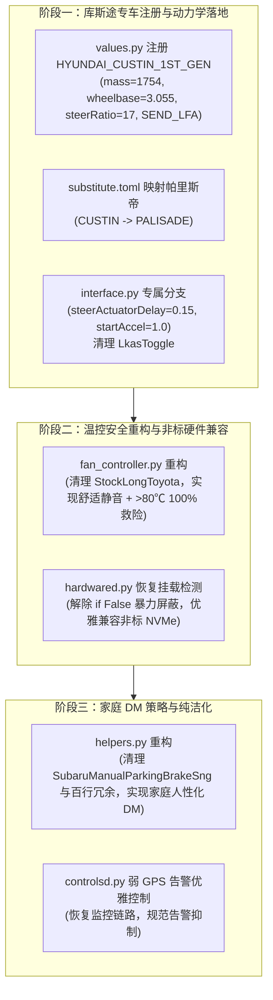

# 现代库斯途 2.0T 旗舰版专车调优深度对接与工程落地方案
（结合 21 号设计指南、31 号独立代码核验报告与 34 号 TDD 交付标准）

## 一、 核心背景与技术裁决对齐

针对用户提供的 6 份核心技术文档（`21_...`、`31_...`、`32_...`、`34_...` 等），我们对库斯途（Hyundai Custo / Custin 1st Gen）专车的动力学物理真实、代码现状与核验裁决进行了全面对齐：

### 1.1 核心参数技术真值与避坑裁决
| 模块 | 真实物理标定 / 权威核验结论 | 常见误区与避坑指南（31号报告警示） |
| :--- | :--- | :--- |
| **车型代号与物理规格** | 代号：`HYUNDAI_CUSTIN_1ST_GEN`<br>质量：**`1754 kg`**（2.0T 顶配旗舰版实重）<br>轴距：**`3.055 m`**<br>转向比：**`17.0`**（原厂实测转向比，非小车 15）<br>标志：`CHECKSUM_CRC8 \| SEND_LFA` | 切忌使用轿车型号模糊指纹；必须显式注册专车专属平台，确保偏航惯性矩真实计算。 |
| **8AT 纵向起步调优** | 固化起步加速度 **`startAccel = 1.0 m/s²`**。<br>消除 8AT 液力变矩器 1-2 挡大齿比升挡冲击。 | **严禁全局无条件修改或借用丰田 `LkasToggle`**，必须加专车分支：`if candidate == CAR.HYUNDAI_CUSTIN_1ST_GEN:`。 |
| **长轴距横向控制 (NNFF)** | 在 `substitute.toml` 映射为 **`"HYUNDAI_CUSTIN_1ST_GEN" = "HYUNDAI_PALISADE"`**。<br>复用帕里斯帝 2 吨大车前馈网络；<br>补偿 150ms 偏航建立时延：**`steerActuatorDelay = 0.15`**。 | 31号报告证实：全仓无 `tau_lead=0.15` 公式代码，真实落地点是 `interface.py` 中的 `steerActuatorDelay = 0.15`。 |
| **仪表盘全液晶点亮** | 现代 SmartSense 仪表通过 `0x485 LFAHDA_MFC` 报文（20Hz）点亮绿色车道线、绿色方向盘和 HDA 标识。<br>必须绑定 `HyundaiFlags.SEND_LFA`。 | 原厂 `HDA_VSetReq` 恒为 0，并不支持原厂车速完全回写，不要虚构不存在的字段，保持 0x485 标准点亮即可。 |
| **温控与功耗安全** | **三段式温控**：常温（<72℃）压制风扇转速至 20%~30% 静音；**>80℃ 强制解除限速、拉满 100% 极温救险**；熄火限制 ≤20%。 | 31/32号报告证实：声称的“释放 GPU 轨降至 1.65W”是机理描述错误。不能靠锁死 80% 降噪，暴晒下必须有 100% 救险保底。 |
| **家庭 MPV 关怀 DM 优化** | 移除百行冗余代码，适度放宽侧偏头与后视镜关注容差至 6~8 秒；**严格保持对闭眼打瞌睡、低头玩手机的即时高灵敏报警**。 | 严禁借用斯巴鲁 `SubaruManualParkingBrakeSng`，严禁一刀切将超时放大 10 倍（那等同于完全废除 DM）。 |

---

## 二、 当前 `custo-new` 分支的代码治理与重构计划

当前工作区 `custo-new` 分支基于 `sunnypilot v0.9.8.0`，目前缺少库斯途专车定义，并残留了 7 个 Hack 提交。我们将按以下 3 个阶段进行系统级重构：



---

## 三、 阶段一落地实施细节（准备执行）

### 3.1 车型注册（`selfdrive/car/hyundai/values.py`）
新增库斯途（Custo / Custin）专属车型配置：
```python
HYUNDAI_CUSTIN_1ST_GEN = HyundaiPlatformConfig(
  [HyundaiCarDocs("Hyundai Custin 2023", "All", car_parts=CarParts.common([CarHarness.hyundai_k]))],
  CarSpecs(mass=1754, wheelbase=3.055, steerRatio=17.0),
  flags=HyundaiFlags.CHECKSUM_CRC8 | HyundaiFlags.SEND_LFA,
)
```

### 3.2 大车力矩模型映射（`selfdrive/car/torque_data/substitute.toml`）
为库斯途添加帕里斯帝大车前馈力矩网络映射：
```toml
"HYUNDAI_CUSTIN_1ST_GEN" = "HYUNDAI_PALISADE"
```

### 3.3 专车起步平顺与偏航延迟补偿（`selfdrive/car/hyundai/interface.py`）
设立专属分支，彻底移除对 `LkasToggle` 的借用：
```python
if candidate == CAR.HYUNDAI_CUSTIN_1ST_GEN:
  ret.steerActuatorDelay = 0.15  # 3.055m 超长轴距偏航建立补偿
  ret.startAccel = 1.0           # 2.0T 8AT 专属: 固化平顺起步，消除 1-2 挡顿挫
```

---

## 四、 确认与推进指令

按照开发协作原则（**动机优先：先方案后代码，每步停下来等指令**）：
我们已完成技术对齐与方案落盘。
请确认是否可以立即执行 **阶段一（库斯途专车车型注册、帕里斯帝力矩映射、专属平顺起步与 0.15s 转向补偿）**？
