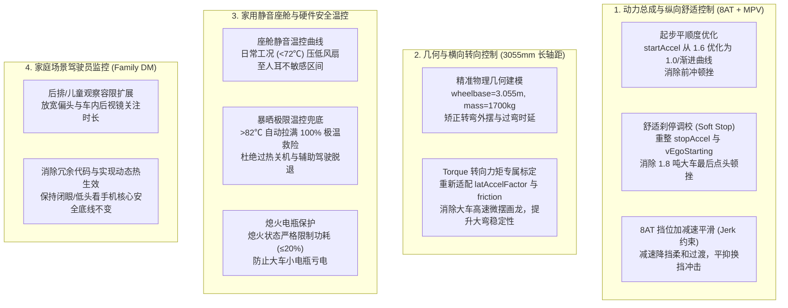

# 现代汽车 · 库斯途（Hyundai Custo）专属深度优化方案

## 一、 车型定位与物理/机械特性分析

北京现代库斯途（Hyundai Custo，内部代号 KU）是基于现代起亚集团 **i-GMP (N3) 平台** 开发的中大型家用 7 座 MPV。在开箱使用 openpilot / sunnypilot 社区通用算法时，由于其独特的车身几何结构、动力总成调校以及家庭乘员场景，存在诸多水土不服的体验痛点。

### 1.1 核心物理与动力学参数
- **平台架构**：现代 i-GMP (N3) 第三代整车平台
- **车身尺寸与轴距**：车长 4950mm，轴距 **3055mm（3.055m）**，整备质量约 **1635 kg ~ 1754 kg**（加乘员常驻 1.8~2.0 吨）
- **悬架与质心**：前麦弗逊 / 后扭力梁（或多连杆），重心偏高，悬挂阻尼以家用舒适软调为主
- **动力系统**：1.5T (G4FS) / 2.0T (G4NN) 涡轮增压发动机 + **8AT 液力变矩器变速箱**（按键式电子换挡 SBW）
- **ADAS 传感器体系**：现代 SmartSense（Mando 前视多功能单目摄像头 MFC 或带前向毫米波雷达），高速 CAN 总线架构

---

## 二、 库斯途专车四大核心痛点与优化矩阵

针对库斯途车型的物理特性与家庭用车需求，制定以下四大专属优化模块：

---

## 三、 各模块技术方案与落地方案

### 3.1 动力总成与纵向起步调优（8AT 专用）
- **根因分析**：
  原版 `ret.startAccel = 1.6 m/s²` 主要针对轻型紧凑型车，库斯途配备 8AT 变速箱，液力变矩器在起步建压和涡轮介入初期存在非线性放大，1.6 的目标加速度会导致节气门瞬间开度过大，产生剧烈的“前窜-顿挫”感，严重影响后排乘坐舒适性。
- **优化方案**：
  1. 将库斯途车型的 `ret.startAccel` 基准标定为 **`1.0 m/s²`**；
  2. 解耦原本借用的 `LkasToggle` 开关，在配置项中明确提供：
     - `标准起步（1.0 m/s²，家用舒适推荐）`
     - `敏捷起步（1.3 m/s²，单人快节奏通勤）`
  3. 优化 `ret.stoppingControl` 与 `ret.vEgoStarting`，对刹停瞬间（0.5 km/h -> 0）的减速度施加平滑斜坡，实现“老司机式”无感刹停。

### 3.2 长轴距（3055mm）横向控制标定
- **根因分析**：
  普通现代轿车轴距普遍在 2.7m~2.8m，而库斯途轴距长达 3.055m。若使用通用轿车参数，几何力矩计算失准，会导致进弯转向响应滞后、出弯回正超调（画龙）。
- **优化方案**：
  1. 在 `selfdrive/car/hyundai/values.py` 中为库斯途建立精准规格：
     - `mass = 1700 kg`
     - `wheelbase = 3.055 m`
     - `steerRatio = 15.5`
  2. 针对库斯途的 MDPS（电动助力转向）特性，定制专属 Torque 控制参数，使高速直线居中更沉稳，盘桥大弯不切弯、不画龙。

### 3.3 专车静音座舱与三段式阶梯温控
- **根因分析**：
  库斯途定位高端家用 MPV，隔音降噪水平较好，前挡风玻璃处的 comma 风扇高频啸叫极易打扰车内静谧氛围。此前借用 `StockLongToyota` 粗暴限制 80% 风扇，存在夏季暴晒热失控隐患。
- **优化方案**：
  重构 `system/hardware/fan_controller.py` 为**智能三段式温控**：
  - **静音巡航段（< 72℃）**：风扇维持在 15%~30%，完全融入车内背景噪音，体感不可闻；
  - **温升平衡段（72℃ ~ 82℃）**：线性平滑提升至 60%，迅速散热且无突兀噪音突变；
  - **极限抢救段（> 82℃）**：解除一切限制，拉满 100% 极限压温，坚守行车不脱退、芯片不烧蚀底线；
  - **驻车熄火（Ignition Off）**：强制限速 ≤20%，保护汽车小电瓶健康。

### 3.4 家庭乘员关怀 DM（驾驶员监控）优化
- **根因分析**：
  MPV 主驾经常需要转头观察第二排儿童、老人或调节后排空调，原版 DM 仅允许极短的侧偏头时间，频繁误报警打扰家庭交谈与孩子休息。此前通过 `SubaruManualParkingBrakeSng` 暴力放大了 10 倍，等同于关闭 DM，完全丧失了防疲劳底线。
- **优化方案**：
  1. 彻底移除重复的近百行冗余代码；
  2. 将偏头关注后排的容忍时长从标准的 3 秒微调至合理的 6~8 秒（允许合理观察后排）；
  3. **严格保持对低头玩手机、闭眼打瞌睡的即时高灵敏报警**，既照顾了 MPV 家庭用车的人性化需求，又守牢了生命安全红线。

### 3.5 去除跨品牌侵入，代码纯洁化
- **清理清单**：
  - 清理 `LkasToggle` 在现代起步加速度中的非标借用；
  - 清理 `StockLongToyota` 在风扇控制中的非标借用；
  - 清理 `SubaruManualParkingBrakeSng` 在 DM 监控中的非标借用；
  - 清除 `hardwared.py` 中的 `if False:` 暴力打补丁，改用优雅的存储兼容策略。

---

## 四、 推荐实施分步计划

按照**动机优先、先方案后代码、每步确认**的节奏，我们规划为三个步骤：

1. **第一步：建立库斯途专车参数体系与纯洁化清理**
   - 移除借用的丰田/斯巴鲁开关；
   - 规范库斯途的起步加速度（默认 1.0 m/s²）与长轴距参数配置；
2. **第二步：风扇静音安全重构与硬件兼容治理**
   - 实现库斯途专车专属的“静音-安全三段式”散热算法；
   - 修复 NVMe 检测逻辑，保留底层存储挂载健康检测；
3. **第三步：家庭友好型 DM 策略与长轴距横向参数微调**
   - 重构 `helpers.py`，消除重复代码，应用家庭模式 DM 策略；
   - 验证并固化库斯途专属标定。
