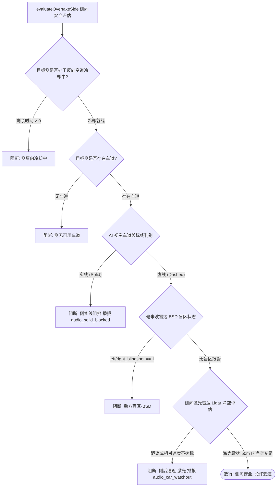
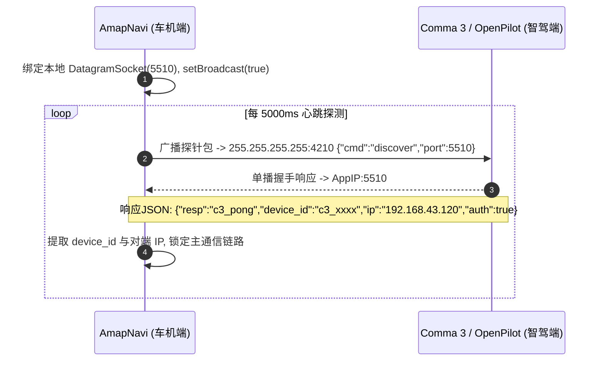

# 《04_核心算法与通信契约》

> **报告版本**：V1.0  
> **分析对象**：`AmapNavi-V1.3.6.9.apk` (`com.carrot.amapnavi`)  
> **分析日期**：2026-11-01  
> **证据等级规范**：
> - **【已确认】**：有 DEX 反编译 Smali/Java 代码、方法签名、数学运算逻辑与数据协议定义直接佐证。
> - **【高度可信】**：由上下文多重调用链与跨组件通信闭环相互支撑。
> - **【推测】**：基于自动驾驶算法通用工程理论推导。


> **⚠ 勘误（2026-11-06，以代码级核验为准）**
>
> 本文以下内容已被证伪，请以《39_四端协议联合核验与双端协同可运行性判定报告.md》为准：
> - **§4.2**：“C3 向车机 7705 端口推送遥测” —— 仅原版 APK 监听 7705；
>   当前 C3 发往 **7706**，Reborn 监听 7706。
> - **§4.3.2**：“导航引导数据流（UDP 发往 C3:4211，`nav_valid/tbt_dist/...`）” ——
>   **从未实现**；两端代码均无这些字段，`sendNavi()` 无任何调用点。
> - **§4.3.1**：原版 APK 上行指令只有 `carrotCmd=LANECHANGE`；
>   `SPEED_LIMIT / CANCEL_LANE_CHANGE` 是 Reborn 新增，原版 APK 不存在。

---

## 目录

- [一、视觉车道线识别算法全流程逆向](#一视觉车道线识别算法全流程逆向)
  - [1.1 模型拓扑与输入预处理规范](#11-模型拓扑与输入预处理规范)
  - [1.2 YOLO-seg Proto-Mask 掩膜点积后处理算法](#12-yolo-seg-proto-mask-掩膜点积后处理算法)
  - [1.3 车道类别判定与虚实线映射字典](#13-车道类别判定与虚实线映射字典)
  - [1.4 左右车道线几何筛选与平滑滤波 (`selectLanes`)](#14-左右车道线几何筛选与平滑滤波-selectlanes)
- [二、自动超车多状态机决策算法逆向](#二自动超车多状态机决策算法逆向)
  - [2.1 前车压速与触发门限评估公式 (`evaluateOvertakeTrigger`)](#21-前车压速与触发门限评估公式-evaluateovertaketrigger)
  - [2.2 侧向目标车道安全性综合评估 (`evaluateOvertakeSide`)](#22-侧向目标车道安全性综合评估-evaluateovertakeside)
  - [2.3 激光雷达动态制动安全净空算法 (`LidarSideSafety`)](#23-激光雷达动态制动安全净空算法-lidarsidesafety)
  - [2.4 反向变道防横跳冷却控制状态机](#24-反向变道防横跳冷却控制状态机)
- [三、高德车机版标准广播交互契约](#三高德车机版标准广播交互契约)
  - [3.1 下行广播监听与字段解码规范 (`AUTONAVI_STANDARD_BROADCAST_SEND`)](#31-下行广播监听与字段解码规范-autonavi_standard_broadcast_send)
  - [3.2 上行控制广播指令集 (`AUTONAVI_STANDARD_BROADCAST_RECV`)](#32-上行控制广播指令集-autonavi_standard_broadcast_recv)
- [四、CarrotMan / OpenPilot UDP 交互协议全解析](#四carrotman--openpilot-udp-交互协议全解析)
  - [4.1 局域网组播设备自动握手协议 (Port 5510 / 4210)](#41-局域网组播设备自动握手协议-port-5510--4210)
  - [4.2 81项车身遥测 JSON 上报契约表 (Port 7705)](#42-81项车身遥测-json-上报契约表-port-7705)
  - [4.3 控制指令下发协议规范 (Port 7706 / 4211 / 4213)](#43-控制指令下发协议规范-port-7706--4211--4213)
- [五、第四阶段总结与后续阶段路标](#五第四阶段总结与后续阶段路标)

---

## 一、视觉车道线识别算法全流程逆向

本应用内嵌基于深度学习的轻量级车道线实例分割引擎，位于 `com.carrot.lane` 包。

### 1.1 模型拓扑与输入预处理规范 【已确认】
- **模型文件**：`assets/lane.onnx` (12.58 MB)
- **网络架构**：YOLO-seg 车道线定制剪枝网络
- **图像输入层规范**：
  - 输入节点名：`"images"`
  - 输入张量形状：`[1, 3, 416, 416]` (Batch=1, C=3, H=416, W=416)
  - 数据类型：`Float32`
- **预处理流程 (`fillInputBuffer`)**：
  ```
  原始前向摄像头帧 (如 1280x720 或 640x480)
     │
     ▼ (双线性插值缩放至 416x416 RGB Bitmap)
  resizeBitmap (416x416 ARGB_8888)
     │
     ▼ (提取像素 RGB 分量并执行像素归一化: pixel / 255.0f)
  FloatBuffer (容量 1 * 3 * 416 * 416 * 4 字节)
     │
     ▼ (CHW 排布: 先全 R、再全 G、最后全 B)
  OnnxTensor.createTensor(env, inputFloatBuffer, [1, 3, 416, 416])
  ```

### 1.2 YOLO-seg Proto-Mask 掩膜点积后处理算法 【已确认】
ONNX 推理产生两个输出张量：
1. `output0`：`[1, 36, 3549]` (预测候选锚框 Anchor)，其中包含预测框中心 $(c_x, c_y)$、宽高 $(w, h)$、各类别置信度评分 $score$ 以及 32 维掩膜原型系数向量 $\mathbf{coeff} \in \mathbb{R}^{32}$。
2. `output1`：`[1, 32, 104, 104]` (掩膜原型特征图 Proto-Mask $\mathbf{P}$，尺寸 $104 \times 104$，特征维度 32)。

#### 核心合成掩膜数学公式 (`composeMask`)：
对于通过非极大值抑制（NMS，FastIOU 阈值一般为 0.45）保留的候选框 $i$：
$$M_i(x, y) = \sigma \left( \sum_{k=0}^{31} \mathbf{coeff}_{i, k} \cdot \mathbf{P}_{k}(x, y) \right)$$
其中 $\sigma(z) = \frac{1}{1 + e^{-z}}$ 为 Sigmoid 激活函数。当 $M_i(x, y) > 0.5$ 且坐标处于锚框矩形 $Box_i$ 范围内时，判定该像素属于该车道线实例，写入二值掩膜字节数组 `mask: ByteArray`。

### 1.3 车道类别判定与虚实线映射字典 【已确认】
通过静态反编译 `com.carrot.amapnavi.LaneLineKt.<clinit>`，提取模型输出 ClassId 与业务交通语义的精确映射字典：

| Class ID | 英文标识 (`CLASS_TO_TYPE`) | 中文标识 (`CLASS_TO_TYPE_CN`) | 简写 (`CN_LITE`) | 交通法规语义与控制准入 |
| :---: | :---: | :---: | :---: | :--- |
| **0** | `"solid"` | `"实线"` | `"实"` | **严禁压线**：立即阻断自主变道与超车发起，触发 `audio_solid_blocked.wav`。 |
| **1** | `"dashed"` | `"虚线"` | `"虚"` | **允许变道**：满足侧向净空前提下允许自主变道与超车。 |
| **2** | `"solid"` | `"实线"` | `"实"` | **双黄实线/导流实线**：强制禁止变道。 |
| **5** | `"solid"` | `"实线"` | `"实"` | **边缘道路边界实线**：严禁驶入，防止驶出路肩。 |
| **其他** | `"unknown"` | `"未知"` | `"?"` | 标线模糊：默认视为不可变道，进入连续多帧确认。 |

### 1.4 左右车道线几何筛选与平滑滤波 (`selectLanes`) 【已确认】
从分割后的多条车道线多边形中，算法通过计算车道线下边缘与图像底部的横向交点坐标 $C_x$ 进行自车车道标线定位：
1. 提取所有检测线在图像底部（$Y = 416$）附近的横坐标中心点 $C_x$；
2. 以图像中心轴 $X = 208$（对应车辆中心线）为基准划分左右集合：
   - **左车道标线**：在所有 $C_x < 208$ 的候选中，选取距离中心线最近（即 $C_x$ 最大）的线；
   - **右车道标线**：在所有 $C_x > 208$ 的候选中，选取距离中心线最近（即 $C_x$ 最小）的线；
3. 输出包含左线类型与右线类型的结构体 `LaneSelection`。为杜绝单帧跳动，经 `LaneTypeFilter` 连续 3 帧判定一致后才将结果推入系统状态总线。

---

## 二、自动超车多状态机决策算法逆向

### 2.1 前车压速与触发门限评估公式 (`evaluateOvertakeTrigger`) 【已确认】
反编译 `MainActivityLaneDecisionKt#evaluateOvertakeTrigger`，其判定逻辑由以下分级条件构成：

```
前车超车触发评估管道:
1. 前方是否有前车? (lead1.status == true)
   └─ 否 ──> 返回 (Trigger=False, "前方无车")
2. 前车车速是否疑似拥堵极低速? (v_lead < 20 km/h)
   └─ 是 ──> 返回 (Trigger=False, "前车速度XX低于20km/h疑似拥堵")
3. 前车跟车纵向距离检查 (drel):
   ├─ drel > 60m ──> 返回 (Trigger=False, "前车距离XX过远(>60m)")
   └─ drel < 10m ──> 返回 (Trigger=False, "前车距离XX过近等待拉开(<10m)")
4. 巡航压速差判定:
   Δv = v_cruise - v_lead
   速度比 Ratio = v_lead / v_cruise
   ├─ 条件A (绝对压速): Δv >= 10 km/h
   ├─ 条件B (相对压速): Ratio <= 0.88 (即前车慢 12% 以上)
   └─ 若满足 A 或 B ──> 返回 (Trigger=True, "前车较慢: 满足超车触发")
```

### 2.2 侧向目标车道安全性综合评估 (`evaluateOvertakeSide`) 【已确认】
当超车触发后，系统对目标侧（优先左侧超车，左侧受阻且开启“允许右侧超车”时评估右侧）执行全量防御审计：



### 2.3 激光雷达动态制动安全净空算法 (`LidarSideSafety`) 【已确认】
针对外挂激光雷达（Lidar）上报的点云距离与相对速度，`MainActivityLaneControlKt` 实现了动态安全时距解算：

#### 1. 固定安全距离门限（低速工况）：
$$D_{safe\_fix} = 10.0\text{ 米}$$

#### 2. 动态速度时距门限（高速巡航工况）：
$$D_{safe\_dynamic} = v_{ego} \cdot T_{rear} + \max(0, -v_{rel}) \cdot T_{vrel}$$
其中：
- $v_{ego}$：自车当前行驶速度（单位：$\text{m/s}$）；
- $T_{rear}$：后车安全时距（默认 $2.0 \sim 4.0\text{ s}$）；
- $v_{rel}$：后车相对自车速度（$v_{rel} < 0$ 表示后车正在高速贴近）；
- $T_{vrel}$：相对速度外推接近时距容限（默认 $4.0\text{ s}$）。

若激光雷达实际测得侧后方目标距离 $D_{actual} < D_{safe\_dynamic}$，立即阻断超车请求，并向日志输出：`"侧后方车辆过近 (D_actual < D_safe)"`。

### 2.4 反向变道防横跳冷却控制状态机 【已确认】
为杜绝智能驾驶系统“超车变过去后因前车加速又瞬间变回来”的“画龙”现象，代码中构建了严格的冷却计时器：
1. **启动时机**：每次变道完成（`completeOvertake`）或驾驶员手动拨轮接管取消（`audio_lane_change_cancel`）瞬间。
2. **锁定时长**：默认写入 `etReverseCooldown = 20 秒`（高速公路）至 `60 秒`。
3. **熔断恢复**：在冷却倒计时归零前，`evaluateOvertakeSide` 直接短路拦截反向变道请求。

---

## 三、高德车机版标准广播交互契约

本应用无需 Hook 高德进程或注入代码，而是通过高德官方开放的标准车机第三方应用通信广播接口实现数据联动。

### 3.1 下行广播监听与字段解码规范 (`AUTONAVI_STANDARD_BROADCAST_SEND`) 【已确认】

由 `MainActivityUdpKt#startListening` 动态注册监听，高德车机版在导航状态发生改变时以 `Bundle` 形式广播下发：

| Intent Extra 键名 | 数据类型 | 业务语义与字段说明 | 核心解码类与转换规则 |
| :--- | :--- | :--- | :--- |
| `KEY_TYPE` | `Int` | 广播消息类型（`10001`: 导航状态; `10019`: 车道信息; `10020`: 红绿灯） | 分流路由至不同子处理器 |
| `EXTRA_DRIVE_WAY` | `String` | **车道级指引字符串**，格式如 `"s\|s\|S\|X"`<br/>- `s`: 普通直行<br/>- `S`: 推荐直行<br/>- `L/R`: 左转/右转<br/>- `X`: 禁行车道 | `AmapUtilsKt#laneLetterToIcon`<br/>大写字母提取为推荐车道 |
| `EXTRA_ROAD_LIMIT_SPEED` | `Int` | 道路静态限速值（单位：km/h） | 映射至 `NaviState.nRoadLimitSpeed` |
| `EXTRA_CAMERA_SPEED` | `Int` | 电子眼限速值（单位：km/h） | 映射至 `NaviState.nSdiSpeedLimit` |
| `EXTRA_CAMERA_DIST` | `Int` | 距电子眼剩余距离（单位：米） | 映射至 `NaviState.nSdiDist` |
| `EXTRA_CAMERA_TYPE` | `Int` | 电子眼类型（测速/违章/区间终点等） | `AmapUtilsKt#getCameraTypeDesc` |
| `EXTRA_TURN_TYPE` | `Int` | TBT 下个路口转向图标类型编号 | `AmapUtilsKt#getTurnIconDesc` |
| `EXTRA_SEG_REMAIN_DIS` | `Int` | 距下个路口/分岔剩余距离（单位：米） | 映射至 `NaviState.nTBTDist` |
| `EXTRA_TRAFFIC_LIGHT_SECONDS`| `Int` | 红绿灯倒计时读秒剩余秒数 | 触发红绿灯起步提醒 |
| `EXTRA_TRAFFIC_LIGHT_STATUS` | `Int` | 信号灯状态（1: 红灯; 2: 绿灯; 3: 黄灯） | `AmapUtilsKt#getNavTrafficDesc` |
| `EXTRA_ROAD_CATE` | `Int` | 道路等级（0: 高速; 1: 国道; 2: 省道/快速） | `AmapUtilsKt#isHighway` |

### 3.2 上行控制广播指令集 (`AUTONAVI_STANDARD_BROADCAST_RECV`) 【已确认】

AmapNavi 必要时可通过发送该广播对高德地图执行反向控制：
```java
Intent intent = new Intent("AUTONAVI_STANDARD_BROADCAST_RECV");
intent.putExtra("KEY_TYPE", 10007); // 缩放地图 / 改变视角 / 规避拥堵
context.sendBroadcast(intent);
```

---

## 四、CarrotMan / OpenPilot UDP 交互协议全解析

本系统与 OpenPilot (C3 硬件) 处于同一局域网（通常为手机热点或车载 Wi-Fi 网段 `192.168.43.x`），基于纯 UDP 协议实现毫秒级双向通信。

### 4.1 局域网组播设备自动握手协议 (Port 5510 / 4210) 【已确认】



### 4.2 81项车身遥测 JSON 上报契约表 (Port 7705) 【已确认】

C3 硬件以 10Hz ~ 20Hz 频率向车机 7705 端口持续推送结构化车辆底盘遥测数据包，通过 `OpStateKt.OP_FIELD_TABLE` 反编译解析，全量协议定义如下：

| 分组类别 | JSON 键名 (Key) | 数据类型 | 单位/取值范围 | 算法用途与控制意义 |
| :--- | :--- | :---: | :---: | :--- |
| **自车动力学** | `IsOnroad` | `Int` | 0 / 1 | 车辆是否处于上路行车状态 |
| | `v_ego_kph` | `Int` | km/h | **自车真实车速**（CAN 底盘轮速计） |
| | `v_cruise_kph` | `Int` | km/h | **巡航设定目标车速** |
| | `active` | `Bool` | true / false | 纵向/横向辅助驾驶控制是否激活 |
| | `engaged` | `Bool` | true / false | 智驾系统是否处于接管控制中 |
| | `steer_angle` | `Float` | 度 (deg) | 当前方向盘物理转角（用于识别驾驶员干预） |
| | `desire_speed` | `Int` | km/h | OpenPilot 模型当前期望规划速度 |
| | `gas_press` | `Bool` | true / false | 驾驶员是否正在踩油门踏板 |
| | `brake_press` | `Bool` | true / false | 驾驶员是否正在踩刹车踏板 |
| **正前车雷达** | `lead1` | `Bool` | true / false | 正前方第一近距离目标车是否存在 |
| | `drel` | `Float` | 米 (m) | **前车纵向相对距离**（正数） |
| | `vrel` | `Float` | m/s | **前车相对速度**（负数表示接近） |
| | `vlead` | `Float` | km/h | 前车绝对车速 |
| | `lead_accel` | `Float` | $\text{m/s}^2$ | 前车当前加速度（负数表示前车刹车） |
| **毫米波盲区** | `left_blindspot` | `Bool` | true / false | 左侧后视镜毫米波 BSD 报警标志 |
| | `right_blindspot` | `Bool` | true / false | 右侧后视镜毫米波 BSD 报警标志 |
| | `blind_l` / `blind_r` | `Bool` | true / false | 综合左/右盲区报警标志 |
| **左侧前/后雷达**| `l_lead` | `Bool` | true / false | 左侧目标道是否存在前车 |
| | `l_drel` | `Float` | 米 (m) | 左侧前车纵向距离 |
| | `l_vlead` | `Float` | km/h | 左侧前车绝对速度 |
| | `l_vrel` | `Float` | m/s | 左侧前车相对速度 |
| | `lf_vrel` / `lb_vrel`| `Float` | m/s | 左前 / 左后目标相对速度 |
| | `lf_drel` / `lb_drel`| `Float` | 米 (m) | 左前 / 左后目标纵向距离 |
| **右侧前/后雷达**| `r_lead` | `Bool` | true / false | 右侧目标道是否存在前车 |
| | `r_drel` | `Float` | 米 (m) | 右侧前车纵向距离 |
| | `r_vlead` | `Float` | km/h | 右侧前车绝对速度 |
| | `r_vrel` | `Float` | m/s | 右侧前车相对速度 |
| | `rf_vrel` / `rb_vrel`| `Float` | m/s | 右前 / 右后目标相对速度 |
| | `rf_drel` / `rb_drel`| `Float` | 米 (m) | 右前 / 右后目标纵向距离 |
| **激光雷达时距**| `lidar_front_vdist_time`| `Float` | 秒 (s) | 激光雷达测得前方车距时间门限 |
| | `lidar_front_vrel_time` | `Float` | 秒 (s) | 激光雷达测得前方逼近时距 |
| | `lidar_behind_vdist_time`| `Float`| 秒 (s) | 激光雷达测得后方车距时间门限 |
| | `lidar_behind_vrel_time` | `Float`| 秒 (s) | 激光雷达测得后方逼近时距 |
| **激光盲区标志**| `lidar_lfblind` / `lbblind` | `Bool` | true / false | 激光雷达判定左前 / 左后是否存在障碍物 |
| | `lidar_rfblind` / `rbblind` | `Bool` | true / false | 激光雷达判定右前 / 右后是否存在障碍物 |
| **车道物理属性**| `lane_width` | `Float` | 米 (m) | 当前行驶车道物理宽度（标准 3.75m） |
| | `l_lane_width` / `r_lane_width`| `Float` | 米 (m) | 左相邻 / 右相邻车道宽度 |
| | `l_edge_dist` / `r_edge_dist` | `Float` | 米 (m) | 距左路肩 / 右路肩物理边缘距离 |
| **车道模型置信度**| `l_line_prob` / `r_line_prob` | `Float` | 0.0 ~ 1.0 | OpenPilot 视觉测得左/右标线置信度 |
| | `l_lane_prob` / `r_lane_prob` | `Float` | 0.0 ~ 1.0 | OpenPilot 视觉测得左/右车道可行使概率 |
| **状态机控制反馈**| `atc_state` | `Int` | 枚举值 | 自动变道控制器当前底层执行状态 |

### 4.3 控制指令下发协议规范 (Port 7706 / 4211 / 4213) 【已确认】

车机判定需要变道、限速或同步车道线时，通过以下协议向 C3 端口推送 JSON 控制包：

#### 1. 车辆控制与超车变道指令 (UDP 发往 C3:7706)
```json
{
  "cmd": "LANECHANGE",
  "direction": "LEFT",
  "index": 12,
  "v_cruise": 115,
  "blinker": 1,
  "reason": "overtake_slow_lead",
  "timestamp": 1730473200123
}
```
- `cmd`：指令标识，可选 `"LANECHANGE"`（变道）、`"TURN"`（路口转弯）、`"SPEED_LIMIT"`（下发限速）。
- `direction`：变道方向，可选 `"LEFT"`、`"RIGHT"`、`"KEEP"`。
- `index`：防丢包单调自增序号（Sequence ID）。
- `blinker`：转向灯请求（1: 左灯; 2: 右灯; 0: 关）。

#### 2. 导航引导数据流 (UDP 发往 C3:4211)
```json
{
  "nav_valid": true,
  "tbt_dist": 480,
  "tbt_turn": 2,
  "suggest_lane": [0, 0, 1, 0],
  "road_limit_speed": 120,
  "is_ramp": false
}
```

#### 3. AI 车道线类型同步数据流 (UDP 发往 C3:4213)
```json
{
  "left_type": 1,
  "right_type": 0,
  "left_solid": false,
  "right_solid": true,
  "confidence": 0.92
}
```
- `0`: 实线 (Solid, 禁止跨越); `1`: 虚线 (Dashed, 允许跨越)。

---

## 五、第四阶段总结与后续阶段路标

### 5.1 第四阶段逆向成果总结
1. **模型与算法全透明**：
   - 彻底逆向了 416×416 YOLO-seg 车道线后处理点积算法与 NMS 筛选公式；
   - 明确了 Class 0/2/5 为实线、Class 1 为虚线的硬编码映射关系。
2. **多传感器主动防御数学模型**：
   - 还原了激光雷达动态制动净空公式 $D_{safe} = v_{ego} \cdot T + \max(0, -v_{rel}) \cdot T_{vrel}$；
   - 确证了 20~60 秒反向冷却防横跳锁死机制。
3. **通信契约完全确立**：
   - 完整解码高德车机版 11 项核心下行广播字段；
   - 逐一拆解并还原了 CarrotMan 81 项车身遥测 JSON 字段的精确类型与控制语义，形成了工业级数据契约字典。

### 5.2 后续推进路标
- **第一阶段产出**：`01_应用基础信息分析.md`（基础元信息与包结构）
- **第二阶段产出**：`02_产品功能拆解.md`（产品功能树与业务流程图）
- **第三阶段产出**：`03_UI与交互深度分析.md`（UI 设计系统与控件布局）
- **第四阶段产出**：`04_核心算法与通信契约.md`（本报告：算法逆向与网络协议）
- **第五阶段（终极交付）**：**复刻开发技术设计与实施方案**，编写《05_复刻开发技术设计与实施方案.md》，基于以上全部逆向成果，提供 100% 独立自主复刻重构该套件的 PRD 需求文档、技术架构设计、核心代码骨架与库斯途 Android 4.4 适配实装指南。
